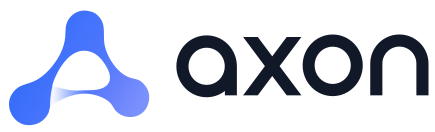

<p>
  <picture>
    <source media="(prefers-color-scheme: dark)" srcset="brand-kit/svg/axon-lockup-dark.svg">
    
  </picture>
</p>

**Design. Connect. Build.**

[](https://github.com/CaioFerreiraB/axon/actions/workflows/core.yml) [](https://github.com/CaioFerreiraB/axon/actions/workflows/contracts.yml) [](https://github.com/CaioFerreiraB/axon/actions/workflows/generic.yml) [](https://github.com/CaioFerreiraB/axon/actions/workflows/console.yml)

     

Axon é um ambiente open source para projetar, conectar e executar sistemas agênticos.

*Axon is an open-source workspace to design, connect, and run agentic systems.*

## Repositórios

| Repositório | O que tem | Aqui |
|---|---|---|
| `axon` (este) | O SDD da plataforma (constituição, specs, ADRs, roadmap) e o código do core: contratos `axon-ai-contracts`, runtime `axon-ai` (comando `axon`), pack de referência `axon-generic` e a console de administração | `axon-ai/`, `specs/`, `docs/` |
| `axon-scouting` [](https://github.com/CaioFerreiraB/axon-scouting/actions/workflows/ci.yml) [](https://github.com/CaioFerreiraB/axon-scouting/actions/workflows/eval.yml) | O pack de domínio escoteiro: contexto, recuperação com vigência e citação verificada, avaliação | submódulo `axon-scouting/` |
| `axon-deploy` [](https://github.com/CaioFerreiraB/axon-deploy/actions/workflows/build.yml) | A instalação de referência: imagem com o core de uma tag e os packs, compose com Postgres, Qdrant, Open WebUI e a console | submódulo `axon-deploy/` |

O core não conhece domínio nenhum: um pack se anuncia no grupo de entry point `axon.packs` e depende só dos contratos.

## Por onde começar

- [`CLAUDE.md`](CLAUDE.md): as regras de trabalho no repositório, o estado de cada fase e os comandos de verificação.
- [`specs/README.md`](specs/README.md): o mapa de módulos, seams e dependências.
- [`docs/roadmap.md`](docs/roadmap.md): as fases e o andamento.
- [`docs/adr/`](docs/adr/): as decisões de arquitetura; os nomes da plataforma estão no
  [ADR-037](docs/adr/ADR-037-a-plataforma-se-chama-axon.md) e a marca no
  [ADR-038](docs/adr/ADR-038-marca-da-plataforma-e-marca-da-instalacao.md).
- [`brand-kit/`](brand-kit/BRAND.md): símbolo, lockups, tokens e voz da marca.

```bash
git clone --recurse-submodules git@github.com:CaioFerreiraB/axon.git
cd axon/axon-ai && uv sync && uv run pytest
```
