# Plataforma Agentic AI — Arquitetura e Plano de Implementação

## 1. Objetivo

Construir uma plataforma de agentes modular, extensível por plugins e capaz de utilizar modelos locais/externos, MCP, RAG e LangGraph.

Primeira versão:
- `ai-core`: plataforma/runtime
- `ai-generic`: agente genérico/plugin
- `ai-scouting`: agente especializado/plugin

Tecnologias principais:
- FastAPI
- LangGraph
- LangChain quando útil
- Ollama
- OpenAI
- OpenRouter
- Qdrant
- MCP
- PostgreSQL para registry/configuração
- Open WebUI

A primeira versão terá RAG híbrido. GraphRAG será uma evolução do `ai-scouting`, sem alterar o contrato principal do core.

---

# 2. Arquitetura geral

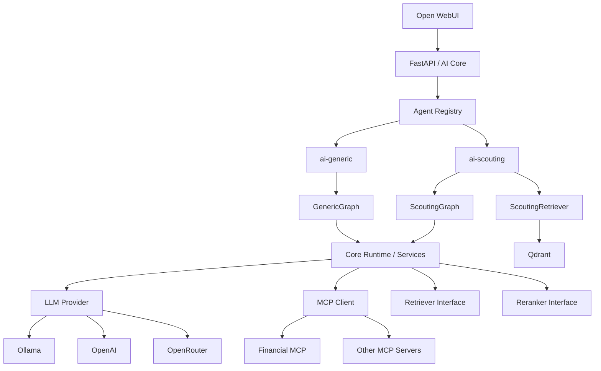

---

# 3. Princípios arquiteturais

## 3.1 Core como plataforma

O `ai-core` não conhece conceitos de escotismo, finanças ou GRIS. Ele fornece infraestrutura e contratos:

- API;
- autenticação;
- Agent Registry;
- carregamento de plugins;
- runtime LangGraph;
- abstração de providers LLM;
- MCP Client;
- contratos de RAG/retrieval e reranking;
- estado e contexto;
- nós genéricos;
- configuração;
- segurança;
- logging/observabilidade.

## 3.2 Plugins como agentes/capabilities

`ai-generic` e `ai-scouting` são pacotes independentes que implementam um contrato público do core.

Plugins podem:
- fornecer seu próprio agente/grafo;
- reutilizar nós do core;
- fornecer nós específicos;
- fornecer prompts e regras;
- fornecer Retriever/Reranker específicos;
- declarar capabilities e extensões de grafo.

## 3.3 Provider e modelo sempre explícitos

Toda requisição deve informar provider e modelo:

```json
{
  "provider": "ollama",
  "model": "qwen3:1.7b"
}
```

ou:

```json
{
  "provider": "openrouter",
  "model": "qwen/qwen3-8b:free"
}
```

O core deve validar se o modelo é válido/disponível para o provider informado.

---

# 4. Conceitos do LangGraph

## Grafo

Define o fluxo de execução.

## Nó

Unidade de execução, normalmente uma função. Pode validar, buscar documentos, executar MCP, chamar LLM etc. Um nó não precisa ser um agente.

## Estado

Transporta os dados da execução entre nós.

```python
class AgentState(TypedDict, total=False):
    request_id: str
    user_id: str
    messages: list
    provider: str
    model: str
    mcp_servers: list[str]
    available_tools: list[dict]
    query: str
    route: str
    retrieved_documents: list[dict]
    reranked_documents: list[dict]
    tool_calls: list[dict]
    tool_results: list[dict]
    answer: str
    citations: list[dict]
    errors: list[dict]
```

## AgentContext

Fornece serviços ao grafo:

```python
@dataclass
class AgentContext:
    llm: LLMProvider
    mcp: MCPClient
    retriever: Retriever | None
    reranker: Reranker | None
    config: dict
```

A distinção é:

```text
AgentState  → dados da execução
AgentContext → serviços/recursos disponíveis
```

## Agente

Usa um LLM para decidir ações. Um agente pode ser um nó ou conjunto de nós.

Regra mental:

```text
Grafo   → controla fluxo
Nó      → executa operação
Estado  → transporta dados
Agente  → decide usando LLM
```

---

# 5. Contratos públicos

## AgentPlugin

```python
class AgentPlugin(Protocol):
    name: str

    def build_graph(
        self,
        context: AgentContext,
    ) -> CompiledGraph:
        ...
```

Pode evoluir para incluir metadados, configuração, capabilities e extensões.

## LLMProvider

```python
class LLMProvider(Protocol):
    async def chat(
        self,
        messages: list[dict],
        model: str,
        tools: list[dict] | None = None,
    ) -> dict:
        ...
```

Implementações iniciais:

- `OllamaProvider`
- `OpenAIProvider`
- `OpenRouterProvider`

## Retriever

```python
class Retriever(Protocol):
    async def search(
        self,
        query: str,
        *,
        top_k: int = 20,
        filters: dict | None = None,
    ) -> list[dict]:
        ...
```

## Reranker

```python
class Reranker(Protocol):
    async def rerank(
        self,
        query: str,
        documents: list[dict],
        *,
        top_k: int = 5,
    ) -> list[dict]:
        ...
```

## MCP Client

```python
class MCPClient(Protocol):
    async def discover_tools(
        self,
        servers: list[str],
    ) -> list[dict]:
        ...

    async def execute(
        self,
        server: str,
        tool: str,
        arguments: dict,
    ) -> object:
        ...
```

---

# 6. Plugins e Agent Registry

O core mantém um registry de plugins. A configuração não deve exigir imports hardcoded.

Exemplo:

```yaml
agents:
  generic:
    package: ai_generic
    enabled: true
  scouting:
    package: ai_scouting
    enabled: true
```

Startup:

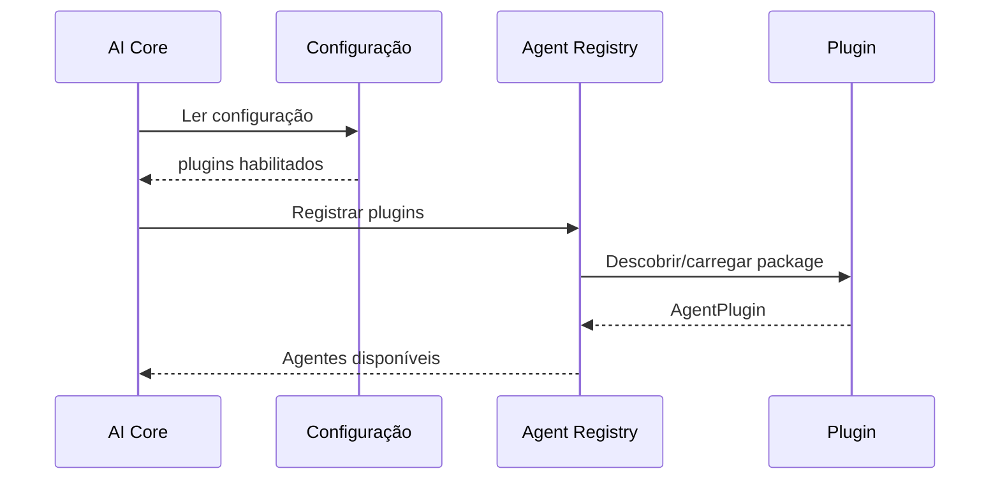

Uma opção inicial de descoberta é utilizar entry points de pacotes Python.

---

# 7. Composição de múltiplos plugins

Plugins não devem modificar arbitrariamente o grafo de outros plugins.

Eles devem declarar capabilities e extensões em pontos controlados.

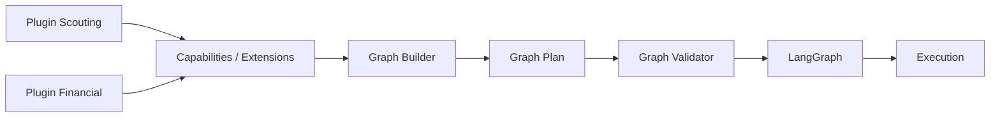

## Graph Builder

Responsável por:
- receber plugins/capabilities;
- resolver compatibilidade;
- montar o grafo base;
- ordenar extensões;
- produzir um Graph Plan;
- validar o plano;
- compilar para LangGraph.

## Extension points

Exemplos:

```text
CONTEXT_PROCESSOR
RETRIEVER
RERANKER
TOOLS
GENERATORS
VALIDATORS
INSTRUCTIONS
```

Plugins declaram capacidades. O core controla a composição.

## Graph Plan

Representação intermediária antes do `StateGraph`:

```json
{
  "nodes": [
    "validate_request",
    "load_capabilities",
    "prepare_scouting_context",
    "agent_controller",
    "retrieve",
    "rerank",
    "call_mcp",
    "agent_generate",
    "validate_answer"
  ],
  "edges": [
    ["validate_request", "load_capabilities"],
    ["load_capabilities", "prepare_scouting_context"],
    ["prepare_scouting_context", "agent_controller"],
    ["agent_controller", "retrieve"],
    ["retrieve", "rerank"],
    ["rerank", "agent_controller"],
    ["agent_controller", "call_mcp"],
    ["call_mcp", "agent_controller"],
    ["agent_controller", "agent_generate"],
    ["agent_generate", "validate_answer"]
  ]
}
```

## Validação do grafo

Validar antes de executar:

- START existe;
- existe caminho até END;
- não existem nós órfãos;
- edges apontam para nós válidos;
- capabilities requeridas existem;
- dependências não formam ciclos inválidos;
- schemas de estado são compatíveis;
- permissões estão corretas.

---

# 8. Nós compartilhados do ai-core

Inicialmente:

```text
validate_request
load_capabilities
agent_controller
retrieve
rerank
call_mcp
agent_generate
validate_answer
```

## validate_request

Valida agente, provider, modelo, MCPs e parâmetros. Não usa LLM.

## load_capabilities

Descobre tools, MCPs, Retriever, Reranker e demais capacidades.

## agent_controller

É o núcleo decisório do agente. Recebe o estado atual e decide a próxima ação.

Não gera um plano textual longo.

Exemplos:

```json
{"action": "retrieve", "query": "..."}
```

```json
{
  "action": "mcp",
  "tool": "finance.get_transactions",
  "arguments": {"month": "2026-09"}
}
```

```json
{"action": "answer"}
```

Pode ser executado várias vezes no mesmo workflow.

## retrieve

Executa o `Retriever` disponível no `AgentContext`.

## rerank

Reduz candidatos recuperados antes de enviá-los ao LLM.

Exemplo:

```text
30 candidatos → 5 candidatos
```

## call_mcp

Executa a tool escolhida pelo agente via MCP Client.

## agent_generate

Gera a resposta final usando pergunta, histórico, documentos, resultados de tools e instruções do agente.

## validate_answer

Valida resposta, formato, erros e, quando aplicável, citações.

---

# 9. ai-generic

## Objetivo

Agente geral que usa as capacidades disponíveis na requisição.

Pode:
- responder diretamente;
- usar RAG se disponível;
- usar MCP;
- combinar RAG e MCP.

## GenericGraph

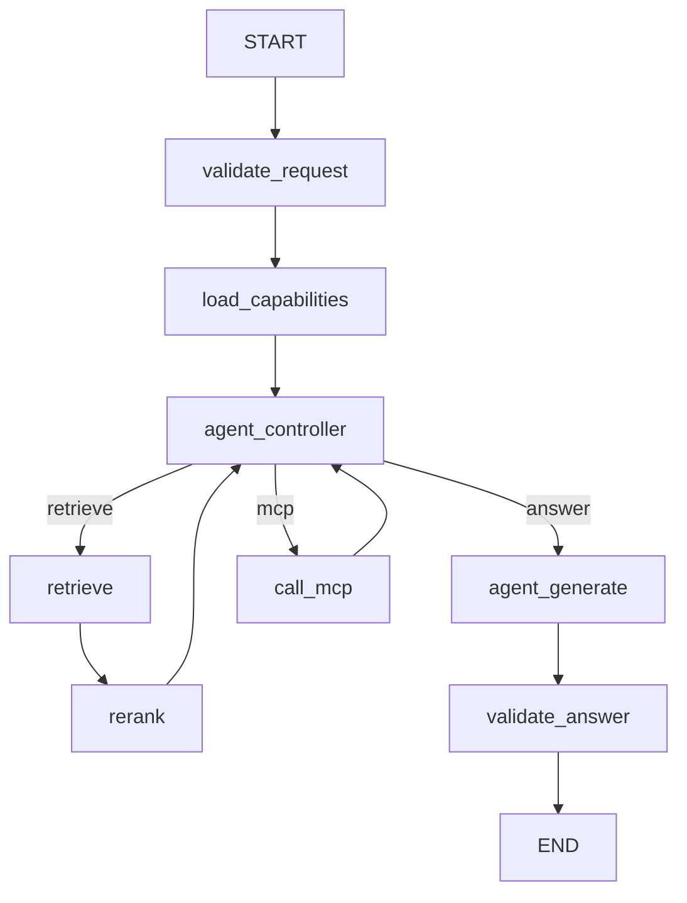

Exemplo:

```text
agent_controller
↓
MCP
↓
finance.get_transactions
↓
agent_controller
↓
agent_generate
↓
validate_answer
```

---

# 10. ai-scouting

## Objetivo

Agente especializado em conhecimento escoteiro.

Prioridades:
- documentos institucionais;
- documentos vigentes;
- fontes mais específicas/primárias;
- recuperação precisa;
- citações e proveniência.

## ScoutingGraph

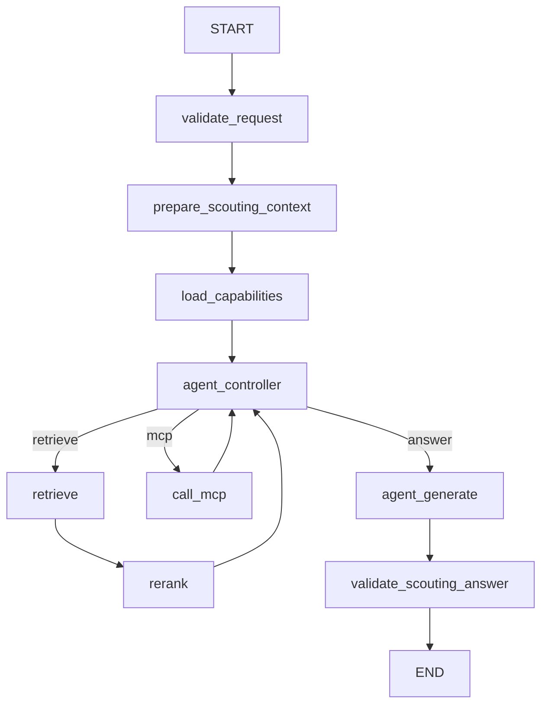

## prepare_scouting_context

Nó específico do domínio. Pode determinar:

- ramo;
- tema;
- tipo de documento;
- versão;
- filtros relevantes.

Exemplo:

```text
"Quais competências do Pioneiro estão relacionadas à liderança?"

branch = pioneiro
topic = liderança
document_types = manual + programa educativo
```

Sempre que possível, usar regras e metadados em vez de uma chamada de LLM.

---

# 11. RAG do ai-scouting

O RAG específico pertence ao `ai-scouting`.

O core fornece apenas o contrato `Retriever`.

## ScoutingRetriever

Primeira versão:

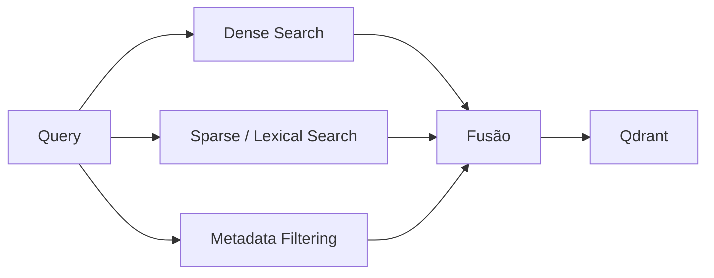

Metadados importantes:

```text
document_id
document_type
document_title
version
publication_date
effective_date
chapter
section
page
branch
jurisdiction
```

## Ingestão

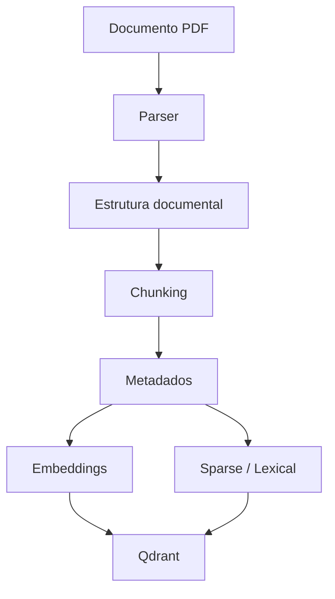

## Chunking

Preservar estrutura:

```text
Documento
  Capítulo
    Seção
      Subseção
        Parágrafo
```

Tamanho inicial sugerido: aproximadamente 300–600 tokens, respeitando fronteiras semânticas.

## Retrieval

```text
query
↓
dense + sparse
↓
fusão
↓
20–30 candidatos
↓
reranker
↓
3–8 chunks
↓
LLM
```

Os números devem ser calibrados empiricamente.

---

# 12. Documentos normativos e legislação

Preservar estrutura:

```text
Lei
 └── Título
      └── Capítulo
           └── Seção
                └── Artigo
                     └── Parágrafo
                          └── Inciso
                               └── Alínea
```

Preservar também:

```text
version
effective_date
```

O texto original continua sendo a fonte de verdade.

---

# 13. Citações e proveniência

O `ai-scouting` deve preservar a origem de cada trecho recuperado.

Exemplo:

```json
{
  "document": "Manual Pioneiro",
  "version": "2026",
  "page": 87,
  "section": "4.2.1"
}
```

No futuro, relações do GraphRAG deverão preservar proveniência também.

Deve existir distinção entre:
- relação explicitamente presente na fonte;
- relação inferida pela LLM.

---

# 14. GraphRAG futuro

GraphRAG será implementado como evolução do `ScoutingRetriever`.

Hoje:

```text
ScoutingRetriever → Qdrant
```

Futuro:

```text
ScoutingGraphRetriever → Knowledge Graph + Qdrant
```

Exemplo de relações:

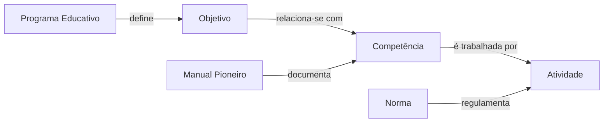

Uma LLM poderá auxiliar em:
- entity extraction;
- relation extraction;
- agrupamento de conceitos;
- sinônimos;
- propostas para evolução da ontologia.

O contrato de `Retriever` não deve mudar.

---

# 15. MCP

Sistemas externos são donos dos seus próprios MCP Servers.

Exemplos:

```text
Financial Service → MCP
GRIS              → MCP
Google Drive      → MCP
outros sistemas   → MCP
```

O `ai-core` é MCP Client.

O GRIS permanece fora da plataforma de IA por enquanto; seu MCP continua pertencendo ao próprio projeto GRIS.

---

# 16. MCP Registry

Os MCPs são configuráveis na aplicação.

Modelo conceitual:

```text
mcp_servers
├── name
├── url
├── enabled
├── auth
└── security_policy
```

A requisição usa aliases:

```json
{
  "mcp_servers": ["finance"]
}
```

## Segurança

Como qualquer pessoa poderá instalar a plataforma, o core deve considerar:

- allowlist de hosts;
- bloqueio de localhost;
- bloqueio de IPs privados;
- timeout;
- limite de tamanho de resposta;
- credenciais armazenadas no servidor;
- políticas por agente/usuário.

---

# 17. FastAPI

O `ai-core` expõe a API.

Endpoints iniciais:

```http
GET  /health
GET  /agents
GET  /providers
GET  /models
POST /chat
```

Administração futura de MCP:

```http
GET    /mcp-servers
POST   /admin/mcp-servers
PATCH  /admin/mcp-servers/{id}
DELETE /admin/mcp-servers/{id}
```

Exemplo:

```json
{
  "agent": "scouting",
  "provider": "ollama",
  "model": "qwen3:1.7b",
  "mcp_servers": [],
  "messages": [
    {
      "role": "user",
      "content": "Quais competências do Ramo Pioneiro estão relacionadas à liderança?"
    }
  ]
}
```

---

# 18. Open WebUI

Open WebUI será a interface gráfica.

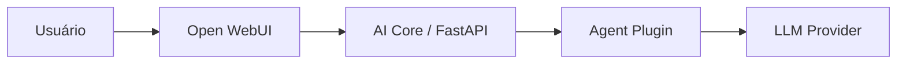

A lógica dos agentes permanece na API/core, não na interface.

---

# 19. Ollama

Ollama será o runtime dos modelos locais.

A VM alvo possui:

```text
2 OCPU
12 GB RAM
ARM64
```

## Instalação

No Linux:

```bash
curl -fsSL https://ollama.com/install.sh | sh
```

Também existe instalação manual específica para ARM64.

Executar:

```bash
ollama serve
```

ou configurar como serviço.

## API

API nativa:

```text
http://localhost:11434/api
```

Compatibilidade OpenAI:

```text
http://localhost:11434/v1
```

Isso permite que o `OllamaProvider` utilize uma interface parecida com OpenAI e simplifica a camada de providers.

## Modelo inicial

```bash
ollama pull qwen3:1.7b
ollama run qwen3:1.7b
```

Listar modelos:

```bash
ollama list
```

Ver modelos carregados:

```bash
ollama ps
```

## Teste da API

```bash
curl http://localhost:11434/api/chat \
  -d '{
    "model": "qwen3:1.7b",
    "messages": [
      {
        "role": "user",
        "content": "Olá"
      }
    ]
  }'
```

## Benchmark

Modelos a comparar:

```text
Qwen3 1.7B
Gemma 4 E2B
```

Métricas:
- tokens/s;
- tempo até primeira resposta;
- RAM;
- CPU;
- português;
- tool calling;
- RAG.

---

# 20. Providers externos

Abstração:

```text
LLMProvider
├── OllamaProvider
├── OpenAIProvider
└── OpenRouterProvider
```

Os agentes não conhecem detalhes do provider.

## OpenRouter

Evitar usar `openrouter/free` como modelo principal, porque o modelo escolhido pode variar e reduzir a previsibilidade.

Preferir modelo explicitamente selecionado, por exemplo:

```text
qwen/qwen3-8b:free
```

Modelos gratuitos devem ser tratados como fallback/opção, não como SLA de produção.

---

# 21. LangGraph

LangGraph é o motor de orquestração.

Utilizar:
- `StateGraph`;
- nodes;
- conditional edges;
- state;
- context;
- checkpointers;
- subgraphs quando fizer sentido.

Plugins podem construir grafos programaticamente usando nós do core e nós próprios.

---

# 22. LangChain

LangChain não será o orquestrador principal.

Será usado quando for útil como biblioteca de integração para:
- modelos;
- tools;
- embeddings;
- retrievers;
- parsers;
- componentes do ecossistema.

LangGraph permanece como motor principal de fluxo.

---

# 23. Persistência e conversas

Temporal foi removido porque não haverá workflows longos.

LangGraph pode continuar responsável por checkpoints/estado de execução quando necessário.

Separar conceitualmente:

```text
execution state
```

de:

```text
conversation history
```

A persistência pode começar simples e posteriormente usar PostgreSQL.

---

# 24. Otimização de tokens

Regra central:

> Se uma decisão puder ser tomada deterministically, não gastar uma chamada de LLM para tomá-la.

Evitar:

```text
LLM decide se usa RAG
LLM decide retrieval
LLM decide quais documentos
LLM decide se rerank
LLM responde
```

Preferir:

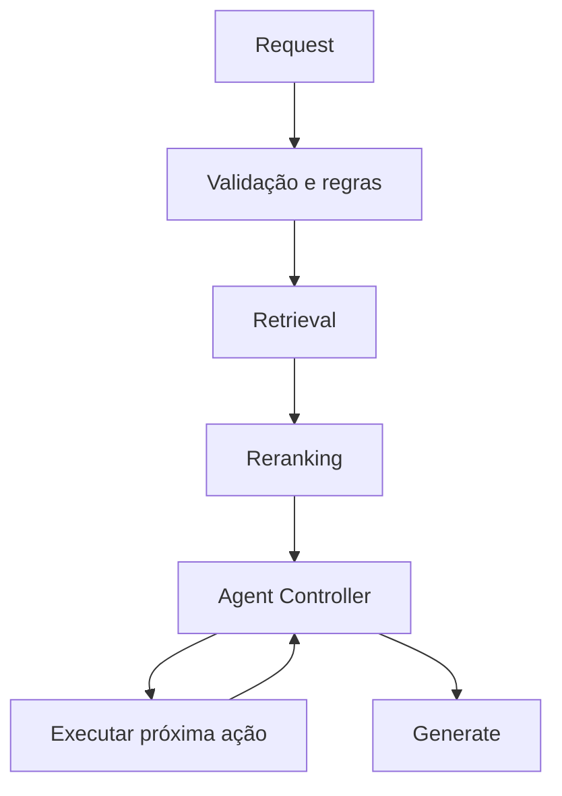

O contexto enviado ao LLM deve ser o menor conjunto suficiente para responder.

---

# 25. Exemplo de execução com dois plugins

Requisição:

```json
{
  "agent": "generic",
  "plugins": ["scouting", "financial"],
  "provider": "ollama",
  "model": "qwen3:1.7b"
}
```

Exemplo de consulta:

> Analise esta atividade do Ramo Pioneiro e estime seu custo.

Fluxo:

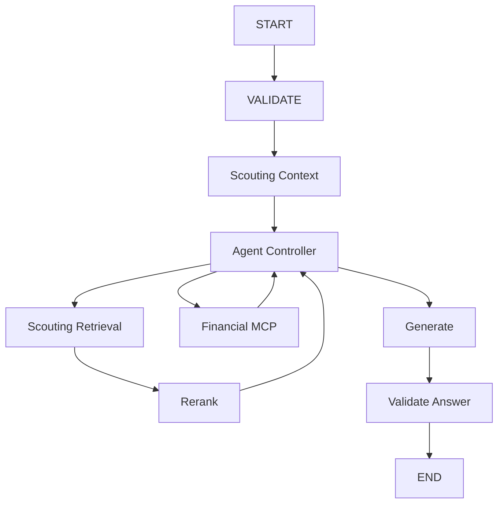

Os plugins fornecem capacidades; o core controla a composição e valida o grafo.

---

# 26. Ordem de implementação

## Fase 1 — ai-core mínimo

Implementar:

```text
FastAPI
AgentPlugin
Agent Registry
AgentState
AgentContext
LLMProvider
LangGraph
OllamaProvider
```

Grafo inicial:

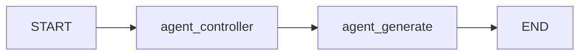

Objetivo: conversa básica funcionando.

## Fase 2 — ai-generic

Adicionar:

```text
agent_controller
call_mcp
```

Depois:

```text
retrieve
rerank
```

## Fase 3 — MCP Registry

Adicionar:

```text
PostgreSQL
MCP registry
security policies
```

## Fase 4 — ai-scouting

Adicionar:

```text
ScoutingPlugin
ScoutingGraph
prepare_scouting_context
ScoutingRetriever
ScoutingReranker
```

## Fase 5 — RAG

Implementar ingestão e retrieval híbrido.

## Fase 6 — Open WebUI

Conectar Open WebUI ao core.

## Fase 7 — GraphRAG

Adicionar Knowledge Graph, extração auxiliada por LLM e retrieval gráfico.

---

# 27. Stack final

| Componente | Tecnologia |
|---|---|
| API | FastAPI |
| Orquestração | LangGraph |
| Componentes | LangChain, quando útil |
| LLM local | Ollama |
| LLM externo | OpenAI |
| LLM externo/fallback | OpenRouter |
| RAG | Qdrant |
| Retrieval | Dense + Sparse |
| Ranking | Reranker |
| Integração | MCP |
| MCP Registry | PostgreSQL |
| Interface | Open WebUI |
| Plugins | Python packages + Agent Registry |
| Estado | LangGraph checkpointer |
| GraphRAG futuro | Knowledge Graph + Qdrant |

---

# 28. Estrutura de diretórios proposta

## ai-core

```text
ai-core/
├── src/
│   └── ai_core/
│       ├── api/
│       ├── agents/
│       │   ├── registry.py
│       │   └── plugin.py
│       ├── graph/
│       │   ├── state.py
│       │   ├── context.py
│       │   ├── nodes/
│       │   └── runtime.py
│       ├── llm/
│       │   ├── base.py
│       │   ├── ollama.py
│       │   ├── openai.py
│       │   └── openrouter.py
│       ├── mcp/
│       ├── retrieval/
│       ├── security/
│       └── config/
└── pyproject.toml
```

## ai-generic

```text
ai-generic/
├── src/
│   └── ai_generic/
│       ├── plugin.py
│       ├── agent.py
│       ├── graph.py
│       └── prompts/
└── pyproject.toml
```

## ai-scouting

```text
ai-scouting/
├── src/
│   └── ai_scouting/
│       ├── plugin.py
│       ├── agent.py
│       ├── graph.py
│       ├── nodes/
│       │   ├── prepare_context.py
│       │   └── validate_answer.py
│       ├── rag/
│       │   ├── retriever.py
│       │   ├── reranker.py
│       │   └── ingestion/
│       ├── citations/
│       └── prompts/
└── pyproject.toml
```

---

# 29. Regras arquiteturais fundamentais

1. `ai-core` não conhece domínio específico.
2. Plugins implementam agentes/capabilities.
3. Plugins podem fornecer nós próprios.
4. Plugins podem reutilizar nós do core.
5. O core controla a composição do grafo.
6. Plugins não modificam arbitrariamente o grafo de outros plugins.
7. A composição passa por Graph Plan e validação.
8. `AgentState` carrega dados da execução.
9. `AgentContext` fornece serviços.
10. `agent_controller` decide a próxima ação e não gera plano textual extenso.
11. Provider e model são sempre explícitos.
12. RAG específico pertence ao plugin que possui o domínio.
13. GraphRAG futuro entra atrás do contrato `Retriever`.
14. MCPs pertencem aos sistemas que possuem os dados.
15. MCPs são configuráveis via registry.
16. Documentos normativos preservam fonte, versão e vigência.
17. O contexto enviado ao LLM deve ser minimizado por retrieval e reranking.
18. Temporal não faz parte da arquitetura.
19. A API não depende da interface gráfica.
20. Novos plugins podem ser adicionados sem modificar o core.
