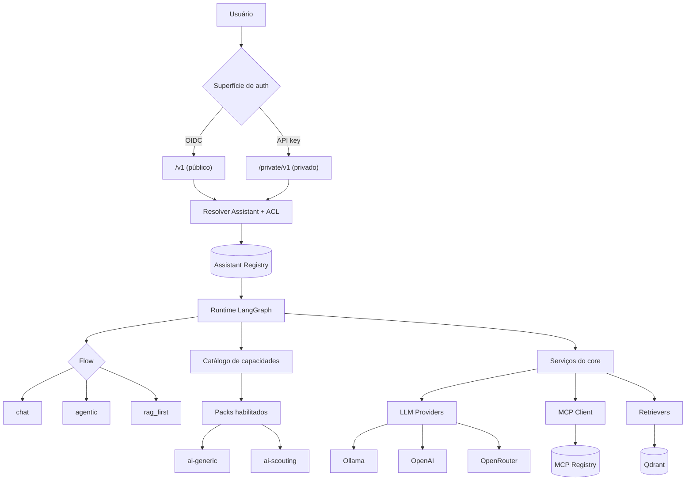
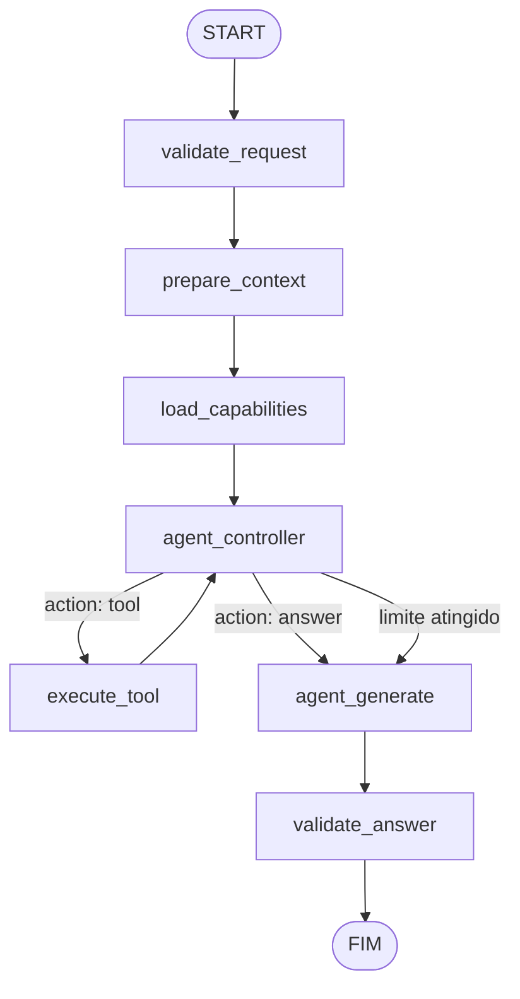
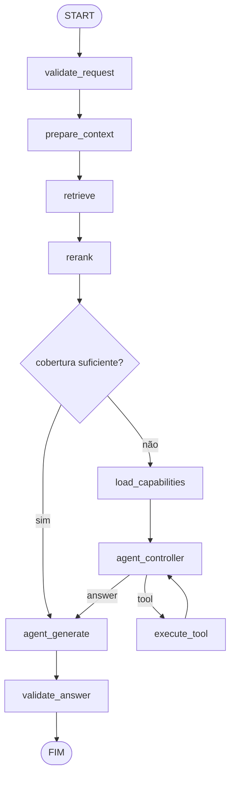
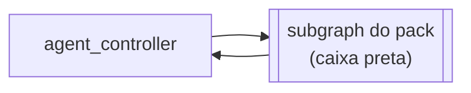
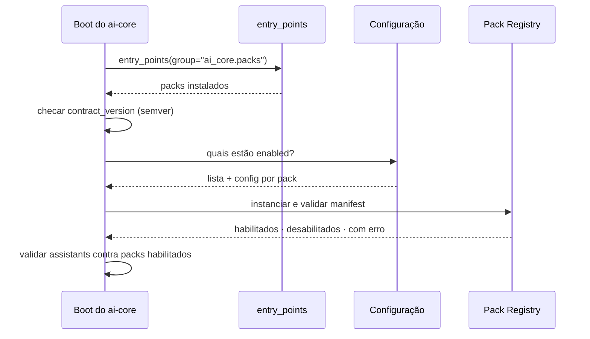
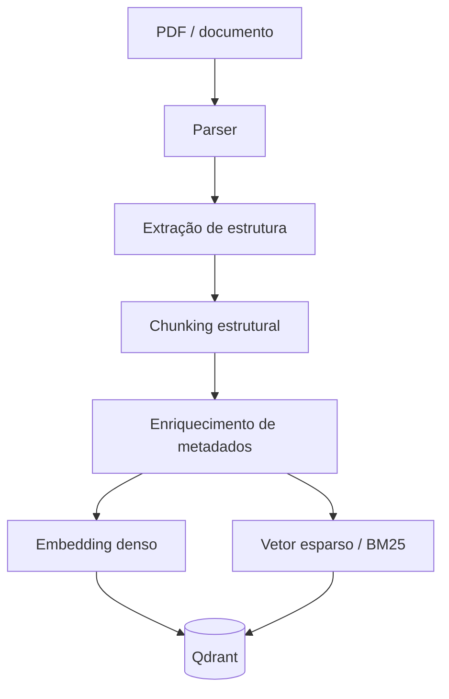
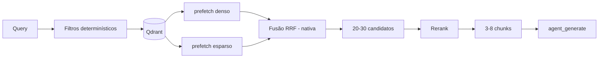
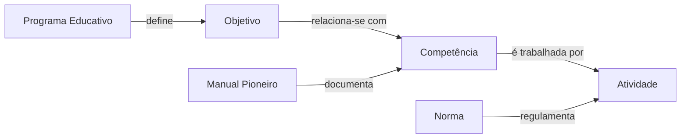
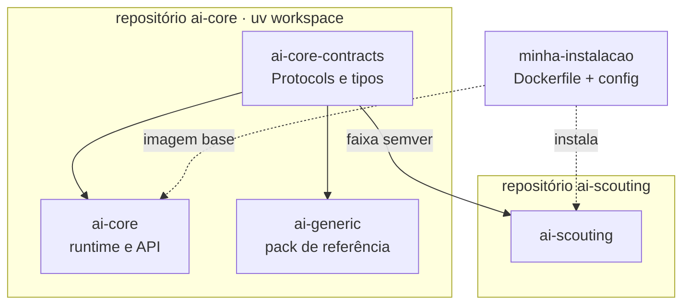

> **ARQUIVADO em 2026-09-10.** Este documento foi traduzido para o SDD (spec-kit) e deixou de ser a fonte de verdade.
> Princípios → [.specify/memory/constitution.md](../../.specify/memory/constitution.md) · Módulos → [specs/README.md](../../specs/README.md) · Decisões → [docs/adr/](../adr/README.md) · Fases → [docs/roadmap.md](../roadmap.md).
> As seções citadas pelas specs como "arch-v1 §N" referem-se a este arquivo.

# Plataforma Agentic AI — Arquitetura

> **Status:** proposta consolidada · **Versão:** 1.0 · **Data:** 2026-09-10
> A versão anterior está preservada em [architecture-v0-chatgpt.md](architecture-v0-chatgpt.md).
> As decisões que mudaram em relação a ela estão registradas na [Parte VIII — Decisões](#parte-viii--decisões-adr).

---

## Índice

| Parte | Conteúdo |
|---|---|
| [I](#parte-i--visão) | Visão — objetivo, glossário, princípios |
| [II](#parte-ii--núcleo-ai-core) | Núcleo — contratos, estado, topologias, nós |
| [III](#parte-iii--extensibilidade) | Extensibilidade — packs, assistants, deployment |
| [IV](#parte-iv--segurança-e-isolamento) | Segurança — autenticação, autorização, MCP, ataques |
| [V](#parte-v--domínio-ai-scouting) | Domínio — scouting, RAG, normativo, citações |
| [VI](#parte-vi--infraestrutura) | Infraestrutura — API, providers, persistência, avaliação |
| [VII](#parte-vii--execução) | Execução — repositórios, roadmap, stack |
| [VIII](#parte-viii--decisões-adr) | Decisões arquiteturais registradas |
| [IX](#parte-ix--em-aberto) | Questões em aberto |

---
---

# PARTE I — Visão

## 1. Objetivo e escopo

Construir uma plataforma de agentes modular e extensível, capaz de usar modelos locais e externos, MCP, RAG e LangGraph, na qual o núcleo é infraestrutura genérica e todo conhecimento de domínio vive em extensões.

### Dentro do escopo

- **`ai-core`** — runtime, API, orquestração, contratos, segurança
- **`ai-generic`** — capacidades de uso geral, com integração via MCP
- **`ai-scouting`** — capacidades de domínio escoteiro: literatura, projeto educativo, manuais, normas e legislação aplicável

### Fora do escopo

| Item | Motivo |
|---|---|
| GRIS dentro da plataforma | Permanece projeto próprio; expõe MCP e é consumido como qualquer sistema externo |
| Workflows de longa duração | Não há caso de uso; ver [ADR-010](#adr-010--temporal-fora-da-arquitetura) |
| Lógica de agente na interface | Open WebUI é apenas apresentação |
| Instalação de código arbitrário pelo usuário final | Extensão de usuário é via MCP; ver [ADR-003](#adr-003--mcp-é-extensão-do-usuário-python-pack-é-extensão-do-operador) |

---

## 2. Glossário

Esta seção existe porque a versão anterior usava "plugin" para duas coisas diferentes, e essa ambiguidade impedia raciocinar sobre isolamento. Os termos abaixo são normativos no restante do documento.

| Termo | Definição |
|---|---|
| **Capability Pack** (ou **pack**) | Unidade de extensão que **fornece capacidades**: tools, retrievers, prompts, validators, preparadores de contexto. Não é um agente e não possui grafo próprio. Ex.: `scouting`, `financial`, `drive` |
| **Assistant** | Configuração **nomeada e server-side** que amarra topologia + packs ativos + MCPs permitidos + coleções acessíveis + política de modelos + ACL. **É a fronteira de isolamento do sistema.** |
| **Principal** | Identidade autenticada que faz a requisição — usuário, serviço ou chave de API |
| **Flow** (topologia) | Um dos grafos LangGraph escritos à mão pelo core: `chat`, `agentic`, `rag_first` |
| **Node** | Unidade de execução dentro de um flow. Escrito pelo core, não por packs |
| **State** (`AgentState`) | Dados que transitam entre nós durante uma execução |
| **Context** (`AgentContext`) | Serviços e recursos disponíveis à execução (LLM, MCP, retriever, config) |
| **Tool** | Capacidade invocável, com schema. **Retrieval e chamadas MCP são tools** — ver [ADR-005](#adr-005--execute_tool-unificado--retrieval-é-tool) |
| **Operador** | Quem administra a instalação: escolhe packs, builda a imagem, define assistants de sistema |
| **Usuário** | Quem consome a plataforma: cria assistants próprios e registra MCPs próprios |

A distinção que sustenta a arquitetura inteira:

```text
Pack       → o que o sistema SABE FAZER      (capacidade)
Assistant  → o que uma execução PODE FAZER   (fronteira)
Flow       → COMO a execução acontece        (controle)
State      → o que a execução CARREGA        (dados)
Context    → a que a execução TEM ACESSO     (serviços)
```

---

## 3. Princípios arquiteturais

1. O `ai-core` não conhece escotismo, finanças ou qualquer domínio.
2. Todo conhecimento de domínio vive em packs.
3. **O core é dono da topologia dos grafos.** Packs registram capacidades; não constroem nem alteram grafos.
4. **O Assistant é a fronteira de isolamento.** Toda decisão sobre o que uma execução enxerga é resolvida ali.
5. **A requisição nunca amplia capacidades.** Ela nomeia um Assistant e, no máximo, restringe dentro do que ele permite.
6. **Capacidade não declarada não existe.** Não é permissão negada — é ausência do catálogo.
7. Provider e modelo são sempre explícitos, e podem variar por papel.
8. Se uma decisão pode ser tomada deterministicamente, não gaste uma chamada de LLM com ela.
9. O contexto enviado ao LLM é o menor conjunto suficiente.
10. RAG de domínio pertence ao pack dono do domínio; o core fornece apenas o contrato.
11. MCPs pertencem aos sistemas que possuem os dados.
12. Documentos normativos preservam fonte, versão e vigência. O texto original é a fonte de verdade.
13. **Citação é verificada mecanicamente**, não por julgamento de LLM.
14. Toda saída de tool é conteúdo não-confiável, nunca instrução.
15. Todo loop tem limite de iteração.
16. Falhas de carregamento de pack são fail-closed e não derrubam o sistema.
17. A API não depende da interface gráfica.
18. **Adicionar um pack ou assistant não exige modificar o core.**

---

## 4. Visão geral



O ponto de entrada não é mais um "agent registry" — é a **resolução de Assistant**, que decide simultaneamente *se* a execução pode acontecer e *com o quê*.

---
---

# PARTE II — Núcleo (`ai-core`)

## 5. Contratos públicos (`ai-core-contracts`)

Os contratos vivem numa distribuição separada e mínima, `ai-core-contracts`, que mora no repositório do core mas tem **versão própria**. Packs dependem dela, **nunca de `ai-core`** — é isso que permite o core lançar versões sem forçar release nos packs de domínio, que vivem em repositórios próprios. Ver [ADR-004](#adr-004--contratos-no-repositório-do-core-packs-de-domínio-separados).

### AgentPack

```python
class AgentPack(Protocol):
    name: str
    contract_version: str

    def manifest(self) -> PackManifest:
        """Metadados, flow preferido, dependências, config schema."""

    def system_prompt(self, ctx: PackContext) -> str | None:
        """Fragmento de instrução. O core concatena em ordem declarada."""

    async def prepare_context(self, state: Mapping, ctx: PackContext) -> dict:
        """Pré-processamento determinístico. Retorna a fatia própria do pack.
        Escreve apenas em state['packs'][self.name]."""

    def tools(self, ctx: PackContext) -> list[ToolSpec]:
        """Catálogo. Nomes são namespaced pelo core."""

    def retrievers(self, ctx: PackContext) -> list[NamedRetriever]:
        ...

    def reranker(self, ctx: PackContext) -> Reranker | None:
        ...

    def validators(self, ctx: PackContext) -> list[AnswerValidator]:
        """Checagens determinísticas da resposta."""
```

Note o que **não** está aqui: `build_graph()`. Packs não constroem grafos. Ver [ADR-001](#adr-001--topologia-fixa-em-vez-de-graph-builder-dinâmico).

### ToolSpec

```python
@dataclass(frozen=True)
class ToolSpec:
    name: str                                    # "scouting.search_docs"
    description: str
    parameters: dict                             # JSON Schema
    kind: Literal["retrieval", "mcp", "native"]
    mutates: bool = False                        # tool de escrita
    handler: Callable[..., Awaitable[object]] | None = None
```

`kind` é o que permite um único nó `execute_tool` despachar para retrieval, MCP ou código nativo. `mutates` marca tools de escrita, que exigem autorização explícita — ver [§18](#18-superfície-de-ataque).

### LLMProvider

```python
class LLMProvider(Protocol):
    async def chat(
        self,
        messages: list[dict],
        model: str,
        *,
        tools: list[dict] | None = None,
        response_format: dict | None = None,   # saída estruturada
        stream: bool = False,
    ) -> AsyncIterator[dict] | dict:
        ...
```

`response_format` importa: o `agent_controller` depende de saída estruturada confiável, e modelos pequenos só entregam isso sob constraint. `stream` está no contrato desde o início porque retrofit de streaming é caro.

### Retriever, Reranker, MCPClient

```python
class Retriever(Protocol):
    async def search(
        self, query: str, *, top_k: int = 20, filters: dict | None = None
    ) -> list[Chunk]: ...


class Reranker(Protocol):
    async def rerank(
        self, query: str, documents: list[Chunk], *, top_k: int = 5
    ) -> list[Chunk]: ...


class MCPClient(Protocol):
    async def discover_tools(self, aliases: list[str]) -> list[ToolSpec]: ...
    async def execute(self, alias: str, tool: str, arguments: dict) -> ToolResult: ...
```

`discover_tools` recebe **aliases já autorizados**, nunca URLs. A resolução alias → endpoint + credencial acontece server-side no MCP Registry.

### AnswerValidator

```python
class AnswerValidator(Protocol):
    name: str
    async def validate(self, state: Mapping, ctx: PackContext) -> ValidationResult:
        """Determinístico. Sem chamada de LLM."""
```

---

## 6. Estado e contexto

### AgentState com reducers

A versão anterior definia o estado como um `TypedDict` plano sem reducers. Isso quebra assim que houver loop ou execução concorrente: `messages`, `tool_results` e `errors` são sobrescritos em vez de acumulados. Os reducers são obrigatórios.

```python
from typing import Annotated, TypedDict
import operator
from langgraph.graph.message import add_messages


class AgentState(TypedDict, total=False):
    # --- identidade (escrita uma vez) ---
    request_id: str
    principal: dict
    assistant: str
    flow: str

    # --- conversa ---
    messages: Annotated[list, add_messages]

    # --- controle do loop ---
    next_action: dict | None
    iteration: int
    iteration_limit: int

    # --- acumuladores (reducer obrigatório) ---
    tool_calls:   Annotated[list[dict], operator.add]
    tool_results: Annotated[list[dict], operator.add]
    errors:       Annotated[list[dict], operator.add]

    # --- retrieval (substituídos, não acumulados) ---
    retrieved: list[dict]
    reranked: list[dict]

    # --- saída ---
    answer: str
    citations: list[dict]

    # --- fatias isoladas por pack ---
    packs: dict[str, dict]
```

### Isolamento de estado entre packs

`state["packs"]` é namespaced por pack. Regras:

- Um pack escreve **apenas** em `state["packs"][self.name]`.
- Um pack lê a fatia de outro **apenas** se declarar dependência no `manifest()`.
- O core valida ambas as coisas; violação é erro de carregamento, não de runtime.

Isso mantém `prepare_context` de dois packs compostos incapaz de se sobrescrever mutuamente.

### AgentContext

```python
@dataclass(frozen=True)
class AgentContext:
    llm: LLMRouter                 # resolve modelo por papel
    mcp: MCPClient                 # já restrito aos aliases do assistant
    retrievers: dict[str, Retriever]
    reranker: Reranker | None
    tools: ToolCatalog             # já filtrado pelo assistant
    assistant: AssistantConfig
    principal: Principal
    budget: Budget
```

Distinção que permanece válida da versão anterior:

```text
AgentState   → dados da execução
AgentContext → serviços e recursos disponíveis
```

O que mudou: `AgentContext` chega **já restrito**. O filtro por Assistant acontece na construção do contexto, não dentro dos nós. Um nó não precisa perguntar "posso usar esta tool?" — ela ou está no catálogo, ou não existe.

---

## 7. Topologias fixas

O core escreve as topologias à mão. São três, e o número cresce por decisão de arquitetura, nunca por composição automática.

Um pack **seleciona** um flow no `manifest()`; um Assistant pode sobrescrever a seleção. Nenhum dos dois constrói ou modifica um flow.

### 7.1 `chat` — sem tools, sem RAG


Conversa direta. É a topologia da Fase 1 e o fallback quando nenhuma capacidade é necessária.

### 7.2 `agentic` — loop de controller



Um único nó `execute_tool` despacha retrieval, MCP e código nativo conforme `ToolSpec.kind`. É isso que torna a composição de packs uma união de catálogos em vez de cirurgia de grafo.

A aresta `limite atingido` não é opcional: sem ela, o loop é ilimitado.

### 7.3 `rag_first` — retrieval determinístico



Este é o flow default do `ai-scouting`. A pergunta dominante do domínio é "responda a partir do corpus", e para ela o caminho determinístico é mais barato **e mais confiável** que um loop agêntico.

O portão de cobertura é **determinístico** — score do melhor chunk abaixo de um limiar, ou nenhum documento vigente encontrado. Não é uma pergunta ao LLM. Só quando ele falha a execução escala para o loop.

### 7.4 Escape hatch: subgraph de pack

Para o caso raro em que um pack precisa de fluxo de controle próprio, ele pode contribuir **um subgraph LangGraph compilado**, invocado como nó único num ponto designado, com contrato explícito de fatia de estado.



Propriedades que tornam isso seguro:

- O subgraph recebe e devolve apenas `state["packs"][nome]` mais campos declarados.
- Não consegue reconectar o grafo pai — não tem referência a ele.
- Tem limite de iteração e orçamento próprios, herdados do Assistant.

O que **não** existe em nenhuma hipótese: injeção arbitrária de nós e arestas no grafo pai.

### Os três níveis, resumidos

| Nível | O que o pack faz | Frequência esperada |
|---|---|---|
| 1 | Registra capacidades. Topologia intocada | ~90% |
| 2 | Seleciona um flow do conjunto enumerado | raro |
| 3 | Contribui um subgraph isolado | excepcional |

---

## 8. Nós do core

```text
validate_request     load_capabilities    execute_tool      agent_generate
prepare_context      agent_controller     rerank            validate_answer
```

### validate_request

Valida assistant, principal, modelo, parâmetros e orçamento. Sem LLM. Falha aqui é 4xx antes de qualquer custo.

### prepare_context

Executa `prepare_context()` de cada pack ativo, na ordem declarada pelo Assistant, cada um escrevendo na própria fatia. Determinístico por design — ver [§20](#19-objetivo-e-fluxo) para o caso do scouting.

### load_capabilities

Monta o `ToolCatalog` da execução:

1. União das tools dos packs ativos
2. Mais as tools dos MCPs permitidos pelo Assistant (via `discover_tools`, com cache por TTL)
3. Mais os retrievers, expostos **como tools**
4. Namespacing de todos os nomes: `scouting.search_docs`, `finance.get_transactions`
5. Filtro final pelo `allowed_tools` do Assistant

O resultado é o único universo que o `agent_controller` conhece.

### agent_controller

Núcleo decisório. Recebe o estado e emite **uma ação estruturada**, nunca um plano textual longo:

```json
{ "action": "tool", "name": "scouting.search_docs", "arguments": { "query": "..." } }
```

```json
{ "action": "tool", "name": "finance.get_transactions", "arguments": { "month": "2026-09" } }
```

```json
{ "action": "answer" }
```

Requisitos operacionais:

| Requisito | Motivo |
|---|---|
| Saída estruturada via `response_format` | Modelo pequeno não produz JSON confiável sem constraint |
| `iteration` incrementado a cada passagem | Loop precisa ser observável |
| `iteration_limit` do Assistant | Sem limite, loop infinito é questão de tempo |
| Catálogo mínimo em contexto | Cada tool no prompt custa tokens e degrada a escolha |
| Modelo próprio (`controller_model`) | Ver [§26](#26-providers-e-política-de-modelo-por-papel) |

Ao atingir o limite, o controller não falha: transiciona para `agent_generate` com o que tem, e registra o truncamento em `errors`.

### execute_tool

Despacha uma tool conforme `kind`:

```text
retrieval → Retriever do pack           → state["retrieved"]
mcp       → MCPClient.execute(alias...)  → state["tool_results"]
native    → handler do pack              → state["tool_results"]
```

Aplica timeout, limite de tamanho de resposta e, para `mutates: true`, a política de autorização de escrita. Resultado entra no estado **fenced** como conteúdo não-confiável — ver [§18](#18-superfície-de-ataque).

### rerank

Reduz candidatos antes do LLM. Contrato permite tanto fusão barata quanto cross-encoder — ver [§21](#21-retrieval-híbrido) para o que é realista na v1.

### agent_generate

Gera a resposta final a partir de pergunta, histórico, documentos reranqueados, resultados de tools e prompts dos packs ativos. Suporta streaming.

### validate_answer

**Determinístico.** Executa os `validators()` dos packs ativos em sequência. Na v1 valida formato, presença de erros e — crucialmente — **integridade de citação** (ver [§23](#23-citações-e-verificação-mecânica)). Julgamento por LLM fica no harness de avaliação offline, não no caminho da requisição.

---

## 9. O controller e o custo real

Vale registrar explicitamente o trade-off, porque ele condiciona várias decisões deste documento.

O hardware alvo é 2 OCPU / 12 GB / ARM64, CPU-only, com `qwen3:1.7b`. Na prática isso significa algo na faixa de **5–15 tokens/s**, e tool calling em um modelo de 1.7B é nominalmente suportado mas **não confiável** — argumentos alucinados são frequentes.

Consequências que atravessam a arquitetura:

1. **`rag_first` é o default do scouting**, não `agentic`. O loop é a exceção.
2. **Modelo por papel** — o controller pode rodar num modelo forte remoto enquanto a geração roda local, ou vice-versa.
3. **Saída estruturada obrigatória** no controller.
4. **Catálogo mínimo** — poucas tools em escopo por vez.
5. **Limite de iteração baixo** por default (3–4).

---
---

# PARTE III — Extensibilidade

## 10. Os quatro níveis de extensão

A pergunta "como adiciono uma capacidade nova?" tem quatro respostas, e escolher a errada é o que gera acoplamento ou risco de segurança.

| Nível | Mecanismo | Quem | Código? | Restart? | Onde vive |
|---|---|---|---|---|---|
| 1 | **Assistant** — compor packs, MCPs, coleções, prompt, política | usuário | não | não | banco |
| 2 | **MCP server** — capacidade nova em processo separado | usuário | não | não | banco |
| 3 | **Pack declarativo** — prompt + bindings de MCP + config de retriever | admin | não | não | banco/YAML |
| 4 | **Code pack** — entry point Python | operador | sim | sim | imagem |

A regra que unifica os quatro:

> **MCP é o mecanismo de extensão do usuário. Python pack é o mecanismo de extensão do operador.**

Quem quer plugar código arbitrário sem ser o operador da instalação escreve um MCP server, não um pack. O MCP já traz fronteira de processo, protocolo e descoberta em runtime — exatamente o que um pack instalável em runtime precisaria reinventar, e sem o isolamento. Ver [ADR-003](#adr-003--mcp-é-extensão-do-usuário-python-pack-é-extensão-do-operador).

---

## 11. Capability Packs

### Pack declarativo

Quando a capacidade é *"estas tools de MCP + este system prompt + estes filtros"*, não é preciso escrever Python:

```yaml
packs:
  financial:
    kind: declarative
    system_prompt: |
      Você tem acesso a dados financeiros da organização.
      Sempre informe o período de referência dos valores.
    mcp_bindings:
      - alias: finance
        expose: [get_transactions, get_balance]     # allowlist explícita
        namespace: finance
    flow: agentic
    validators:
      - kind: required_fields
        fields: [period]
```

Cobre mais casos do que parece. Um pack declarativo não pode: transformar documentos, implementar retriever próprio, ou rodar lógica condicional.

### Code pack

Necessário quando existe lógica real — o `prepare_context` do scouting, um retriever híbrido, um chunker estrutural de norma:

```python
class ScoutingPack:
    name = "scouting"
    contract_version = "0.1"

    def manifest(self) -> PackManifest:
        return PackManifest(
            name="scouting",
            version="0.1.4",
            preferred_flow="rag_first",
            requires_collections=["scouting_docs"],
            config_schema=SCOUTING_CONFIG_SCHEMA,
        )

    def system_prompt(self, ctx): ...
    async def prepare_context(self, state, ctx): ...
    def tools(self, ctx): ...
    def retrievers(self, ctx): ...
    def reranker(self, ctx): ...
    def validators(self, ctx): ...
```

### Composição de packs

Compor dois packs é uma operação de conjunto, não uma transformação de grafo:

```text
tools        → união dos catálogos, namespaced
retrievers   → união, namespaced
prompts      → concatenação na ordem declarada pelo Assistant
prepare_ctx  → execução em sequência, fatias isoladas
validators   → execução em sequência
flow         → o Assistant escolhe; não é derivado
```

Sempre válido por construção. Não existe combinação de packs que produza um sistema não executável.

---

## 12. Assistants

Um Assistant é a unidade de configuração, de isolamento e de exposição.

```yaml
assistants:

  scouting:
    visibility: public
    auth:
      schemes: [oidc, api_key]
      allow: ["*"]                       # qualquer principal autenticado
    flow: rag_first
    packs: [scouting]
    mcp: []                              # nenhum. nem sabe que existem.
    collections: [scouting_docs]
    models:
      generation: { provider: ollama, model: "qwen3:1.7b" }
      controller: { provider: ollama, model: "qwen3:1.7b" }
      allow: ["ollama/*"]
    limits:
      rpm: 20
      max_iterations: 3
      max_context_tokens: 4000

  generic:
    visibility: private                  # não aparece na listagem de terceiros
    auth:
      schemes: [api_key]
      allow: ["user:caio"]
    flow: agentic
    packs: [generic]
    mcp: [finance, drive]
    collections: []
    models:
      generation: { provider: ollama, model: "qwen3:1.7b" }
      controller: { provider: openrouter, model: "qwen/qwen3-8b" }
      allow: ["ollama/*", "openai/*", "openrouter/*"]
    limits:
      max_iterations: 6

  scouting_finance:                      # composição explícita
    visibility: private
    auth:
      schemes: [api_key]
      allow: ["user:caio"]
    flow: agentic
    packs: [scouting, financial]
    mcp: [finance]
    collections: [scouting_docs]
```

Repare que a resposta à pergunta *"como uso scouting sem que o sistema conheça os MCPs do generic?"* é estrutural: **são Assistants diferentes**, e `scouting` declara `mcp: []`. Não há caminho pelo qual um MCP do `generic` entre naquele catálogo.

### Assistants de sistema vs de usuário

| | Sistema | Usuário |
|---|---|---|
| Definidos por | operador, em YAML versionado | usuário, via API |
| Armazenados em | arquivo de configuração | banco |
| Podem referenciar | qualquer pack instalado, qualquer MCP global | packs permitidos ao usuário, MCPs próprios |
| Sobrescritos por | novo deploy | o próprio usuário |

---

## 13. Registro e descoberta de packs

### O pack se declara

```toml
# ai-scouting/pyproject.toml
[project]
name = "ai-scouting"
version = "0.1.4"
dependencies = ["ai-core-contracts>=0.1,<0.2"]   # nunca ai-core

[project.entry-points."ai_core.packs"]
scouting = "ai_scouting.pack:ScoutingPack"
```

É o contrato inteiro do lado do pack.

### O core descobre



**Instalar ≠ habilitar.** Duas etapas de propósito: você pode querer um pack instalado e desligado, cada pack tem config própria, e um pack quebrado não pode derrubar o boot.

```yaml
packs:
  generic:   { enabled: true }
  scouting:  { enabled: true, config: { collection: scouting_docs } }
  financial: { enabled: false }          # instalado, desligado
```

### Fail-closed

Pack com contrato incompatível, manifest inválido ou exceção na instanciação **não carrega**, é logado, e aparece com erro na introspecção. O sistema sobe sem ele. Assistants que dependiam dele ficam indisponíveis com erro explícito — não silenciosamente degradados.

### Introspecção

```json
GET /packs
[
  {"name": "scouting",  "version": "0.1.4", "contract": "0.1", "status": "enabled"},
  {"name": "generic",   "version": "0.3.1", "contract": "0.1", "status": "enabled"},
  {"name": "financial", "version": "0.3.0", "contract": "0.2", "status": "error",
   "error": "requer ai-core-contracts>=0.2, instalado 0.1"}
]
```

### CLI do operador

```bash
ai-core packs list             # o que está instalado e habilitado
ai-core packs check            # valida compatibilidade sem subir o servidor
ai-core assistants validate    # todo assistant referencia pack/MCP/coleção que existe
```

`packs check` roda no build da imagem: incompatibilidade falha o build, não a produção.

---

## 14. Deployment

O core não instala packs. **O deployment instala; o core descobre.** Além dos repositórios de código ([§30](#30-repositórios-e-versionamento-de-contrato)), existe mais um artefato: o repositório da sua instalação.

```text
minha-instalacao/
├── Dockerfile
├── docker-compose.yml
├── assistants.yaml
├── packs.yaml
└── .env                    # segredos, fora do git
```

### Dockerfile

```dockerfile
FROM ghcr.io/caio/ai-core:0.3.1
# a imagem do core já traz ai-core-contracts e ai-generic

# Packs de domínio desta instalação: PyPI ou URL de git
ARG PACKS="\
  ai-scouting@git+https://github.com/caio/ai-scouting@v0.1.4 \
"

RUN uv pip install --system ${PACKS} \
 && ai-core packs check          # falha o build se houver incompatibilidade
```

Adicionar um pack novo é acrescentar uma linha e rebuildar. Nenhum loader custom, nenhum venv gravável em runtime, nenhuma superfície de execução remota de código.

### Compose

```yaml
services:
  ai-core:
    build:
      context: .
      args:
        PACKS: "ai-scouting@git+https://github.com/caio/ai-scouting@v0.1.4"
    volumes:
      - ./assistants.yaml:/etc/ai-core/assistants.yaml:ro
      - ./packs.yaml:/etc/ai-core/packs.yaml:ro
    env_file: .env
    depends_on: [postgres, qdrant, ollama]
```

---
---

# PARTE IV — Segurança e isolamento

## 15. Autenticação e autorização

São duas dimensões independentes, e confundi-las é o que produz sistemas em que o isolamento "quase" funciona.

### Autenticação — quem é você

Propriedade do **sistema**, não do Assistant. Duas superfícies, um app FastAPI:

```python
app.include_router(public,  prefix="/v1",         dependencies=[Depends(oidc)])
app.include_router(private, prefix="/private/v1", dependencies=[Depends(api_key)])
```

Cada esquema resolve para um `Principal`:

```python
@dataclass(frozen=True)
class Principal:
    subject: str          # "user:caio", "svc:ingestor"
    scheme: str           # "oidc" | "api_key"
    groups: list[str]
```

Superfícies são poucas e estáveis; assistants crescem. É por isso que a variável de roteamento é a superfície de auth, não o pack. Ver [ADR-002](#adr-002--assistant-como-fronteira-de-isolamento).

### Autorização — o que você pode usar

Declarada **no Assistant**, avaliada contra o `Principal`:

```yaml
auth:
  schemes: [api_key]           # esquemas aceitos para este assistant
  allow: ["user:caio"]         # subjects ou grupos
```

**Principal não autorizado recebe 404, não 403.** Um 403 revelaria a existência do assistant privado a qualquer usuário público.

---

## 16. Cadeia de enforcement

Isolamento não é uma verificação — é uma cadeia, e cada elo falha fechado.

| # | Camada | O que filtra | Efeito se violado |
|---|---|---|---|
| 1 | **Discovery** | `/v1/models` lista só o que o Principal pode usar | assistant invisível |
| 2 | **Resolução** | ACL do assistant vs Principal | 404, sem vazar existência |
| 3 | **Capability** | catálogo = união só dos packs do assistant | tool inexistente |
| 4 | **MCP** | só aliases do assistant; credencial resolvida server-side | server desconhecido |
| 5 | **Retrieval** | allowlist de coleções Qdrant | query rejeitada |
| 6 | **Provider** | allowlist de provider/model | modelo não permitido |
| 7 | **Budget** | rate limit por (Principal, Assistant), iterações, tokens | 429 / truncamento |

O elo 3 é o mais importante e merece ser dito com clareza:

> **Uma tool que o Assistant não declara não existe.** Ela nunca entra no catálogo passado ao `agent_controller`. O modelo não pode chamar o que nunca viu.

Isso não é uma checagem de permissão que possa ser contornada por prompt injection — é **ausência**. Não se extrai do contexto o que não está no contexto. É a diferença entre este desenho e um que fizesse verificação de permissão em runtime.

---

## 17. MCP Registry

MCP é protocolo: tools são descobertas em runtime via `tools/list`. Portanto **adicionar um MCP é dado puro** — sem código, sem restart.

```text
mcp_servers
├── id
├── alias                        # "finance" — o que a config referencia
├── transport                    # stdio | http | sse
├── endpoint                     # url ou comando
├── auth_type
├── credential_ref               # ponteiro pro secret store, NUNCA o segredo
├── owner_principal              # dono
├── scope                        # global | user   ← nível de usuário
├── enabled
└── security_policy
    ├── timeout_ms
    ├── max_response_bytes
    ├── allowed_tools[]          # allowlist: server expõe 50, assistant vê 3
    └── write_tools[]            # quais mutam estado
```

`owner_principal` + `scope: user` é o que permite cada usuário registrar os MCPs dele, visíveis só para ele. `credential_ref` em vez do segredo é o que evita credencial em texto plano no banco.

### Rede

Como qualquer pessoa poderá instalar a plataforma, o cliente MCP aplica:

- allowlist de hosts
- bloqueio de `localhost` e faixas de IP privadas (defesa contra SSRF)
- timeout e limite de tamanho de resposta
- credenciais nunca trafegam na requisição do usuário

---

## 18. Superfície de ataque

Ausente da versão anterior e não opcional.

### Conteúdo não-confiável no contexto

Resultado de MCP externo e, em menor grau, documento recuperado são **conteúdo controlado por terceiros entrando no prompt**. Regras:

1. Todo resultado de tool entra fenced e rotulado como dado.
2. **Saída de tool nunca é instrução.** O system prompt afirma isso explicitamente, e o controller ignora diretivas vindas de resultados.
3. Resultado excedendo `max_response_bytes` é truncado com marca, não silenciosamente cortado.

### Tools de escrita

`ToolSpec.mutates = True` marca tools que alteram estado externo. Política:

| Contexto | Comportamento |
|---|---|
| Assistant público | tools mutantes indisponíveis por default |
| Assistant privado | permitidas se declaradas em `write_tools` |
| Qualquer | efeito registrado em auditoria com Principal e argumentos |

### Orçamento como controle de segurança

Rate limit, limite de iteração e teto de tokens não são só custo — são o que impede que um prompt malicioso transforme uma requisição num loop caro.

---
---

# PARTE V — Domínio: `ai-scouting`

## 19. Objetivo e fluxo

Agente especializado em conhecimento escoteiro: literatura institucional, projeto educativo, manuais, normas, regras e legislação aplicável.

Prioridades, em ordem:

1. Documentos institucionais sobre fontes secundárias
2. **Documentos vigentes** sobre revogados
3. Fontes específicas e primárias sobre genéricas
4. Recuperação precisa sobre recuperação ampla
5. Citação e proveniência sempre

O flow default é **`rag_first`**, não `agentic`. A pergunta dominante é "responda a partir do corpus", e para ela o caminho determinístico é mais barato e mais confiável. Escalar para o loop é decisão de portão determinístico, não do LLM. Ver [ADR-006](#adr-006--rag_first-determinístico-como-default-do-scouting).

### prepare_scouting_context

Nó determinístico do pack. A partir da pergunta, deriva filtros:

```text
"Quais competências do Pioneiro estão relacionadas à liderança?"

  branch          = pioneiro
  topic           = liderança
  document_types  = [manual, programa_educativo]
  effective_on    = hoje                    ← default de vigência
```

Sempre que possível por regra, léxico e metadado — **não** por chamada de LLM.

---

## 20. Ingestão e chunking



### Metadados

```text
document_id        chapter          version
document_type      section          publication_date
document_title     subsection       effective_date
branch             page             superseded_by
jurisdiction       article          status
```

### Chunking estrutural, não janela fixa

Para material narrativo (manuais), janela de 300–600 tokens respeitando fronteira semântica é adequada.

Para material normativo, **a estrutura é a unidade**:

```text
Lei
 └── Título
      └── Capítulo
           └── Seção
                └── Artigo        ← um artigo = um chunk
                     └── Parágrafo
                          └── Inciso
                               └── Alínea
```

Cada chunk carrega o caminho ancestral prefixado como contexto:

```text
[Lei X · Título II · Capítulo III · Seção I]
Art. 42. O responsável pela atividade deverá...
```

Isso resolve dois problemas de uma vez: o chunk é auto-contido para o LLM, e a citação é derivável do próprio chunk.

O texto original permanece a fonte de verdade; chunks são índice, não substituto.

---

## 21. Retrieval híbrido



**Correção em relação à versão anterior:** a fusão acontece *dentro* do Qdrant, via query API com `prefetch` + RRF. O sistema não funde resultados de buscas separadas.

### Reranker: o que é realista na v1

Cross-encoder (~280M parâmetros) sobre 30 candidatos em 2 cores ARM custa segundos por requisição. Progressão recomendada:

| Estágio | Reranker | Custo |
|---|---|---|
| v1 | RRF nativo + boost por metadado (vigência, tipo, especificidade) | ~zero |
| v2 | Reranker hospedado (Cohere / Jina / Voyage) atrás do contrato | latência de rede |
| v3 | Cross-encoder local, se o hardware crescer | CPU |

O contrato `Reranker` permite os três sem mudança no core.

### Números

```text
query → dense + sparse → fusão → 20–30 candidatos → rerank → 3–8 chunks → LLM
```

Todos calibrados empiricamente, **contra o harness de avaliação** ([§29](#29-observabilidade-e-avaliação)), não por intuição.

---

## 22. Vigência, versão e revogação

Este é o problema central do domínio normativo, e não estava desenhado na versão anterior.

Guardar `version` e `effective_date` não basta. É preciso modelar a substituição:

```text
document
├── version
├── effective_date        # início da vigência
├── expiry_date           # fim, se houver
├── superseded_by         # → document_id que o substituiu
└── status                # vigente | revogado | substituído | rascunho
```

### Comportamento default

Toda busca do scouting aplica, por default, filtro de **vigente na data de hoje**. Documento revogado não aparece a menos que explicitamente solicitado.

### Consulta histórica

```text
"O que dizia o manual anterior sobre X?"
"Qual era a regra em 2023?"

  → effective_on = 2023-XX-XX  (em vez de hoje)
  → status inclui revogado/substituído
  → resposta marca explicitamente que a fonte não está vigente
```

### Na resposta

Quando um chunk vem de documento não vigente, `validate_answer` exige que a resposta marque isso. Citar norma revogada sem aviso é o pior erro possível neste domínio.

---

## 23. Citações e verificação mecânica

Cada chunk recuperado carrega proveniência:

```json
{
  "chunk_id": "man-pio-2026#4.2.1@p87",
  "document": "Manual Pioneiro",
  "version": "2026",
  "status": "vigente",
  "section": "4.2.1",
  "page": 87
}
```

### A verificação que importa

> **Toda citação emitida pelo modelo deve mapear para um `chunk_id` que esteve de fato no contexto daquela geração.**

Checagem puramente mecânica, custo zero de tokens, e elimina a maior parte da alucinação de citação — que é o modo de falha mais grave neste domínio, porque uma citação inventada é convincente.

Citação que não resolve é removida e registrada em `errors`; se nenhuma sobreviver, a resposta é marcada como não fundamentada.

Julgamento por LLM (a resposta é fiel ao trecho?) pertence ao harness de avaliação offline, não ao caminho da requisição. Ver [ADR-007](#adr-007--verificação-mecânica-de-citação-em-vez-de-llm-judge-online).

---

## 24. GraphRAG futuro

Evolução do retriever, **atrás do mesmo contrato**:

```text
hoje:    ScoutingRetriever      → Qdrant
futuro:  ScoutingGraphRetriever → Knowledge Graph + Qdrant
```



Um LLM pode auxiliar em extração de entidades e relações, agrupamento e sinônimos. Duas exigências herdadas:

1. Relações preservam proveniência, como chunks.
2. **Distinguir relação presente na fonte de relação inferida por LLM.** São epistemologicamente diferentes e não podem ser citadas do mesmo jeito.

O contrato `Retriever` não muda.

---
---

# PARTE VI — Infraestrutura

## 25. API

### Duas superfícies

```http
# Pública — OIDC
GET  /v1/models                      # assistants visíveis ao Principal
POST /v1/chat/completions            # compat OpenAI, streaming SSE
GET  /v1/assistants
POST /v1/assistants                  # assistants de usuário
GET  /v1/mcp-servers                 # MCPs do próprio usuário
POST /v1/mcp-servers

# Privada — API key
POST /private/v1/chat/completions
GET  /private/v1/packs
POST /private/v1/admin/mcp-servers   # MCPs globais
GET  /private/v1/health
```

### Compatibilidade OpenAI e Open WebUI

Open WebUI fala o formato da API da OpenAI. O encaixe é expor **cada Assistant como um "model"**:

```json
GET /v1/models
{"data": [
  {"id": "scouting/qwen3:1.7b",         "object": "model"},
  {"id": "scouting_finance/qwen3:1.7b", "object": "model"}
]}
```

O usuário escolhe o ambiente isolado no dropdown de modelo. Zero interface custom, e o isolamento fica visível na UI. A listagem já vem filtrada pela ACL — assistants privados não aparecem.

### Streaming

Não é opcional e não é retrofit. LangGraph expõe `astream_events`; o core traduz para SSE no formato de chunk da OpenAI. Entra na Fase 1.

```text
astream_events → filtrar eventos de token do agent_generate → SSE
```

Eventos intermediários (tool chamada, retrieval em curso) podem ser emitidos como metadados para feedback de progresso — importante quando a geração leva dezenas de segundos.

### Requisição nativa

```json
{
  "assistant": "scouting",
  "messages": [
    {"role": "user", "content": "Quais competências do Ramo Pioneiro se relacionam à liderança?"}
  ],
  "stream": true
}
```

Repare no que **não** está aqui: `mcp_servers`, `packs`, `provider`. Tudo isso vem do Assistant. A requisição pode, no máximo, restringir dentro do permitido — nunca ampliar.

---

## 26. Providers e política de modelo por papel

```text
LLMProvider
├── OllamaProvider        # local; API compatível OpenAI em :11434/v1
├── OpenAIProvider
└── OpenRouterProvider
```

### Modelo por papel

Papéis distintos têm requisitos distintos. Amarrar tudo a um modelo por requisição desperdiça o caso comum:

| Papel | Requisito | Escolha típica |
|---|---|---|
| `controller` | JSON confiável, raciocínio curto | modelo forte, poucos tokens |
| `generation` | fluência em português, contexto longo | pode ser local |
| `rerank` | ordenação | modelo dedicado ou nenhum |

```yaml
models:
  controller: { provider: openrouter, model: "qwen/qwen3-8b" }
  generation: { provider: ollama,     model: "qwen3:1.7b" }
  allow: ["ollama/*", "openrouter/*"]
```

### OpenRouter

Evitar `openrouter/auto` ou variantes que escolhem modelo dinamicamente — reduzem previsibilidade e dificultam avaliação. Preferir modelo explícito. Modelos gratuitos são fallback, não SLA.

---

## 27. Ollama e o hardware alvo

```text
2 OCPU · 12 GB RAM · ARM64 · sem GPU
```

### Instalação e operação

```bash
curl -fsSL https://ollama.com/install.sh | sh    # há instalação manual para ARM64
ollama serve                                      # ou como serviço systemd

ollama pull qwen3:1.7b
ollama list          # modelos disponíveis
ollama ps            # modelos carregados em memória
```

API nativa em `:11434/api`; camada compatível OpenAI em `:11434/v1` — o `OllamaProvider` usa a segunda e fica quase idêntico ao `OpenAIProvider`.

### Benchmark antes de decidir

Comparar `Qwen3 1.7B` e `Gemma 4 E2B` em:

```text
tokens/s · tempo até primeiro token · RAM · CPU
qualidade em português · tool calling · fidelidade em RAG
```

As duas últimas métricas são as decisivas, e são exatamente as que o benchmark padrão não mede. Rodá-las contra o conjunto dourado ([§29](#29-observabilidade-e-avaliação)).

### Expectativa honesta

5–15 tok/s em CPU ARM. Tool calling em 1.7B é nominal, não confiável. É isso que justifica `rag_first` como default, modelo por papel, e saída estruturada obrigatória no controller.

---

## 28. Persistência

Dois conceitos que não devem se misturar:

```text
execution state        → LangGraph checkpointer, efêmero por natureza
conversation history   → domínio da aplicação, durável
```

| Dado | Onde | Quando |
|---|---|---|
| Checkpoint de execução | memória → Postgres | Fase 1 → Fase 3 |
| Histórico de conversa | Postgres | Fase 2 |
| Assistants de usuário | Postgres | Fase 2 |
| MCP registry | Postgres | Fase 3 |
| Auditoria de tool mutante | Postgres | Fase 3 |
| Chunks e vetores | Qdrant | Fase 5 |

---

## 29. Observabilidade e avaliação

### Trace

Um trace por requisição, cobrindo: assistant resolvido, packs ativos, tools em catálogo, cada iteração do controller, cada tool executada com latência, chunks recuperados com score, tokens por papel, validators e seus resultados.

Sem isso, depurar por que o controller escolheu determinada tool é adivinhação.

### Harness de avaliação

Ausente da versão anterior, e é o que impede calibrar no escuro. A versão anterior afirmava corretamente que os números do RAG "devem ser calibrados empiricamente" — sem harness, não há empiria.

```text
conjunto dourado
├── pergunta
├── documentos que DEVEM ser recuperados   → mede retrieval
├── resposta de referência                 → mede geração
└── citações esperadas                     → mede fundamentação
```

Métricas:

| Camada | Métrica |
|---|---|
| Retrieval | recall@k, MRR, taxa de documento vigente |
| Rerank | ganho de precisão sobre baseline |
| Geração | fidelidade ao trecho, cobertura |
| Citação | taxa de citação resolvível, taxa de citação inventada |
| Operação | latência p50/p95, tokens por resposta |

Roda em CI a cada mudança de chunking, prompt, retriever ou modelo. **É o que responde se uma mudança melhorou ou piorou**, que de outro modo é impossível saber num sistema RAG.

Começar pequeno: 30–50 perguntas reais do domínio escoteiro valem mais que 500 sintéticas.

---
---

# PARTE VII — Execução

## 30. Repositórios e versionamento de contrato

Um repositório para o core — com os contratos e o pack genérico dentro — e um repositório por pack de domínio. Ver [ADR-004](#adr-004--contratos-no-repositório-do-core-packs-de-domínio-separados).



A seta que **não** existe: de qualquer pack para `ai-core` — `ai-generic` incluído, mesmo morando no mesmo repositório. Packs importam apenas contratos.

### Repositório ai-core

```text
ai-core/
├── pyproject.toml          # raiz do workspace + regras de import-linter
├── packages/
│   ├── contracts/          # distribuição ai-core-contracts
│   └── core/               # distribuição ai-core
└── packs/
    └── generic/            # distribuição ai-generic
```

Três distribuições no mesmo repositório: mudar um contrato e ajustar o core e o `ai-generic` é um PR só. Cada distribuição continua instalável sozinha, e é por isso que `ai-generic` é descoberto por entry point exatamente como um pack externo.

### ai-core-contracts

```text
packages/contracts/src/ai_core_contracts/
├── pack.py          # AgentPack, PackManifest, PackContext
├── tools.py         # ToolSpec, ToolResult
├── llm.py           # LLMProvider
├── retrieval.py     # Retriever, Reranker, Chunk
├── mcp.py           # MCPClient
├── validation.py    # AnswerValidator, ValidationResult
└── state.py         # AgentState
```

Sem dependências além da stdlib e de `typing_extensions`. É o que evita um pack externo arrastar FastAPI, LangGraph e Qdrant como dependência transitiva.

### Política de versionamento

| Distribuição | Repositório | Versão | Tag de exemplo |
|---|---|---|---|
| `ai-core-contracts` | `ai-core` | própria | `contracts-v0.1.0` |
| `ai-core` e `ai-generic` | `ai-core` | única, lançados juntos | `v0.3.1` |
| `ai-scouting` e demais packs | próprio | própria | `v0.1.4` |

| Regra | |
|---|---|
| Semver estrito em `ai-core-contracts` | breaking change = major |
| Janela de depreciação | um minor antes de remover — existe para os packs externos |
| `contract_version` no pack | verificada no boot |
| Faixa nos packs externos | `>=0.1,<0.2` |
| `ai-generic` | testado contra os contratos do mesmo commit, sem faixa |

A versão dos contratos é separada da do core de propósito: uma breaking change no runtime ou na API HTTP sobe o major de `ai-core` sem tocar na faixa que os packs declaram.

### Fronteiras verificadas

No workspace as três distribuições dividem o mesmo venv, então um import proibido funcionaria localmente. A fronteira é garantida no CI:

```toml
# ai-core/pyproject.toml
[tool.importlinter]
root_packages = ["ai_core_contracts", "ai_core", "ai_generic"]

[[tool.importlinter.contracts]]
name = "contratos não importam o resto do projeto"
type = "forbidden"
source_modules = ["ai_core_contracts"]
forbidden_modules = ["ai_core", "ai_generic"]

[[tool.importlinter.contracts]]
name = "core e pack genérico não se importam"
type = "independence"
modules = ["ai_core", "ai_generic"]
```

Cada pack externo roda a mesma verificação no próprio CI, proibindo `ai_core`.

### ai-core

```text
packages/core/src/ai_core/
├── api/           # routers público e privado, SSE, compat OpenAI
├── auth/          # esquemas, Principal, ACL
├── assistants/    # registry, resolução, validação
├── packs/         # descoberta por entry point, carregamento fail-closed
├── graph/
│   ├── state.py        # AgentState com reducers
│   ├── context.py
│   ├── flows/          # chat.py · agentic.py · rag_first.py
│   ├── nodes/
│   └── runtime.py
├── llm/           # router por papel + providers
├── mcp/           # client, registry, políticas
├── retrieval/     # contratos e implementações genéricas
├── security/      # allowlists, fencing, auditoria
├── eval/          # harness
└── cli/           # packs check, assistants validate
```

### ai-generic

```text
packs/generic/src/ai_generic/
├── pack.py
├── tools/
└── prompts/
```

Pack de referência, com o mesmo formato de um pack externo: `pyproject.toml` próprio, entry point e dependência apenas de contratos. É o primeiro consumidor real dos contratos e a fixture dos testes de carregamento de pack do core.

### ai-scouting

```text
ai-scouting/src/ai_scouting/
├── pack.py
├── context/         # prepare_scouting_context (determinístico)
├── rag/
│   ├── retriever.py      # híbrido sobre Qdrant
│   ├── reranker.py
│   └── ingestion/        # parser, chunking estrutural, metadados
├── validators/      # integridade de citação, aviso de vigência
├── eval/            # conjunto dourado do domínio
└── prompts/
```

Repositório próprio. Em desenvolvimento e CI, os contratos vêm da tag no repositório do core; na instalação, já estão na imagem base ([§14](#14-deployment)).

```toml
# ai-scouting/pyproject.toml
[tool.uv.sources]
ai-core-contracts = { git = "https://github.com/caio/ai-core", tag = "contracts-v0.1.0", subdirectory = "packages/contracts" }
```

---

## 31. Roadmap

### Fase 0 — Contratos

Criar o workspace `ai-core` e escrever `ai-core-contracts` 0.1 **antes de qualquer implementação**: Protocols, tipos de estado, `ToolSpec`. Os contratos ainda vão mudar nas fases 1 a 3 — dentro do workspace, cada mudança é um PR só. A tag `contracts-v0.1.0` precisa existir antes da Fase 4, quando `ai-scouting` começa em repositório próprio sobre contratos que `ai-generic` já exercitou.

### Fase 1 — Core mínimo

FastAPI · topologia `chat` · `OllamaProvider` · descoberta de packs por entry point · `AgentState` com reducers · **streaming SSE**.

**Objetivo:** conversa funcionando ponta a ponta, com pack carregado por entry point e resposta em stream.

### Fase 2 — Assistants e autorização

Assistant registry · duas superfícies de auth · ACL com 404 · `GET /packs` · `GET /v1/models` · assistants de usuário em Postgres · histórico de conversa.

Antecipado em relação ao plano original: é a fronteira de isolamento, e tudo depois depende dela existir.

### Fase 3 — ai-generic e MCP

Topologia `agentic` · `agent_controller` com saída estruturada e limite de iteração · `execute_tool` · MCP registry em Postgres · políticas de segurança · fencing de resultado · auditoria de tool mutante.

### Fase 4 — ai-scouting sem RAG

`ScoutingPack` · `prepare_scouting_context` determinístico · prompts de domínio · validators. Prova a arquitetura de packs antes de somar a complexidade de RAG.

### Fase 5 — RAG

Ingestão · chunking estrutural · metadados de vigência · Qdrant híbrido com fusão nativa · topologia `rag_first` · verificação mecânica de citação.

### Fase 6 — Avaliação

Conjunto dourado (30–50 perguntas reais) · métricas de retrieval e citação · execução em CI.

**Antes de calibrar qualquer número do RAG.** Calibrar sem medir é adivinhar.

### Fase 7 — Open WebUI

Conectar via compat OpenAI. Assistants aparecem como modelos.

### Fase 8 — GraphRAG

Knowledge graph, extração assistida por LLM, `ScoutingGraphRetriever` atrás do contrato existente.

---

## 32. Stack

| Componente | Tecnologia |
|---|---|
| API | FastAPI |
| Orquestração | LangGraph |
| Componentes auxiliares | LangChain, quando útil |
| LLM local | Ollama |
| LLM externo | OpenAI · OpenRouter |
| Vetores | Qdrant (denso + esparso, fusão nativa) |
| Registries (MCP, assistants, histórico) | PostgreSQL |
| Interface | Open WebUI (compat OpenAI) |
| Packs | Pacotes Python + entry points |
| Contratos | `ai-core-contracts`, semver próprio |
| Repositório do core | uv workspace · import-linter |
| Estado de execução | LangGraph checkpointer |
| Deployment | Docker com build-arg |
| Avaliação | Harness próprio em CI |
| GraphRAG futuro | Knowledge Graph + Qdrant |

---
---

# PARTE VIII — Decisões (ADR)

## ADR-001 — Topologia fixa em vez de Graph Builder dinâmico

**Contexto.** A proposta original previa que packs declarassem extensões em pontos nomeados (`CONTEXT_PROCESSOR`, `RETRIEVER`, `TOOLS`, `GENERATORS`, `VALIDATORS`…), um `Graph Builder` compusesse um `Graph Plan`, um `Graph Validator` o checasse, e o resultado fosse compilado para LangGraph.

**Decisão.** O core escreve as topologias à mão. Packs registram capacidades consumidas por nós fixos. `Graph Builder`, `Graph Plan` e `Graph Validator` não existem.

**Alternativas rejeitadas.**

*Manter o builder dinâmico.* A validação proposta era estrutural — START existe, há caminho até END, sem órfãos, arestas válidas. Todas essas propriedades são verdadeiras em grafos semanticamente absurdos: um grafo que roda `rerank` antes de `retrieve`, ou `prepare_context` depois do controller, passa nos oito checks. **A falha real é semântica, e validação estrutural não a alcança.** Além disso, N packs × M extension points gera topologias exponenciais, cada uma um sistema distinto que precisaria da própria avaliação de qualidade — o que torna a matriz de teste inviável e produz bugs que só aparecem em combinações específicas.

*Topologia única, sem seleção.* Simples demais: o scouting perderia o caminho `rag_first` determinístico e pagaria uma chamada de controller onde não precisa.

**Consequências.**
- Uma topologia por vez para testar, instrumentar e depurar
- Composição de packs sempre válida por construção
- Três componentes de infraestrutura deixam de ser escritos
- Custo: uma topologia nova exige mudança no core — aceitável, porque topologias são poucas e a decisão de criar uma deve ser deliberada

---

## ADR-002 — Assistant como fronteira de isolamento

**Contexto.** Era preciso usar o pack de scouting sem que a execução conhecesse os MCPs configurados no generic, com possibilidade de compor os dois quando explícito. Cogitou-se uma rota por plugin mais uma rota de composição.

**Decisão.** Separar **Capability Pack** de **Assistant**. O Assistant é configuração server-side nomeada que amarra topologia, packs, MCPs, coleções, política de modelos e ACL. A requisição nomeia um Assistant e nunca amplia capacidades. Endpoint único; duas superfícies de auth (`/v1` OIDC, `/private/v1` API key). Cada Assistant é exposto como um "model" na compat OpenAI.

**Alternativas rejeitadas.**

*Rota por plugin.* Duplica middleware, auth, streaming e tratamento de erro; adicionar um pack passaria a exigir mudança no core, violando o princípio 18; e complica a integração com Open WebUI. A variável que de fato precisa de rota separada é a **superfície de autenticação** — que é pequena e estável — não o pack.

*Endpoint único com packs e MCPs na requisição.* Foi o desenho original. O cliente decide o que o agente enxerga, podendo ampliar o conjunto de capacidades. Sem fronteira server-side, não há isolamento — apenas convenção.

**Consequências.**
- Isolamento é estrutural: `scouting` declara `mcp: []` e não há caminho para um MCP entrar naquele catálogo
- Composição é um terceiro Assistant, explícito e auditável
- Autorização diferenciada por Assistant (público com OIDC, privado com API key) sai de graça
- 404 em vez de 403 evita vazar existência de assistant privado
- Custo: mais um conceito no vocabulário — mitigado pelo glossário da [§2](#2-glossário)

---

## ADR-003 — MCP é extensão do usuário, Python pack é extensão do operador

**Contexto.** Desejava-se adicionar packs sem hardcode no core, configurável a nível de usuário, possivelmente a partir de um repositório git.

**Decisão.** Quatro níveis de extensão, com fronteira clara: Assistant e MCP server são dado, nível de usuário, ao vivo; pack declarativo é dado, nível admin; code pack é código Python via entry point, nível operador, exige rebuild.

**Alternativas rejeitadas.**

*Endpoint de admin que instala pack de git em runtime.* É execução remota de código por construção. Exigiria venv gravável, mecanismo de restart, e uma allowlist de origens cuja falha é comprometimento total. Além disso, produz estado divergente do manifesto de deployment — a instalação deixa de ser reproduzível.

**Consequências.**
- A pergunta "como adiciono capacidade?" tem resposta determinada pelo papel de quem pergunta
- Usuário final nunca executa código arbitrário no processo do core
- Quem precisa de código próprio escreve um MCP server e ganha fronteira de processo de brinde
- Custo: capacidade que exige lógica Python depende do operador — aceitável, e é a fronteira certa de confiança

---

## ADR-004 — Contratos no repositório do core, packs de domínio separados

**Contexto.** Packs de domínio precisam de contratos bem definidos para se plugar sem conhecer o core, e de ciclo de release próprio. Ao mesmo tempo, os contratos são mais instáveis justamente nas primeiras fases, e coordenar cada mudança entre vários repositórios custa caro.

**Decisão.** O repositório `ai-core` é um uv workspace com três distribuições: `ai-core-contracts` (mínima, só Protocols e tipos, com versão própria), `ai-core` e `ai-generic` (pack de referência). Packs de domínio — `ai-scouting` e os próximos — vivem em repositórios próprios e dependem apenas de `ai-core-contracts`, com faixa semver e janela de depreciação de um minor.

**Alternativas rejeitadas.**

*Contratos como módulo de `ai-core` (`ai_core.contracts`).* Packs externos passariam a depender de `ai-core` inteiro, arrastando FastAPI, LangGraph e Qdrant, e a versão que fixam seria a do runtime: qualquer breaking change no core, mesmo fora dos contratos, bloquearia os packs pela faixa semver. Manter a distribuição separada dentro do mesmo repositório custa um `pyproject.toml`.

*Quatro repositórios (contracts, core, generic, scouting).* Toda mudança de contrato viraria release em contracts mais bump em três repositórios, justamente nas fases em que os contratos mais mudam. Contratos e pack genérico não têm dono nem ciclo de release diferentes dos do core; separá-los não compra nada.

*Monorepo com todos os packs.* Packs de domínio têm ciclo de release próprio e podem ter donos diferentes; morar no repositório do core amarraria o release deles ao do core.

**Consequências.**
- Mudança de contrato é um PR atômico no `ai-core`; packs externos adotam dentro da janela de depreciação
- `ai-core` lança versões sem forçar release nos packs externos, porque a faixa deles aponta para a versão dos contratos
- `ai-generic` tem o formato de um pack externo e serve de referência e de fixture do carregamento por entry point
- A independência é verificada por import-linter no CI do `ai-core` e de cada pack externo — ver [§30](#30-repositórios-e-versionamento-de-contrato)
- Custo: o repositório `ai-core` mantém duas linhas de versão (contratos e core); e, dentro do workspace, a fronteira entre `ai-generic` e o core depende de lint, não de separação física

---

## ADR-005 — `execute_tool` unificado — retrieval é tool

**Contexto.** O desenho original tinha nós separados `retrieve` e `call_mcp`, cada capacidade nova tendendo a virar um nó novo.

**Decisão.** Um único nó `execute_tool` despacha por `ToolSpec.kind` (`retrieval` · `mcp` · `native`). Retrievers são expostos ao controller como tools.

**Consequências.**
- Adicionar capacidade nunca exige nó novo — só entrada no catálogo
- É a peça que torna a composição de packs uma união de conjuntos
- Timeout, limite de resposta, auditoria e fencing ficam num lugar só
- Custo: o `ToolSpec` carrega mais responsabilidade

---

## ADR-006 — `rag_first` determinístico como default do scouting

**Contexto.** O desenho original levava toda pergunta ao `agent_controller`, que decidia se recuperava documentos — inclusive no caso dominante do scouting, que é responder a partir do corpus.

**Decisão.** O flow default do scouting é `rag_first`: retrieval e rerank determinísticos, depois geração. Escalada para o loop agêntico acontece por **portão determinístico** (score abaixo de limiar, nenhum documento vigente), nunca por decisão de LLM.

**Consequências.**
- Elimina uma a duas chamadas de LLM no caminho comum, o que importa a 5–15 tok/s
- Mais confiável: não depende de um modelo de 1.7B decidir corretamente que precisa buscar
- Aplica literalmente o princípio 8
- Custo: perguntas fora do padrão pagam retrieval desnecessário antes de escalar — barato comparado a uma chamada de LLM

---

## ADR-007 — Verificação mecânica de citação em vez de LLM judge online

**Contexto.** `validate_answer` estava especificado sem definir o que valida.

**Decisão.** `validate_answer` é determinístico. A checagem central: toda citação emitida deve mapear para um `chunk_id` presente no contexto daquela geração. Citação não resolvível é removida e registrada. Julgamento por LLM fica no harness offline.

**Consequências.**
- Custo zero de tokens, latência desprezível
- Elimina a maior parte da alucinação de citação — o modo de falha mais grave do domínio, porque citação inventada é convincente
- Evita usar um modelo de 1.7B como juiz, o que seria ruído
- Custo: não detecta resposta que distorce um trecho realmente citado — coberto pela métrica de fidelidade no harness offline

---

## ADR-008 — Modelo por papel

**Contexto.** O desenho original fixava um provider e um modelo por requisição, usados para tudo.

**Decisão.** O Assistant declara modelo por papel: `controller`, `generation` e opcionalmente `rerank`, com allowlist de providers.

**Consequências.**
- Controller pode usar modelo forte remoto (poucos tokens, alto valor) e geração usar modelo local
- Torna viável o loop agêntico em hardware modesto
- Custo: uma dimensão a mais na configuração

---

## ADR-009 — Deploy por imagem Docker com build-arg

**Contexto.** O operador precisa escolher quais packs, vindos de repositórios separados, compõem a instalação.

**Decisão.** Repositório de deployment próprio, com Dockerfile que recebe a lista de packs por build-arg e roda `ai-core packs check` no build.

**Consequências.**
- Instalação imutável e reproduzível; sem venv gravável em runtime
- Incompatibilidade de contrato falha o build, não a produção
- Packs vêm de PyPI ou de URL de git, com packaging Python padrão
- Adicionar pack é uma linha mais rebuild
- Custo: adicionar pack exige rebuild — aceitável, e é o que garante reprodutibilidade

---

## ADR-010 — Temporal fora da arquitetura

**Contexto.** Uma versão inicial previa Temporal para orquestração durável.

**Decisão.** Removido. Não há workflows de longa duração. O checkpointer do LangGraph cobre estado de execução.

**Consequências.** Menos um serviço na VM de 12 GB. Se surgir ingestão de longa duração, avaliar fila simples antes de motor de workflow.

---
---

# PARTE IX — Em aberto

Questões deliberadamente não decididas, para não fingir precisão que não existe.

### Modelo de embedding para português

Uma das decisões que mais afetam qualidade final, e ainda sem resposta.

| Candidato | Prós | Contras |
|---|---|---|
| `multilingual-e5-small/base` | leve, roda em ARM CPU | qualidade média em português técnico |
| `bge-m3` | forte, denso + esparso num modelo | pesado; viável só se ingestão for offline |
| Embedding hospedado | melhor qualidade, zero CPU local | custo por documento, dependência externa |

**Decidir com medição**, contra o conjunto dourado, na Fase 5.

### Números de calibração do RAG

`top_k` de retrieval, quantidade após rerank, tamanho de chunk, sobreposição, limiar do portão de cobertura. Todos com faixa inicial sugerida, todos a fixar empiricamente na Fase 6.

### Multi-tenancy

O documento assume um operador com múltiplos usuários. Se a plataforma for distribuída para outras organizações escoteiras, surge a pergunta de isolamento **entre organizações** — coleções separadas, packs separados, ou instalações separadas. Instalação separada é o default implícito hoje. Revisar se aparecer o caso.

### Ontologia do GraphRAG

Quais entidades e relações modelar no domínio escoteiro; quanto o LLM pode propor e quanto exige curadoria humana. Fase 8.

### O papel do `ai-generic`

Com o modelo de Assistants, `ai-generic` pode não precisar existir como pack: um Assistant com `packs: []`, flow `agentic` e MCPs configurados já é "um agente genérico". Avaliar na Fase 3 se o pack agrega algo além de prompts — e, se não agregar, ele vira um Assistant e `packs/generic` sai do workspace. Nesse caso, a fixture de carregamento de pack do core precisa de outro pack mínimo.

---

## Apêndice — Rastreabilidade

Mapa das 29 seções da versão anterior para esta.

| v0 | v1 | Nota |
|---|---|---|
| §1 Objetivo | §1 | ampliado com escopo negativo |
| §2 Arquitetura geral | §4 | redesenhado com Assistant na entrada |
| §3 Princípios | §3 | reescrito |
| §4 Conceitos LangGraph | §2, §6 | vira glossário + estado com reducers |
| §5 Contratos | §5 | `build_graph()` removido; `ToolSpec` e `AnswerValidator` adicionados |
| §6 Registry de plugins | §13 | vira registro de packs, fail-closed |
| §7 Composição de plugins | §7, §11 | **substituído** — ver ADR-001 |
| §8 Nós compartilhados | §8 | `retrieve`+`call_mcp` → `execute_tool` |
| §9 ai-generic | §11, §IX | pode virar Assistant |
| §10 ai-scouting | §19 | flow default vira `rag_first` |
| §11 RAG scouting | §20, §21 | fusão corrigida para nativa do Qdrant |
| §12 Normativo | §20, §22 | chunk estrutural + revogação |
| §13 Citações | §23 | verificação mecânica |
| §14 GraphRAG | §24 | mantido |
| §15 MCP | §17 | mantido |
| §16 MCP Registry | §17 | escopo de usuário e `credential_ref` |
| §17 FastAPI | §25 | duas superfícies, streaming, compat OpenAI |
| §18 Open WebUI | §25 | assistants como modelos |
| §19 Ollama | §27 | expectativa de desempenho explícita |
| §20 Providers | §26 | modelo por papel |
| §21 LangGraph | §7 | topologias fixas |
| §22 LangChain | §32 | mantido |
| §23 Persistência | §28 | mantido |
| §24 Otimização de tokens | §3, §19 | vira princípio + `rag_first` |
| §25 Exemplo dois plugins | §12 | vira Assistant `scouting_finance` |
| §26 Ordem de implementação | §31 | Fase 0 e Fase de avaliação adicionadas |
| §27 Stack | §32 | ampliada |
| §28 Diretórios | §30 | workspace do core + um repositório por pack de domínio |
| §29 Regras | §3 | reescritas |
| — | §9, §18, §22, §29 | **novos**: custo do controller, superfície de ataque, vigência, avaliação |
