# O grafo do RAG do scouting — o que temos, a proposta do ChatGPT e o desenho do mantenedor (2026-11-10)

Este relatório responde a três perguntas:

1. Como o RAG do pack `scouting` funciona hoje, e qual o papel do grafo nele.
2. O que a proposta do ChatGPT (ontologia híbrida em três camadas, LlamaIndex `PropertyGraphIndex`) acrescenta ou
   atrapalha.
3. Se o desenho do mantenedor (`corpus/Organização Escoteira.json`) leva a um caminho melhor que o desenho revisado
   (`corpus/Organização Escoteira.revisado.json`), que guiou o ADR-063.

Os números vêm do artefato do `scouting` 0.11.1, que está em produção: 642 documentos, 9.523 unidades e 15.685 trechos.
Vêm também das linhas de base de avaliação commitadas (`eval/*-baseline.json`).

## Resumo

- **Hoje o grafo é um roteador, não um banco de respostas.** Ele decide quais trechos ocupam as 20 vagas da
  geração. Quem responde continua sendo o texto do artigo, da regra ou do parágrafo.
- **O que pagou, medido.**
  - A ligação pergunta → órgão → seções que o disciplinam (ADR-063) levou o acervo de 0,8768 a 0,9203.
  - As fichas das atas (ADR-062) levaram a síntese de 0,4551 a 0,8462.
  - As 22 relações de governança (ELEGE, FISCALIZA…), usadas como fatos, deram **zero** de ganho.
- **O que ainda falha não é governança.** As 7 perguntas abaixo de 1 no acervo, e as 3 da regressão, são todas de
  **programa educativo e gestão de adultos**: comparação entre ramos, requisitos do escotista, passagem de ramo,
  patrulha sem adultos. O grafo atual só conhece órgãos, então não chega lá.
- **ChatGPT.** Vale adotar:
  - as três camadas;
  - a **força normativa** separada do tipo do documento (obriga × recomenda);
  - a fonte obrigatória em toda relação;
  - a validação com poucos documentos e cerca de 20 perguntas.

  Não vale adotar o LlamaIndex nem a extração de esquema livre (`DynamicLLMPathExtractor`). Eles trazem de volta os
  problemas que já recusamos no GraphRAG da Microsoft: entidades duplicadas, nenhuma página e nenhuma vigência.
- **O seu desenho.** Acerta em duas coisas que o grafo atual não faz:
  - a **cadeia de aplicabilidade**: grupo → região → nacional → mundial, cada nível com as normas dele;
  - os **vínculos de seção, ramo e cargo com as políticas** de programa educativo e de adultos, que é onde estão as
    falhas.

  Pede três ajustes:
  - separar **tipo** de **instância**;
  - não modelar **pessoas**;
  - deixar o **conteúdo** no texto, com os nós funcionando como um índice remissivo.
- **Neo4j: não.** O grafo-alvo inteiro tem algumas dezenas de milhares de nós e é percorrido em 1 a 3 saltos. Cabe
  em dicionários Python, carregado do artefato em milissegundos, como hoje.
- **Recomendação.**
  - Generalizar o ADR-063 de "órgão" para **entidade do domínio** (órgão, cargo, ramo, tipo de seção, área, conceito).
  - Acrescentar a cadeia de aplicabilidade e a força normativa.
  - Medir cada passo com um conjunto novo de programa e adultos, **escrito antes da mudança**.
- **Consultas para todo o acervo (seção 11).** Os cinco mecanismos de hoje (`graph_rank`, fichas das atas, lista de
  documentos, lista de unidades, busca por ramo) viram sete consultas com nome sobre um grafo só, com uma aresta
  central, `SOBRE`, que vale para norma, manual, ata e comunicado. A pergunta vira um plano de consultas, em dados e
  não em código. Das 89 perguntas dos conjuntos de avaliação, só a de uma pessoa fica fora.

---

## 1. A arquitetura de hoje

### 1.1 Visão geral

Duas metades:
- **offline**, no computador do mantenedor: a ingestão, as fichas das atas e o grafo, que viram o artefato commitado
  no pacote;
- **online**, a cada pergunta: tudo em memória, sem modelo na recuperação e com **uma** chamada de modelo, a geração.

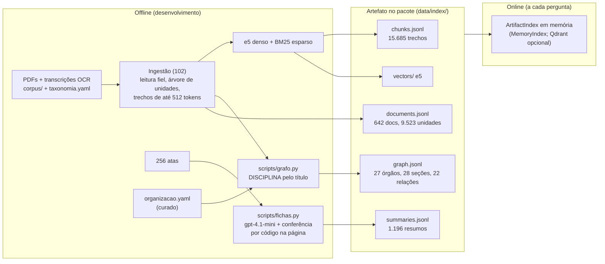

### 1.2 Uma pergunta, passo a passo

O core (005) não sabe nada de escotismo. Ele chama os hooks do pack, roda as tools de recuperação, reordena, passa pelo
portão e gera. O conhecimento do domínio está em três lugares do pack: a derivação de contexto (101), o retriever
(103) e o prompt.

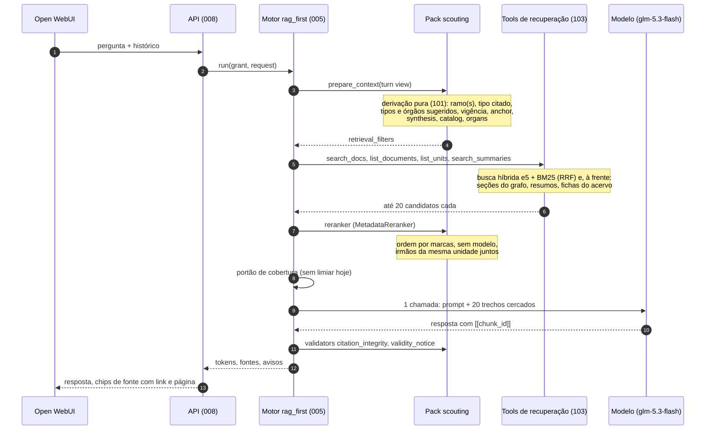

### 1.3 Como a busca enche as 20 vagas

A peça central é o `ScoutingRetriever`. Cada sinal da derivação liga uma "frente" que põe trechos à frente da busca
comum, e cada frente grava uma marca no trecho (`graph_rank`, `summary_rank`, `facet_rank`…). O `MetadataReranker`
ordena pelas marcas.

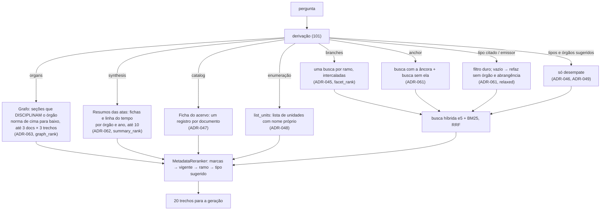

### 1.4 O que é o grafo hoje

O grafo implementado é pequeno: 77 linhas em `graph.jsonl`, 28 KB.

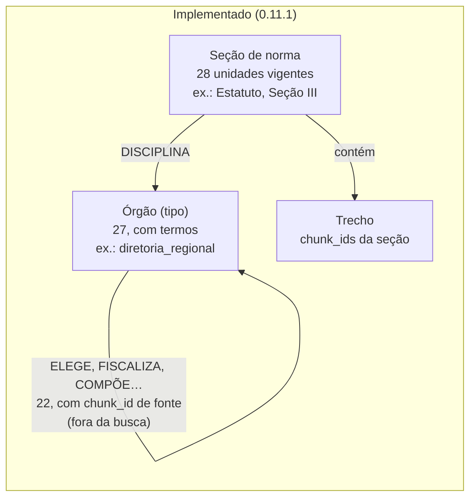

A ligação `DISCIPLINA` sai **por regra**, do título da seção ("Seção III – Da Diretoria Regional") ou de um regulamento
cujo título nomeia o órgão. Não há modelo nem na construção nem na pergunta.

### 1.5 O acervo em números

O peso de cada tipo explica por que a busca "plana" erra: atas e manuais dominam, e as normas de que as perguntas
precisam somam pouco.

| Tipo | Documentos | Trechos | % dos trechos |
|---|---:|---:|---:|
| ata | 256 | 5.658 | 36% |
| manual | 38 | 3.995 | 25% |
| resolução | 273 | 2.531 | 16% |
| relatório | 14 | 1.542 | 10% |
| política | 16 | 792 | 5% |
| regulamento + POR + estatuto | 10 | 682 | 4% |
| outros | 35 | 485 | 3% |

Na abrangência, são 450 documentos nacionais, 186 regionais (quase todos de SP), 3 locais (um só grupo, o GE Professora
Inah de Mello), 2 mundiais e 1 interamericano.

### 1.6 O que cada camada rendeu

| Mudança | Natureza | Conjunto | Antes → depois |
|---|---|---|---|
| ADR-045 facetas por ramo | busca | regressão | 0,75 → 0,81 |
| ADR-048 árvore de unidades + `list_units` | estrutura | acervo | 0,882 → 0,910 |
| ADR-062 fichas das atas | resumo extraído offline, conferido | síntese | **0,4551 → 0,8462** |
| ADR-063 `DISCIPLINA` órgão → seção | **grafo como roteador** | acervo | **0,8768 → 0,9203** |
| 0.11.1 relações de governança como fatos | **grafo como fonte de fatos** | acervo | 0,9236 → 0,9236 (zero) |
| parágrafo e inciso na árvore | granularidade | sondagem | §3º 0,876 × artigo 0,872 (zero) |

**A lição está nas duas linhas em negrito.** O grafo rende quando decide *onde olhar*. Ele não rende quando tenta
*ser a resposta*: o texto do artigo que o roteador traz já diz quem elege quem, com a redação e a página, e a aresta
`ELEGE` não acrescenta nada à geração.

## 2. O que ainda falha

| Conjunto | Item | `fact_recall` | Do que precisa |
|---|---|---:|---|
| acervo | requisitos do escotista | 0,00 | POR + Política Nacional de Adultos + Espaços Seguros |
| acervo | reconhecimento máximo de cada ramo | 0,50 | quatro guias/capítulos, um por ramo |
| acervo | blocos para a 1ª mudança de etapa (escoteiro e sênior) | 0,50 | dois ramos |
| acervo | nomes das patrulhas (escoteiro e sênior) | 0,50 | dois ramos |
| acervo | passagem do sênior para o pioneiro | 0,50 | POR do ramo sênior + reconhecimento |
| acervo | tamanho das equipes (matilha, patrulhas) | 0,67 | três ramos |
| acervo | patrulha acampando sem adultos | 0,67 | POR + Gestão de Riscos + Espaços Seguros |
| regressão | marco simbólico dos 5 ramos / dos nomeados | 0,80 | cinco ramos |
| regressão | etapas de cada ramo | 0,75 | cinco ramos |
| síntese | mandatos da DR, delegados à AN, alterações do regulamento | 0,33 | atas (fichas) |

**Leitura.** Tirando as três de síntese, todas as falhas têm a mesma forma: a resposta é a **mesma pergunta
aplicada a vários ramos, tipos de seção ou papéis**, e a regra de cada um está num capítulo diferente, às vezes num
documento diferente (POR, guia do ramo, política). Esse é o padrão que o ADR-063 resolveu para órgãos, com
"órgão → seções que o disciplinam". Falta fazer o mesmo para **ramo, tipo de seção e cargo**. É exatamente o que o seu
desenho pede quando liga seção e grupo a escotistas, dirigentes e às políticas de programa e de adultos.

## 3. A proposta do ChatGPT

### 3.1 O que ela propõe

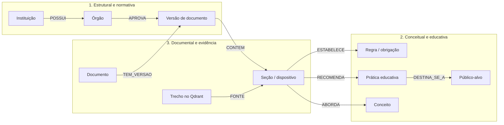

As ferramentas sugeridas são o LlamaIndex `PropertyGraphIndex`, com `SchemaLLMPathExtractor` para as relações
estruturadas e `DynamicLLMPathExtractor` para as educativas, e o grafo guardado em SQLite ou no
`SimplePropertyGraphStore`.

### 3.2 Camada a camada, contra o que já temos

| Camada do ChatGPT | O que já existe | O que falta |
|---|---|---|
| Estrutural e normativa | catálogo de órgãos (`organizacao.yaml`), `DISCIPLINA`, 22 relações com fonte, hierarquia das normas no prompt | instâncias de instituição; cadeia de aplicabilidade; **força normativa** |
| Documental e evidência | documento, versão (linhagem do `corpus.yaml`), vigência como intervalo, árvore de unidades, trecho com página e link (ADR-051) | nada essencial; `SUBSTITUI`/`REVOGA` já são metadados |
| Conceitual e educativa | `list_units` (especialidades, etapas por nome próprio), facetas por ramo | **ramo, tipo de seção, cargo e conceito como entidades ligadas às seções**: a camada que falta |

**A proposta confirma a direção do desenho revisado e aponta o buraco certo**: a camada educativa. O nosso desenho
olhou para governança porque o caso de 08/11 era de governança.

### 3.3 O que adotar e o que não

| Ideia | Veredito | Por quê |
|---|---|---|
| Três camadas que se ligam pela seção | **adotar** | É o desenho revisado mais a camada educativa. A seção (unidade da árvore) já é a ponte. |
| Tipo documental ≠ força normativa | **adotar** | Uma política pode obrigar e um guia só recomenda. Dá para extrair por regra (modais: "deverá", "é vedado", "recomenda-se", "pode") e por modelo offline no que sobrar. O prompt passa a separar "obrigatório" de "recomendado". |
| Toda relação com fonte identificável | **já fazemos, e melhor** | Em vez de `confidence: 0.92`, o item é conferido por código contra a página (ADR-062: 93% conferidos). A confiança declarada pelo extrator não prova nada. |
| Validar com 4 documentos e ~20 perguntas antes | **adotar** | É o nosso método: conjunto escrito antes, `fact_recall` antes e depois. |
| Vocabulário pequeno de relações | **adotar** | Coincide com o revisado. Proponho ainda menos na seção 5. |
| `Regra`, `Prática` e `Conceito` como nós com conteúdo | **adaptar** | O conteúdo fica no texto. O nó é uma entrada de índice remissivo (nome, apelidos, arestas para unidades), não uma paráfrase que diverge do original. |
| `DynamicLLMPathExtractor` (esquema livre) | **não** | Gera "progressão pessoal", "progressão", "sistema de progressão" como três nós, e dezenas de nomes de relação. A normalização vira um projeto à parte, e nenhuma pergunta medida pede isso. |
| LlamaIndex `PropertyGraphIndex` | **não** | Duplicaria a ingestão, os trechos e a busca que temos, sem `chunk_id` estável, vigência nem conferência por página. O pack depende só dos contratos, e esse framework entraria inteiro. A **ideia** do extrator com esquema estrito já está no `scripts/fichas.py`. |
| Trechos no Qdrant | **desatualizado** | Desde o ADR-043, o índice é o artefato em memória. O Qdrant é opcional. |
| SQLite ou `SimplePropertyGraphStore` | **desnecessário** | O `graph.jsonl` em memória já é um "simple graph store". Ver a seção 6. |

Uma ressalva honesta sobre custo: extrair entidades do acervo inteiro por modelo **não** é caro. As 256 atas, cerca
de 1,8 milhão de tokens, custaram US$ 1,30, e o acervo todo ficaria na casa de poucos dólares. O argumento contra a
extração livre é **qualidade e revisão**, não dinheiro.

## 4. O seu desenho

### 4.1 O que o desenho original diz

Condensado (o original tem 37 nós e 54 relações):

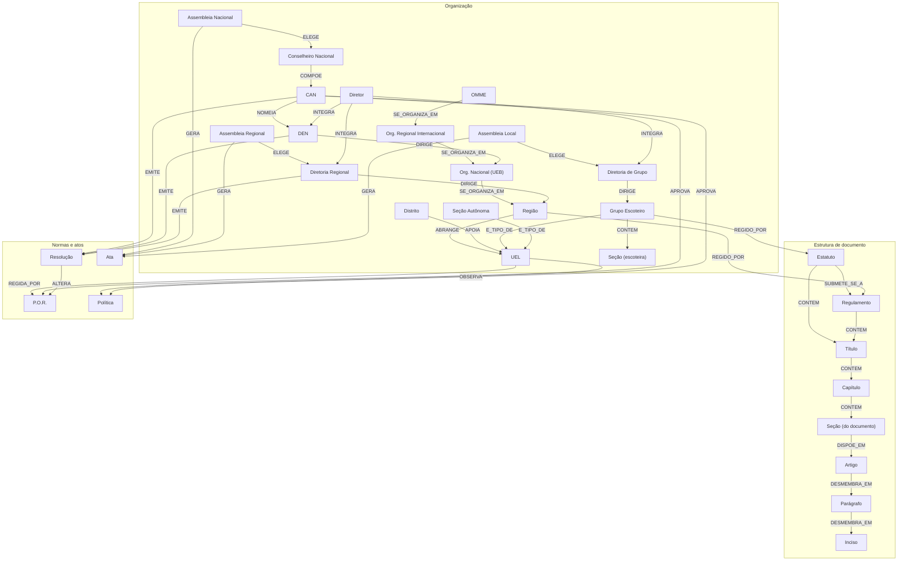

E a ideia nova, da sua mensagem: **cada grupo escoteiro é uma instância**, ligada ao próprio estatuto e aos estatutos
da região, nacional e assim por diante. Seção e grupo se ligam a escotistas e dirigentes, e se vinculam às políticas
de programa educativo e de gestão de adultos.

### 4.2 O que ele acerta

1. **A cadeia de aplicabilidade.** "O GE é regido pelo seu estatuto, pelo da região e pelo nacional" é a regra do
   mantenedor ("o nível da pergunta e todos os de cima") escrita como grafo. Hoje ela existe só para órgãos (ADR-063)
   e no prompt. Como instância, ela vale para **qualquer** pergunta situada: "no meu grupo…", "na região SP…".
2. **Seção, cargo e política ligados.** `UEL OBSERVA Política` e a ideia de ligar seção e grupo a escotistas,
   dirigentes, programa educativo e gestão de adultos atacam exatamente as falhas da seção 2.
3. **Quem emite o quê.** `CAN/DEN/DR EMITE Resolução`, `Resolução ALTERA POR` e `Assembleia GERA Ata` são a linhagem e
   a autoria. O `corpus.yaml` e a taxonomia já as dão por regra.
4. **A estrutura do documento até o inciso.** Coincide com a árvore de unidades, que já vai até artigo e regra.

### 4.3 O que ajustar

| Ponto | O problema | Ajuste |
|---|---|---|
| **Tipo × instância** | "Grupo Escoteiro", "Diretoria Regional" e "Diretor" são tipos. "GE Prof. Inah de Mello" e "Diretoria Regional de SP" são instâncias. Misturados, a aresta `DIR INTEGRA DR` não diz se vale para toda DR ou só para uma. | Dois níveis, como no revisado: `TipoDeInstituicao`/`Instituicao`, `TipoDeOrgao`/`Orgao`. As regras ficam nos tipos e os fatos (atas, eleições), nas instâncias. |
| **Instâncias sem documento** | O acervo tem documentos de **um** GE e de **uma** região. Uma instância para cada um dos grupos do país seria uma lista sem nada para recuperar, e envelheceria. | Criar instância só onde há documento, ou quando a instalação disser qual é a instituição do usuário. As outras ficam implícitas: "um GE qualquer" herda a cadeia do tipo. |
| **Pessoas** | Escotistas e dirigentes como pessoas: o acervo não os lista, a informação muda todo ano e é dado pessoal. O ADR-058 já exige apagar o que identifica alguém. | Modelar **cargos** (escotista, assistente de seção, chefe de seção, diretor-presidente de grupo), não pessoas. Nomes só onde a ata os registra, como fato datado com página (a `Eleicao` das fichas). |
| **"Seção" homônima** | O desenho tem dois nós "Seção": a do documento (n3) e a escoteira (n29, alcateia ou tropa). A derivação vai tropeçar no mesmo homônimo. | `Unidade` (do documento) e `TipoDeSecao` (alcateia, tropa escoteira, tropa sênior, clã…). |
| **Conteúdo dentro do nó** | Um nó com o "conteúdo das coisas" vira uma segunda fonte da verdade: diverge do PDF, não tem página e ninguém revisa milhares deles. | O nó é **índice remissivo**: nome, apelidos e arestas para as unidades que tratam dele. O conteúdo está no trecho, que já tem página e link. A exceção são os resumos conferidos por código (fichas). |
| **Relações sem fonte** | "CAN NOMEIA DEN" não está no Estatuto. O Art. 18 §1º só diz que os membros da DEN "podem ser escolhidos" entre os conselheiros. | Toda aresta de conteúdo leva o `unit_id` de onde sai (o `organizacao.yaml` já faz isso: 49 conferidas, 9 a verificar). |
| **Replicar a taxonomia** | Como hierarquia de nós (categoria → subcategoria → nível → documento), ela só refaz o que os filtros já fazem. | A taxonomia tem **dois tipos** de categoria. As **emissoras** (CAN, DEN, DR, assembleias, conselhos) viram `EMITIDO_POR`. As **temáticas** (Programa Educativo, Gestão de Adultos, Espaços Seguros, Governança, Relações Institucionais) viram nós `Area`, ligados aos cargos, ramos e tipos de seção que tratam. É aqui que entra o "seção vinculada à política de programa educativo". |
| Detalhes | `OBSERVAw`, "Reiongal", "FIsca", "Conselho Consultivo Nacional" duplicado (n30 e n32). | Corrigir no desenho. |

### 4.4 E o desenho revisado?

O revisado está mais perto da sua ideia do que parece. Ele já tem `Instituicao` (instância) `PARTE_DE` `Instituicao`,
`Documento APLICA_SE_A Instituicao`, `Cargo`, `Ramo`, `TipoDeSecao` e `Unidade DISCIPLINA Ramo/Cargo`. O problema não
é o desenho, é **o que foi implementado dele**: só a parte de órgãos, porque o caso de 08/11 era de órgãos. As arestas
que ligariam ramo, tipo de seção e cargo às normas e políticas estão no papel e vazias.

O que o revisado **não tem**, e a sua ideia e o ChatGPT trazem:
- a `Area` temática como ponte entre políticas e quem elas regem;
- a força normativa da unidade;
- `Conceito` (progressão, etapa, especialidade, reconhecimento, promessa) como entrada de índice.

O que o revisado tem **a mais e que não pagou**: as relações de governança percorridas na busca, medidas em zero, e o
`ResumoDeNorma`, que não foi feito e não tem pergunta que o peça.

## 5. Proposta: o grafo de domínio

### 5.1 O desenho

A ideia é uma só, repetida: **toda entidade que a pergunta pode nomear aponta para as unidades que a disciplinam**,
e cada instituição aponta para as normas que se aplicam a ela. O ADR-063 fez isso para órgãos, e aqui vale para
todos.

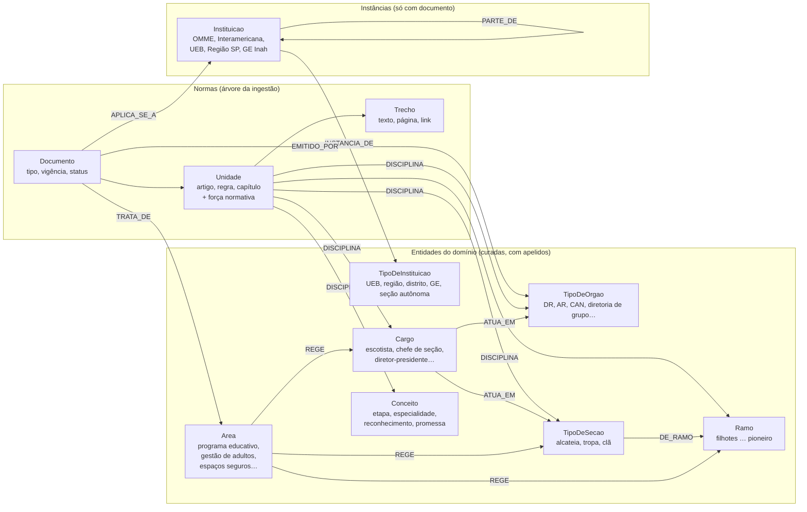

O vocabulário fica em **seis relações que a busca usa**: `DISCIPLINA`, `APLICA_SE_A`, `PARTE_DE`, `EMITIDO_POR`,
`TRATA_DE` e `REGE`. Mais duas que estruturam: `DE_RAMO` e `ATUA_EM`. As de governança (`ELEGE`, `FISCALIZA`…)
continuam no YAML, para consulta e para a prova de que o texto bate, fora da busca até alguma pergunta medida pedir.

### 5.2 As instâncias, do jeito que você imaginou

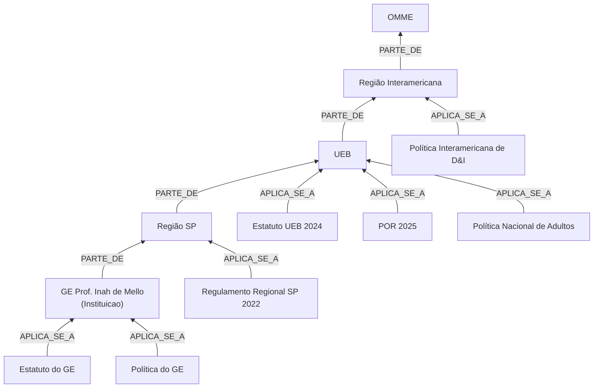

A consulta "que normas valem para este GE?" sobe pelo `PARTE_DE` e junta o que cada nível tem, na ordem de cima para
baixo. São **dados que já existem**: o nível e a pasta da taxonomia dizem a abrangência de cada documento, e a
instância de cada pasta regional ou local é uma linha curada.

### 5.3 Duas perguntas atravessando o grafo

**"Que requisitos um adulto precisa cumprir para atuar como escotista?"** (hoje 0,00)

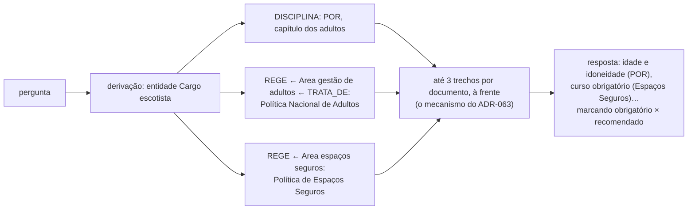

**"No GE Inah de Mello, quem aprova as contas da diretoria?"**

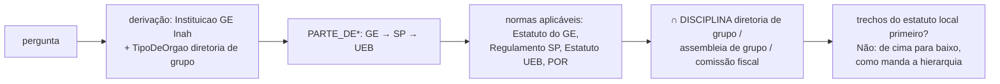

### 5.4 De onde vem cada aresta

O princípio do ADR-063 continua: **regra antes de modelo, e modelo só offline, conferido**.

| Aresta | Fonte | Custo |
|---|---|---|
| `PARTE_DE`, `INSTANCIA_DE` | curado (`organizacao.yaml`), poucas linhas | zero |
| `APLICA_SE_A`, `EMITIDO_POR`, `TRATA_DE` | taxonomia: nível, pasta, categoria emissora × temática | zero, por regra |
| `DISCIPLINA` (órgão) | título da seção ou do regulamento | feito (ADR-063) |
| `DISCIPLINA` (ramo, tipo de seção, cargo) | título do capítulo ou da regra ("Ramo Escoteiro", "Do Escotista"), o `branch` que a ingestão já grava, e os guias por ramo | regra; o modelo offline só no que o título não diz, conferido |
| `DISCIPLINA` (conceito) | lista curada de conceitos + títulos + tipos de unidade (`especialidades`, `progressao`) | regra; modelo offline conferido |
| `REGE` (área → cargo, ramo, tipo de seção) | curado, poucas dezenas de linhas | zero |
| força normativa da unidade | modais por regra; o modelo offline nos ambíguos | regra + poucos dólares |

### 5.5 Força normativa

Um atributo da unidade, com quatro valores: `obriga`, `proibe`, `faculta` e `recomenda`. Ele chega ao modelo no
cabeçalho do trecho, ao lado da vigência, e o prompt pede a resposta separada em "o que é obrigatório" e "o que é
recomendado". É a ideia mais barata e de maior efeito da proposta do ChatGPT, e serve também às perguntas de segurança
("é permitido consumir bebida alcoólica…", "patrulha sem adultos").

O atributo **não muda o core**: o cabeçalho do trecho é montado pelo core (ADR-026), mas a força pode ir nos metadados
que o pack já controla, e o prompt é do pack. Se precisar aparecer no cabeçalho, é uma linha de metadado a mais, sem
mudar seam.

## 6. Armazenamento: sem serviço novo

| Opção | Tamanho e forma | Veredito |
|---|---|---|
| **JSONL no artefato, em memória** (hoje) | o alvo: ~10 mil unidades + ~100 entidades + algumas dezenas de milhares de arestas, poucos MB; travessia de 1 a 3 saltos em dicionários | **manter** |
| SQLite (CTE recursiva) | mesma coisa, com consulta SQL | sem ganho: ninguém consulta ad hoc em produção |
| LlamaIndex `SimplePropertyGraphStore` | em memória, persistido em JSON | igual ao nosso, com uma dependência enorme junto |
| Neo4j | serviço JVM, ~1 GB de RAM numa VM pequena, mais um backup | **não**: ganharia só a exploração visual e o Cypher, que o mantenedor pode ter offline |

O que o Neo4j daria, e é útil, é **ver** o grafo. Isso se resolve sem serviço: um `scripts/grafo.py export --arrows`
que grave o grafo construído no formato do arrows.app, o mesmo do seu desenho. Assim você confere o grafo real no
editor onde desenhou o planejado.

## 7. Plano, um passo de cada vez e cada um medido

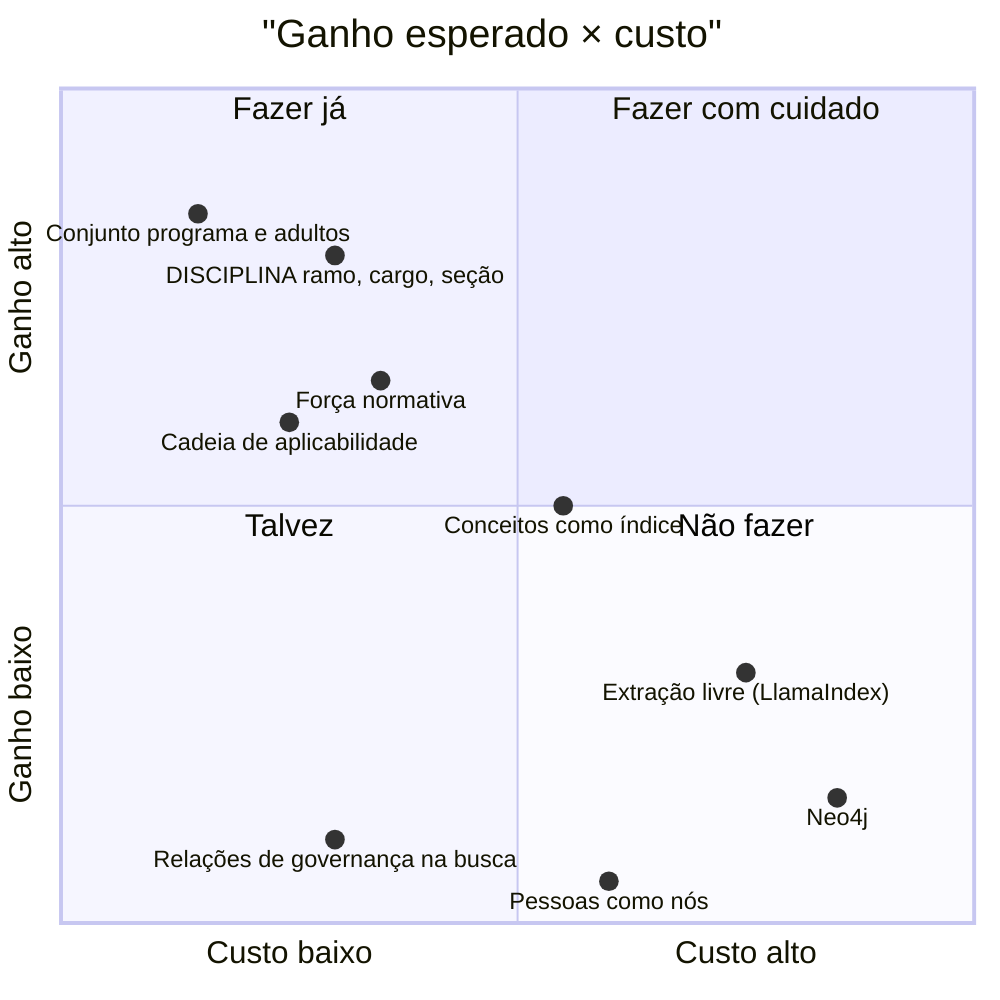

| Passo | O que é | Como medir |
|---|---|---|
| 0 | **Conjunto `programa-adultos.yaml`**, escrito antes: ~20 perguntas, metade controle, incluindo as 7 que falham, perguntas "obrigatório × recomendado" e duas situadas no GE Inah | linha de base |
| 1 | **Entidades além de órgão**: cargo, ramo, tipo de seção no `organizacao.yaml`, com apelidos; a derivação publica `entities` no lugar de `organs` (101) | `context_accuracy` |
| 2 | **`DISCIPLINA` por regra** para elas, sobre títulos e `branch` (102), e o retriever trazendo as seções como no ADR-063, com uma frente por entidade quando a pergunta nomeia várias (103) | as 7 falhas do acervo e as 3 da regressão |
| 3 | **Área temática** (`TRATA_DE` pela taxonomia, `REGE` curado) | "requisitos do escotista", "patrulha sem adultos" |
| 4 | **Cadeia de aplicabilidade** (`PARTE_DE`, `APLICA_SE_A`) e a instituição na derivação | perguntas situadas |
| 5 | **Força normativa** por regra, modelo offline no resto, e o prompt separando | perguntas "obrigatório × recomendado" (fidelidade pelo juiz) |
| 6 | **Conceitos** como índice remissivo, só se os passos 1–5 deixarem falhas | o que sobrar |
| — | Export para o arrows.app | revisão visual |

Cada passo é um ADR curto do pack, como o 063, e nenhum toca o core.

## 8. Decisões do mantenedor (10/11)

1. **Instâncias: cadastrar tudo o que já houver de informação.** Entram as instituições com documento (OMME,
   Interamericana, UEB, Região SP, GE Inah) e as que o acervo cita com fonte, como distritos e grupos nomeados em atas,
   fichas e regulamentos. Cada instância leva a fonte de onde saiu, e a que não tem fonte fica de fora.
2. **Pessoas: não.** Modelamos cargos, e os nomes ficam só como fatos datados das atas.
3. **Ordem: o conjunto de programa e adultos vem primeiro**, escrito antes de qualquer código.
4. **Governança: as relações continuam fora da busca** até uma pergunta medida pedir.

## 9. Mais de uma chamada de modelo?

### 9.1 O que existe hoje

- O `rag_first` faz **uma** chamada, a geração. Toda a inteligência antes dela é determinística: a derivação por
  léxico (101), o grafo e a busca (103).
- O core já tem o loop do `agentic`, com o papel `controller`. O `rag_first` só escala para ele quando o portão diz
  "sem cobertura" e o Assistant declara `controller`. O `scouting` não declara, e o portão não tem limiar, então
  isso nunca acontece.
- **O pack não pode chamar modelo.** O `PackContext` é "dados de carga, nenhum serviço", de propósito: toda chamada
  passa pelo Model Router (006), que aplica allowlist, orçamento, trace, custo e impacto. Uma chamada feita pelo pack
  com chave própria escaparia de tudo isso, e não vale a pena. Mas o que o planejador **decide** é do domínio, então
  ele mora no `scouting`, e o core só **empresta** a chamada (9.3).

### 9.2 As opções

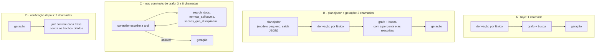

| Opção | O que resolve | Custo por pergunta | Evidência que temos | Veredito |
|---|---|---|---|---|
| **B · planejador** | **vocabulário**: a pergunta descreve um caso e a norma fala em abstrato; seguimento sem assunto; entidades ditas com outras palavras | +1 chamada curta (~1 mil tokens de entrada, ~200 de saída); mais latência antes do primeiro token, a medir | Na revisão de 08/11, cinco reescritas realistas puseram o Estatuto Art. 27 entre o 1º e o 7º lugar, contra 448º com a pergunta original. O vocabulário foi a **causa principal**. | **fazer** |
| C · loop com tools | perguntas de vários passos ("compare os cinco ramos", "o que vale no meu grupo") | 3 a 8 chamadas, latência várias vezes maior; modelo pequeno erra ações (`controller_invalid_rate`) | Nenhuma medição no `scouting`. O `geral` precisou de `max_iterations: 8` para terminar. | **só depois de B**, e só para as perguntas que o planejador marcar como de vários passos |
| D · verificação | frase sem apoio no trecho | +1 chamada do tamanho da geração, e quebra o streaming: a resposta só sai depois do juiz | A fidelidade medida pelo juiz offline já está entre 0,95 e 1,00, e o `citation_integrity` impede citação inventada. | **não**: fica no eval, offline |
| Reranker por modelo | ordem dos 20 trechos | uma chamada com os 20 trechos | Dois cross-encoders medidos empataram ou ganharam 0,01 (103 R14). | **não** |

**Avaliação sincera.** A segunda chamada vale a pena, mas como **planejador antes da busca**, não como loop nem
como revisor. Há três razões:

- **Ataca a causa que já medimos.** O vocabulário é o problema principal, e a correção que funcionou para órgãos
  (o grafo) não generaliza: cada assunto novo pede um termo novo no léxico. O planejador generaliza.
- **Não troca o determinístico pelo modelo.** A derivação por léxico continua valendo onde ela é certa (tipo citado,
  "Regra 054", enumeração, datas). O planejador só **acrescenta**: reescritas e entidades que o léxico não pegou.
- **O modelo escolhe entidades de uma lista fechada.** O planejador não inventa órgão nem ramo: o esquema de saída
  tem um `enum` com os ids do catálogo do grafo. Assim, "quem pode ser chefe de tropa" vira `cargo: chefe_de_secao`,
  `tipo_de_secao: tropa_escoteira`, e o grafo faz o resto.

**O que piora:**
- **Latência.** O primeiro token chega depois do planejador. A timeline do Open WebUI mostra a etapa
  ("Planejando a busca"), mas a espera é real e precisa ser medida.
- **Reprodutibilidade.** O eval da CI roda com o gerador simulado. Com o planejador, ele precisa de um cache de
  planos por pergunta, gravado numa rodada com modelo real e conferido no git. Sem isso, a linha de base passa a
  variar de uma rodada para outra.
- **Uma peça a mais nos contratos.** O `prepare_context` passa a receber, opcionalmente, um cliente de modelo
  emprestado pelo core. É uma mudança aditiva nos contratos 001, com ADR.

### 9.3 Como fica a arquitetura com o planejador

*Revisto em 10/11, depois da pergunta do mantenedor ("o planner não deveria ficar dentro do scouting?").* A primeira
versão punha o planejador numa etapa nova do core. Ele fica no pack: o prompt, o esquema de saída e o uso da resposta
são do domínio. O core só empresta uma chamada de modelo ao `prepare_context`, pelo Model Router.

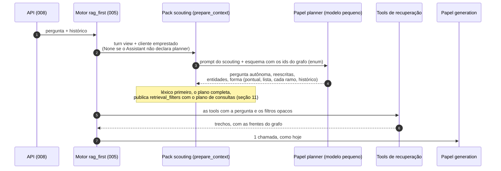

**Onde mora cada parte** (o core continua agnóstico de domínio):

| Parte | Módulo | Mudança |
|---|---|---|
| Papel opcional `planner` na política de modelos | 006, 003 | sem ele, nada é emprestado e o `rag_first` é o de hoje |
| Cliente emprestado ao `prepare_context`: uma chamada, saída por esquema obrigatória, prazo curto, falha vira `None` | contratos 001, 005 | versão menor, aditiva; a chamada sai no trace (009) como as outras |
| Prompt, esquema com o enum do grafo, reescritas, junção com o léxico | 101 (derivação) | o léxico vence onde for explícito; sem modelo, segue só com ele |
| Executar o plano de consultas | 103 (retriever, `rag/graph/`) | seção 11 |
| Cache de planos para o eval da CI | 105 | gravado numa rodada com modelo real, conferido no git |

**Em dois degraus, para medir cada um.**
1. **Só reescritas.** O planejador devolve a pergunta autônoma e de 2 a 4 reescritas, e o retriever busca com cada
   uma. Mede-se o vocabulário (a pergunta de 08/11 sem o grafo, as perguntas de seguimento) e o efeito no acervo e no
   conjunto de programa e adultos.
2. **Entidades e forma.** O planejador escolhe entidades do enum e a forma da pergunta, e o plano de consultas da
   seção 11 passa a sair dele quando o léxico não decide. Mede-se o ganho sobre o degrau 1; se for pequeno, o degrau 2
   não entra.

A escalada para o loop (opção C) fica para depois, ligada à forma "comparação" ou "vários passos" que o planejador
devolver, e só se o conjunto de programa e adultos mostrar que reescrever e rotear não bastam.

## 10. Consultas no grafo

### 10.1 Como o grafo é percorrido hoje

Ele é consultado, mas por **uma única consulta fixa, de um salto**, escrita em código: "dado o órgão, quais seções o
disciplinam?". Não há linguagem de consulta. O `ArtifactGraph` lê o `graph.jsonl` uma vez e monta um dicionário
`órgão → seções`. A consulta é um acesso a esse dicionário.

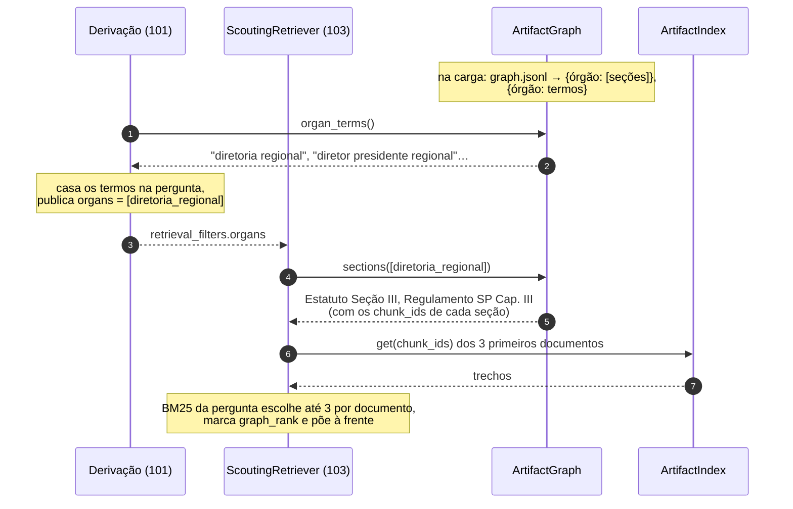

As 22 relações de governança são carregadas, e o método `relations(organs)` existe, mas a busca não o chama: medidas,
elas não mudaram nada.

### 10.2 Precisamos de consultas?

**Sim, mas de três tipos diferentes, e só um deles em produção com modelo.**

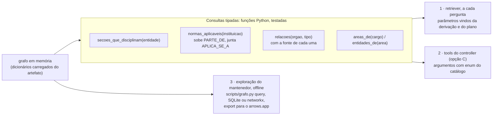

1. **Consultas tipadas no retriever.** Hoje há uma. Com a cadeia de aplicabilidade, passam a ser umas cinco, e a
   primeira com vários saltos: `normas_aplicaveis` sobe pelo `PARTE_DE` até o topo, com no máximo cinco níveis. Cada
   uma é uma função pura sobre os dicionários, com teste, e roda em microssegundos. Ficam num módulo do pack
   (`rag/graph/`), atrás do seam que já existe (`NormGraph`).
2. **As mesmas consultas como tools**, quando houver loop (opção C): `scouting.normas_aplicaveis(instituicao)`,
   `scouting.secoes_que_disciplinam(entidade)`. O modelo escolhe a tool e preenche argumentos de uma lista fechada; ele
   **não escreve** a consulta. É assim que o grafo fica consultável pelo modelo sem o risco do texto-para-Cypher, em
   que um modelo pequeno escreve consultas erradas sem que ninguém perceba.
3. **Consulta livre para você, offline.** Para explorar, conferir e achar buracos: um `scripts/grafo.py query` com as
   mesmas funções na linha de comando, e um export do grafo para um SQLite (consultas recursivas com `WITH
   RECURSIVE`), para o networkx num notebook ou para o arrows.app. Nada disso vai para a instalação.

**Por que não uma linguagem de consulta em produção.** As perguntas que o grafo responde têm poucas formas, e todas
cabem em funções com nome. Uma linguagem genérica (Cypher, SPARQL) só pagaria se houvesse consultas imprevistas a
cada pergunta, e elas viriam de um modelo, que é justamente onde não queremos imprecisão. Se um dia a exploração
offline pedir mais que SQL e networkx, um Neo4j local, no computador do mantenedor e alimentado pelo mesmo
`graph.jsonl`, resolve sem tocar a instalação.

A seção 11 troca a lista de consultas acima, pensada para normas, por um catálogo único que vale para todos os tipos de
documento.

## 11. Consultas para todo o acervo

*Pedido do mantenedor em 10/11: consultas suficientes para muitos tipos de pergunta, que funcionem para atas, guias,
manuais e qualquer tipo da taxonomia, e para as relações deles com as entidades.*

### 11.1 O ponto de partida: já temos cinco consultas, cada uma num canto

Hoje o retriever tem cinco mecanismos que trazem trechos à frente da busca. Cada um foi feito para uma falha medida,
com estrutura própria:

| Mecanismo | ADR | O que é, como consulta | Tipos que alcança |
|---|---|---|---|
| `graph_rank` | 063 | órgão → seções que o disciplinam | estatuto, regulamento |
| `summary_rank` (`search_summaries`) | 062 | órgão, ano, abrangência → fichas de ata | ata |
| `list_documents` | 047, 049 | tipo, órgão, abrangência → fichas do acervo | todos, só como lista |
| `list_units` | 048 | tipo de unidade, ramo → unidades com nome | guias, POR, manuais |
| `facet_rank` | 045 | ramo → uma busca por ramo | todos, só por ramo |

São **cinco consultas a um grafo que não existe como um só**. A proposta é juntá-las: um grafo, um conjunto pequeno de
consultas com nome, e um **plano** que diz quais rodar. Cada novo tipo de pergunta deixa de pedir um mecanismo novo e
passa a ser uma combinação das consultas que já existem.

### 11.2 O papel de cada tipo de documento

A mesma pergunta ("o que existe sobre a Diretoria Regional?") tem respostas de natureza diferente em cada tipo de
documento: o estatuto diz o que **vale**, o manual diz **como fazer**, a ata diz o que **aconteceu** numa data. Para
que uma consulta sirva a todos os tipos, cada tipo da taxonomia ganha um **papel**, numa tabela curada de vinte linhas:

| Papel | Tipos da taxonomia (documentos no acervo) | O que a unidade dá à resposta |
|---|---|---|
| `norma` | Estatuto (2), P.O.R. (1), Regulamento (7), Resolução (273), Política (16), Lei (1) | o que vale, com vigência e força normativa |
| `orientacao` | Manual e guias (38), Planejamento Estratégico (1) | como fazer, o que se recomenda |
| `registro` | Ata (256), Parecer (3), Relatório (14), Manifestação (1) | o que aconteceu ou foi decidido, com data |
| `comunicacao` | Ofício (7), Edital (5), Boletim (4), Posicionamento (5), Recomendação (4), Apresentação (4) | o que um órgão comunicou, com data |

O papel serve a três coisas: filtrar a consulta ("só normas"), ordenar a entrega (norma antes de orientação, e
registro por data) e dizer ao prompt como falar ("o Estatuto determina" × "a ata de 2019 registra").

### 11.3 O grafo, com uma aresta central

A seção 5 tinha a aresta `DISCIPLINA`, que só faz sentido em norma. Ela vira um caso de uma aresta mais geral,
**`SOBRE`**: *esta unidade trata desta entidade*. A aresta leva o **modo**, que vem do papel do documento:

- `disciplina`, numa norma;
- `orienta`, num manual ou guia;
- `registra`, numa ata, num parecer ou num relatório;
- `comunica`, nos demais.

Os documentos também são entidades. Assim, "o que as atas dizem sobre o Regulamento Regional" é a mesma consulta que
"o que as normas dizem sobre a Diretoria Regional".

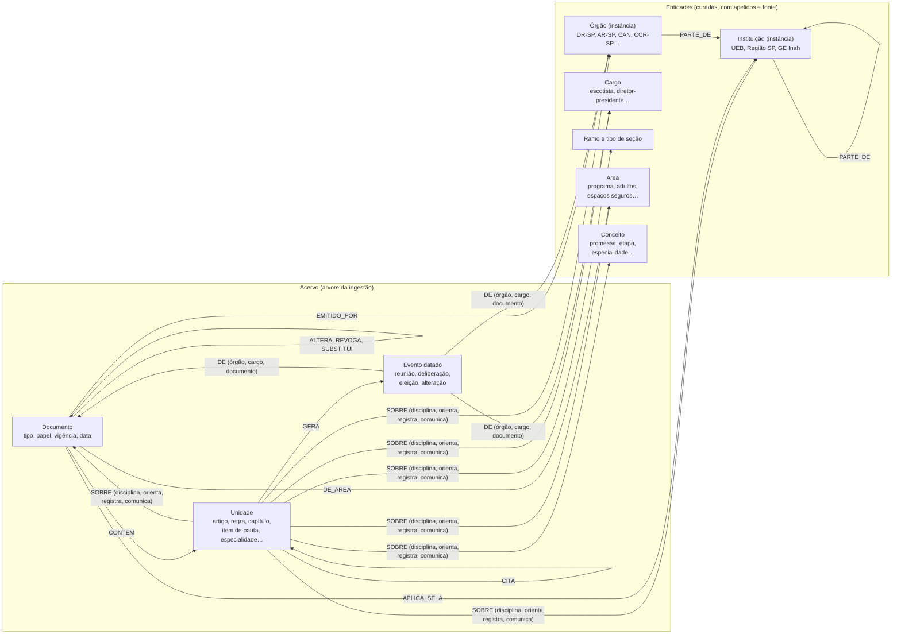

Pessoas continuam fora (decisão 2). Um nome eleito fica no texto do evento, não vira nó.

### 11.4 Sete consultas

Todas são funções puras sobre os dicionários carregados do artefato. Todas devolvem **evidência**, e não respostas:
cada item traz a unidade ou o evento, o documento, o papel, a data e a **fonte da aresta** que o trouxe. O retriever
transforma a evidência em trechos e, dentro de cada documento, escolhe os que mais casam com a pergunta, como o
`graph_rank` faz hoje.

| # | Consulta | Entrada | Devolve | Substitui ou generaliza |
|---|---|---|---|---|
| 1 | `reconhecer(texto)` | a pergunta | entidades mencionadas, pelos apelidos | `organ_terms` e o léxico de ramos |
| 2 | `sobre(entidades, modo=todas\|alguma, papeis, tipos, ramo, periodo)` | uma ou mais entidades | unidades que tratam delas, em qualquer tipo de documento | `graph_rank`, `facet_rank` |
| 3 | `aplicavel_a(instituicao, papeis=norma)` | uma instituição | documentos que valem para ela, subindo o `PARTE_DE`, de cima para baixo | nova (cadeia da seção 5.2) |
| 4 | `documentos(tipo, emissor, aplica_se_a, area, ramo, periodo, vigente)` | filtros | documentos | `list_documents` |
| 5 | `itens(tipo_de_unidade, de, ramo)` | tipo de unidade ou de entidade, e o "dono" | unidades com nome ou entidades filhas, com fonte | `list_units`, os órgãos de uma instituição |
| 6 | `linha_do_tempo(alvo, eventos, periodo)` | entidade ou documento | eventos datados: reuniões, deliberações, eleições, alterações | `search_summaries`, as versões |
| 7 | `ligados(alvo, relacoes)` | unidade, documento ou entidade | vizinhos com a fonte: citações, alterações, governança | `relations`, hoje sem uso |

Duas regras de composição completam o catálogo, no executor e não em consultas novas:
- **`para_cada(entidades, consulta)`** responde "cada ramo" e as comparações: roda a consulta para cada entidade e
  reserva vagas para cada uma, como o `facet_rank` faz hoje para os ramos.
- **Interseção.** `sobre([A, B], modo=todas)` traz as unidades que tratam das duas entidades ao mesmo tempo
  ("pioneiro" **e** "escotista"), e `aplicavel_a` filtra `sobre` pela instituição.

### 11.5 O plano: a consulta em tempo de execução, sem linguagem de consulta

A pergunta vira um **plano**: dados num esquema fechado, que dizem quais das sete consultas rodar e com quais
entidades. Quem escreve o plano é a derivação (léxico) ou, no degrau 2, o planejador. O executor é código fixo e
testado. É assim que o grafo é consultado a cada pergunta, com vários saltos, sem que ninguém escreva Cypher.

```json
{
  "forma": "interseção",
  "consultas": [
    {"q": "sobre", "entidades": ["ramo:pioneiro", "cargo:escotista"], "modo": "todas", "papeis": ["norma", "orientacao"]},
    {"q": "aplicavel_a", "instituicao": "ueb"}
  ]
}
```

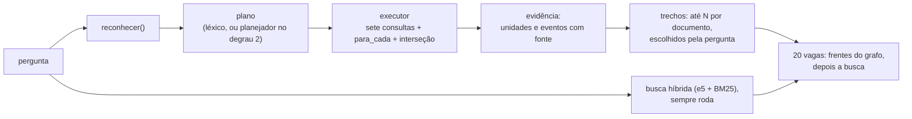

A busca híbrida **continua rodando sempre**. O grafo só ocupa as primeiras vagas, com um teto por consulta. Se o grafo
não reconhecer nada, a pergunta segue como hoje.

### 11.6 Cobertura: as perguntas dos conjuntos de avaliação

As 89 perguntas do acervo (48), da regressão (28) e da síntese (13), agrupadas pela forma, cada forma com o plano que
a responde:

| Forma | Exemplo real (id no eval) | Plano | Tipos alcançados |
|---|---|---|---|
| O que é, como funciona | "O que é o Mensageiros da Paz?" (`mensageiros-da-paz`) | `sobre([conceito])` | norma, orientação |
| Quem pode, que requisitos | "Que requisitos um adulto precisa cumprir para atuar como escotista?" (`requisitos-do-escotista`, hoje 0,00) | `sobre([cargo:escotista], papeis=[norma, orientacao])` | POR, Política de Adultos, Espaços Seguros, manuais de adultos |
| Duas entidades ao mesmo tempo | "Um pioneiro pode atuar como escotista?" (`pioneiro-como-escotista`) | `sobre([ramo:pioneiro, cargo:escotista], modo=todas)` | POR, manual do Pioneiro |
| Lista de documentos | "Quais são as políticas nacionais?" (`politicas-nacionais`) | `documentos(tipo=política, aplica_se_a=ueb)` | política |
| Lista de itens | "Quais são as especialidades do Ramo Pioneiro?", "Quais são os órgãos de um grupo escoteiro?" | `itens(especialidade, ramo=pioneiro)`, `itens(orgao, de=grupo_escoteiro)` | guias, estatuto |
| Cada ramo, comparação | "Qual a idade mínima para ser chefe de seção em cada ramo?" (`idade-chefe-de-secao`) | `para_cada(ramos, sobre([cargo:chefe_de_secao, ramo]))` | POR, manuais dos ramos |
| Situada numa instituição | "No GE Inah, quem aprova as contas da diretoria?" | `sobre([orgao:comissao_fiscal_de_grupo])` ∩ `aplicavel_a(ge_inah)` | estatuto local, regulamento SP, Estatuto UEB |
| Normativa sobre um órgão | "Quem fiscaliza as contas da Diretoria Regional?" | `sobre([orgao:dr_sp], papeis=[norma])` | estatuto, regulamento |
| Histórico de um cargo | "Quem foram os diretores-presidentes eleitos desde 2016?" (`presidentes-regionais-desde-2016`) | `linha_do_tempo(cargo:diretor_presidente_regional, eventos=[eleicao], periodo=2016–)` | ata |
| Histórico de um órgão | "Onde se reuniu o Conselho Consultivo Regional entre 2017 e 2019?" | `linha_do_tempo(orgao:ccr_sp, eventos=[reuniao], periodo=2017–2019)` | ata |
| Histórico de um documento | "O que foi decidido sobre o Regulamento Regional nas atas desde 2014?" (`alteracoes-do-regulamento-regional`) | `linha_do_tempo(doc:regulamento_regional_sp, eventos=[deliberacao], periodo=2014–)` | ata |
| O que mudou numa norma | "Que resolução alterou a Regra 054?" | `ligados(regra:054, [ALTERA, REVOGA])` + `linha_do_tempo(doc:por, [alteracao])` | resolução, POR |
| O que um órgão publicou | "O que a Diretoria Regional publicou sobre espaços seguros?" | `documentos(emissor=dr_sp)` ∩ `sobre([area:espacos_seguros])` | resolução, ofício, instrução normativa |
| Pessoa | "O que você sabe sobre Nicholas Picin Casagrande?" (`pessoa-nicholas`) | nenhum: busca textual nas fichas e nos trechos | ata |
| Fato simples | "Quando foi fundada a UEB?" (`fundacao-ueb`) | `sobre([instituicao:ueb])` ajuda, a busca resolve | estatuto |

Só a pergunta sobre uma pessoa fica fora do grafo, por decisão. As formas novas, como "o que mudou numa norma" e "o
que um órgão publicou", não estão nos conjuntos de hoje. O conjunto `programa-adultos.yaml` (passo 0) deve trazer
algumas delas, para que as consultas 6 e 7 sejam medidas antes de entrarem.

### 11.7 De onde vêm as arestas, tipo por tipo

O princípio continua: **regra antes de modelo, modelo só offline e conferido**. A tabela diz, para cada tipo, de onde
vem cada aresta e o que já existe.

| Tipo (documentos) | `EMITIDO_POR`, `APLICA_SE_A`, `DE_AREA` | `SOBRE` | Eventos e ligações entre documentos |
|---|---|---|---|
| Estatuto, P.O.R., Regulamento (10) | pasta e nível da taxonomia, e a subpasta da região ou da UEL | título de seção, artigo e regra (já feito para órgãos); o modelo offline só no que o título não diz | `SUBSTITUI` pelas versões do catálogo; a aprovação vem das atas |
| Resolução (273) | pasta: CAN, DEN, DR-SP | **pela ementa**: o título é só o número ("Resolução CAN 08/1995"), então o assunto sai da primeira frase ("Aprova…", "Altera…", "Dispõe sobre…"), por regra e, no que sobrar, pelo modelo offline | `ALTERA` e `REVOGA` por regra no texto: 180 resoluções revogam algo, 61 alteram e 89 citam regras do POR |
| Política (16), Lei (1) | nível da taxonomia; área pela categoria | títulos das seções | — |
| Manual e guias (38) | área pela categoria | títulos de capítulo; ramo pelo `branches` que a ingestão já grava; especialidades, insígnias, etapas e blocos já são unidades | — |
| Ata (256) | órgão e região pela pasta | as **fichas** já conferidas por página (ADR-062): cada deliberação passa por `reconhecer()` e ganha `SOBRE` para órgãos, cargos e documentos | reunião, deliberação e eleição já estão nas fichas (680 fichas e 516 linhas do tempo); falta ligá-las às entidades |
| Parecer, Relatório (17) | comissão fiscal ou de ética pela pasta | o órgão fiscalizado e o exercício, pela regra no título e no texto | o exercício como evento |
| Ofício, Edital, Boletim, Posicionamento, Recomendação, Apresentação, Manifestação, Planejamento (31) | pasta | título; o modelo offline só se uma pergunta medida pedir | data |

Nenhum tipo pede serviço novo nem extração em tempo de pergunta. O trabalho mais caro e mais rentável está nas
**resoluções**: são 273, a maior fatia do acervo, e hoje nada diz do que tratam além do texto corrido.

### 11.8 Onde mora, e em que ordem

- **Módulo.** `axon_scouting/rag/graph/`, com `domain/` (as sete consultas, o esquema do plano e o executor, puros e
  testados), `api.py` (o seam que substitui o `NormGraph`) e o adapter que lê o `graph.jsonl` novo. O retriever chama
  o executor, e as tools de hoje (`search_summaries`, `list_documents`, `list_units`) viram fachadas das consultas 6,
  4 e 5. Nada muda no core.
- **Tamanho.** Centenas de entidades e algumas dezenas de milhares de arestas `SOBRE`: poucos MB, em memória, como
  hoje.
- **Para o mantenedor.** `scripts/grafo.py query sobre cargo:escotista --papeis norma` roda as mesmas funções na
  linha de comando, e o export para o arrows.app mostra o grafo.

A ordem encaixa no plano da seção 7, cada passo medido:

| Passo | Consultas | Medida |
|---|---|---|
| 0 | conjunto `programa-adultos.yaml`, com perguntas de todas as formas da 11.6 | linha de base |
| 1 | `reconhecer` e as entidades (cargo, ramo, área, instâncias) | `context_accuracy` |
| 2 | `sobre` com papel e modo, para norma e orientação, mais `para_cada` e a interseção; o `graph_rank` e o `facet_rank` passam a ser casos dela | as falhas do acervo e da regressão |
| 3 | `aplicavel_a` | perguntas situadas |
| 4 | `linha_do_tempo` e `SOBRE` nas fichas das atas; o `search_summaries` passa a ser fachada | síntese, sem cair |
| 5 | ementas das resoluções, `ALTERA` e `REVOGA`, e `ligados` | perguntas "o que mudou" |
| 6 | `documentos` e `itens` absorvem `list_documents` e `list_units` | acervo e regressão, sem cair |

Os passos 4 a 6 trocam mecanismos que funcionam por fachadas das consultas novas. Cada um só entra se os conjuntos de
hoje não caírem.
