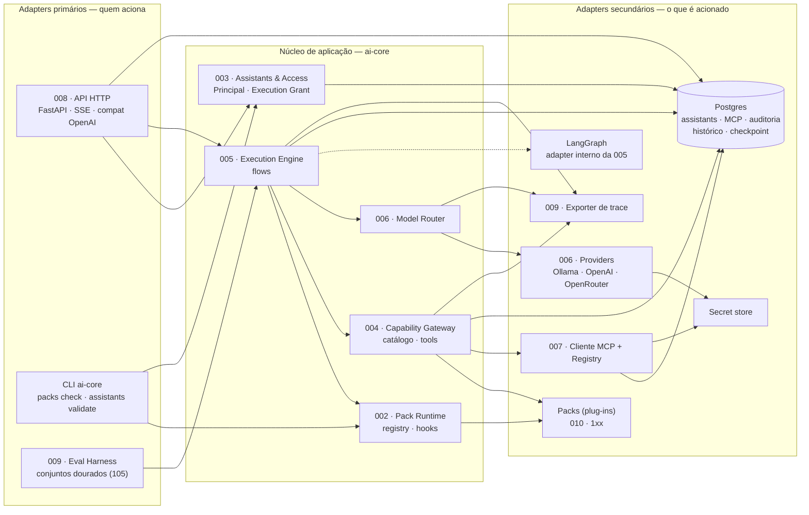

# Relatório — Estilo arquitetural da plataforma

> Revisão da SDD · 2026-09-14 · **Aceito pelo mantenedor em 2026-09-14; ajustes aplicados**
> Decisões: [ADR-012](adr/ADR-012-estilo-arquitetural-hexagonal.md) (estilo) e
> [ADR-013](adr/ADR-013-seams-transversais-trace-e-tempo.md) (Trace Sink e tempo de referência), aceitos junto com o
> [ADR-011](adr/ADR-011-contratos-independentes-do-motor.md).
>
> As referências de arquivo e linha nas seções 2 a 6 descrevem a SDD **antes** dos ajustes; vários desses trechos
> mudaram com a aplicação.

## 1. Resumo executivo

**Recomendação:** adotar **Arquitetura Hexagonal (Ports & Adapters) dentro de cada módulo** e dar nome ao que a SDD já
é nos níveis de cima: um **Microkernel** (core + packs como plug-ins) organizado como **Monolito Modular** (módulos com
seams, um único deployable). No centro de cada hexágono ficam as políticas determinísticas, como **núcleo funcional**
(*Functional Core / Imperative Shell*). Da **Clean Architecture** fica só a **regra de dependência**, que o import-linter
já impõe. A cerimônia dos quatro anéis (interactors, presenters, modelos de requisição e resposta por fronteira) fica de
fora.

A escolha não é entre "hexagonal *ou* clean": os estilos respondem a perguntas de escalas diferentes. A SDD já respondeu,
sem dar nome, às perguntas de sistema (microkernel) e de organização (monolito modular). A pergunta em aberto é a de
**dentro do módulo**: onde fica a regra e onde fica a infraestrutura. Hexagonal e Clean dão a mesma resposta, com a mesma
regra de dependência. O hexagonal exige menos estrutura, e por isso se ajusta ao princípio XII e ao que já está escrito.

O que isso muda:

- **8 lacunas** encontradas: persistência, segredos, tempo e trace sem portas; dois ciclos entre specs que o grafo não
  mostra; nenhum dono para o wiring; adapter HTTP vazando para a 003; scouting acoplado ao Qdrant e ao modelo de embedding.
- **2 ADRs novos**, aceitos: ADR-012 (estilo) e ADR-013 (seams transversais).
- **1 spec nova**: `011-core-bootstrap` (composition root), criada.
- Seção "Portas e adapters" em todos os `design.md`, emenda MINOR na constituição e ajustes nos templates, no
  `specs/README.md` e no `CLAUDE.md`.
- Nenhum ADR aceito precisa ser substituído. O **ADR-011**, que é a peça hexagonal mais importante do motor, foi aceito
  junto.

**Momento:** ainda não há código e a tag `contracts-v0.1.0` não existe. Hoje tudo isso é edição de texto. Depois da
Fase 0, parte vira breaking change.

## 2. Como a SDD está hoje

A arquitetura pode ser lida em três níveis:

| Nível | Pergunta | O que a SDD já tem | Estilo |
|---|---|---|---|
| Sistema | Como o produto se estende? | Core dono do fluxo (ADR-001); packs só registram capacidades; contrato 001; registro 002; descoberta por entry point; MCP como extensão fora de processo (ADR-003) | **Microkernel** — adotado, sem nome |
| Organização | Como o core se divide? | Um processo, uma imagem (ADR-009); um módulo por spec; seams como `Protocol`; import-linter | **Monolito modular** — adotado, sem nome |
| Módulo | Onde fica a regra e onde fica a infraestrutura? | Não especificado; os `design.md` misturam regra, I/O e framework | **Em aberto** — é aqui que entra hexagonal × clean |

**O que já é hexagonal, sem esse nome:**

- **Portas secundárias com adapters.** `LLMProvider` → Ollama, OpenAI, OpenRouter ([006 design](../specs/006-core-llm-providers/design.md));
  `MCPClient` → cliente da 007; `Retriever` e `Reranker` → implementações dos packs; reranker v1/v2/v3 atrás do mesmo
  contrato ([103 design](../specs/103-scouting-retrieval/design.md)).
- **Porta primária com adapter.** `ExecutionEngine.run(grant, request) → eventos`
  ([005 design](../specs/005-core-execution-engine/design.md), seção Seams). Os eventos são neutros e a 008 os traduz
  para SSE no formato OpenAI.
- **Framework fora do núcleo.** O ADR-011 tira o LangGraph dos contratos e torna estado, nós e framework detalhes internos
  da 005.
- **Contratos só com stdlib** ([001 design](../specs/001-core-contracts/design.md) l.20) e fronteiras verificadas no CI
  ([constituição](../.specify/memory/constitution.md) l.44-45).
- **Value objects imutáveis** como moeda entre módulos: `ExecutionGrant`, `Principal`, `Chunk`, `ToolSpec` (`frozen=True`).

**O que falta:** o lado da infraestrutura (Postgres, segredos, tempo, trace, OIDC), um dono para o wiring e uma regra que
diga, dentro de cada módulo, o que pode importar o quê. O detalhe está na seção 6.

## 3. Estilos avaliados

Critérios, tirados da constituição e do roadmap:

| | Critério |
|---|---|
| **A** | Aderência ao que já está escrito (seams, contrato 001, ADR-011) |
| **P** | Suporte a plug-ins de terceiros (packs, MCP) |
| **T** | Trocas previstas no roadmap (memória → Postgres, embeddings, reranker, backend de trace, framework do grafo) |
| **Q** | Testar sem infraestrutura (fixtures, suítes de conformidade) |
| **S** | Custo cerimonial baixo (princípio XII; um mantenedor; Python) |
| **D** | Favorece políticas determinísticas (princípio V) |
| **H** | Cabe no deploy alvo (uma VM de 2 OCPU e 12 GB, uma imagem) |

● atende bem · ◐ atende em parte · ○ não atende ou conflita · — não se aplica

| Estilo | Escala | A | P | T | Q | S | D | H | Veredito |
|---|---|---|---|---|---|---|---|---|---|
| Camadas (n-tier) | módulo / sistema | ○ | ○ | ○ | ◐ | ● | ◐ | ● | Rejeitado |
| Clean Architecture | módulo | ◐ | ◐ | ● | ● | ○ | ● | ● | Só a regra de dependência |
| Onion | módulo | ◐ | ◐ | ● | ● | ◐ | ● | ● | Rejeitado (redundante) |
| **Hexagonal** | módulo | ● | ● | ● | ● | ● | ◐ | ● | **Adotado** |
| **Microkernel** | sistema | ● | ● | ◐ | ◐ | ● | ◐ | ● | **Mantido e nomeado** |
| **Monolito modular** | organização | ● | ◐ | ◐ | ◐ | ● | — | ● | **Mantido e nomeado** |
| Microsserviços | organização | ○ | ◐ | ● | ◐ | ○ | — | ○ | Rejeitado |
| Event-driven | sistema | ○ | ◐ | ◐ | ◐ | ○ | ○ | ◐ | Rejeitado como estilo global |
| Pipes & Filters | local | ● | — | ● | ● | ● | ● | ● | Uso local (ingestão 102) |
| Vertical Slice | organização | ◐ | ○ | ◐ | ◐ | ● | ◐ | ● | Rejeitado |
| DDD estratégico | organização | ● | ◐ | — | — | ● | — | — | Já praticado; nomear |
| Functional Core / Imperative Shell | dentro do módulo | ● | — | ◐ | ● | ● | ● | ● | Adotado como disciplina |

O hexagonal leva ◐ em **D** porque, sozinho, não exige que o centro seja puro. É por isso que vem junto com o núcleo
funcional.

### Camadas (n-tier)

Apresentação → negócio → persistência. A dependência aponta para o banco, ou seja, o negócio depende da persistência,
o contrário do que as trocas de fase pedem. As camadas horizontais cortam os módulos verticais da SDD (princípio II), e o
estilo não tem noção de plug-in.

### Clean Architecture

Anéis Entidades → Casos de uso → Adapters de interface → Frameworks, com a dependência apontando para dentro. O que ela
acerta é justamente o que interessa: independência de framework, banco e UI, e testabilidade. A SDD já adota isso
(ADR-011, import-linter). O problema é o peso que ela traz aqui:

- **Os anéis são globais.** `entities/`, `usecases/` e `adapters/` no topo do código cortam os módulos e brigam com
  "um módulo = uma spec = um caminho". Aplicada por módulo, a Clean vira hexagonal com camadas a mais.
- **O anel de Entidades seria fino.** O core não tem regras de negócio ricas com invariantes longas: tem política (grant,
  catálogo, portão, limites) e orquestração. Quem teria entidades ricas é o domínio do pack, e mesmo lá o que existe são
  value objects (chunk, vigência).
- **O caso de uso central é um orquestrador.** Executar um turno (005) coordena quatro serviços. Na Clean, isso vira um
  interactor gigante ou interactors chamando interactors, o que a própria Clean desaconselha.
- **Duplica o que já existe.** Presenter e *output boundary* para streaming, e modelos de requisição e resposta por
  fronteira, repetem o `AsyncIterator[ExecutionEvent]` e os value objects dos seams.

**Onde a Clean ganharia:** num sistema com muitas regras de negócio estáveis e muitos casos de uso independentes
(faturamento, ERP), ou com um time grande que precisa de uma unidade padrão de trabalho (o caso de uso). Nenhum dos dois é
o caso aqui.

### Onion

Mesma regra de dependência, com um modelo de domínio no centro e serviços em volta. A crítica é a mesma da Clean: supõe um
domínio rico no centro e não acrescenta nada ao hexagonal neste sistema.

### Hexagonal (Ports & Adapters)

A aplicação fica no centro e toda tecnologia fica do lado de fora, atrás de portas. **Portas primárias** servem a quem
aciona (HTTP, CLI, harness) e **portas secundárias**, ao que é acionado (modelos, MCP, bancos, relógio, segredos, trace).
O estilo não impõe camadas internas. Casa com o problema (integração), com o que já existe e com o custo que o princípio
XII aceita. Sozinho, porém, não diz nada sobre plug-ins de terceiros nem sobre a organização entre módulos, e por isso vem
junto com microkernel e monolito modular.

### Microkernel

Já é o estilo do sistema. Os riscos conhecidos são o core inchar e o contrato de plug-in mudar demais. A SDD já tem as
mitigações: topologia fixa (ADR-001), contrato com semver estrito e janela de depreciação (001) e Turn View em vez de
estado bruto (ADR-011). A recomendação é nomeá-lo, para que "pack é plug-in; o contrato 001 é o conjunto de portas do
microkernel" vire vocabulário comum.

### Monolito modular

Já é a organização do core: um deployable, módulos com API pública e fronteira verificada por lint. Deixa aberta uma
extração futura: a ingestão (102) já é offline, e o MCP já roda fora de processo.

### Microsserviços

Teria rede entre motor, gateway e roteador em toda requisição, numa VM de 2 OCPU com modelo a 5–15 tokens/s. Traria
operação distribuída para um único mantenedor e trace e transações entre processos. Os pontos que pedem fronteira de
processo já têm uma: o MCP. Contraria o princípio XII e o espírito do ADR-010.

### Event-driven e Pipes & Filters

Não há integração assíncrona entre módulos (ADR-010), e request/response com streaming resolve. Dois padrões, porém,
servem localmente. A **ingestão (102)** já é *pipes & filters* por natureza (parser → estrutura → chunking → metadados →
embedding → índice). Já o **fluxo de eventos do motor** (`ExecutionEvent`) é streaming de saída, e não arquitetura
orientada a eventos.

### Vertical Slice

Organiza por requisição ou feature e aceita duplicação entre fatias. A cadeia de enforcement (7 elos) e o gateway único de
tools (ADR-005) existem justamente para que a segurança não se repita em cada fatia, então o estilo conflita com os seams
compartilhados.

### DDD estratégico

A SDD já pratica, sem o nome:

- o **vocabulário normativo** é a linguagem ubíqua;
- as specs são contextos delimitados;
- a **tabela de seams** é o *context map*;
- o **contrato 001** é a linguagem publicada;
- os **adapters de MCP e de LLM** são a camada anticorrupção, porque traduzem formatos externos para `ToolSpec` e
  `ToolResult`.

O DDD tático (agregados, repositórios) só é útil onde há persistência, como no Assistant de usuário e no servidor MCP. Nesses
casos, repositório é porta secundária, e hexagonal e DDD dizem a mesma coisa.

### Functional Core / Imperative Shell

As decisões puras ficam no centro e o I/O fica na casca. É o princípio V ("determinismo antes de LLM") aplicado ao código.
Entra como disciplina *dentro* do hexágono; os exemplos estão na seção 5.4.

## 4. Decisão e motivos

**Hexagonal por módulo, dentro de um microkernel organizado como monolito modular, com núcleo funcional.**

1. **O problema é integração.** O core conversa com três providers de LLM, N servidores MCP, Qdrant, Postgres, OIDC,
   secret store e Open WebUI. Isolar a aplicação da tecnologia em volta é o problema para o qual o hexagonal foi
   desenhado. A Clean mira regras de negócio ricas, que o core não tem.
2. **Dá nome ao que já existe.** Seams são portas, o contrato 001 é o conjunto de portas do microkernel e o ADR-011 é o
   isolamento do framework. Adotar o hexagonal é preencher lacunas, e não reorganizar. A Clean exigiria anéis globais
   cortando os módulos, em conflito com o princípio II.
3. **As trocas do roadmap são trocas de adapter.**

   | Troca prevista | Onde está | Porta | Adapters |
   |---|---|---|---|
   | Checkpoint memória → Postgres (Fase 1 → 3) | 005 FR-014 | `CheckpointStore` | memória, Postgres |
   | Rate limit memória → Postgres/Redis | 003 design l.141 | `RateCounterStore` | memória, Postgres/Redis |
   | Embedding e5 / bge-m3 / hospedado | 102 FR-010, 105 | `Embedder` | um por candidato |
   | Reranker v1 / v2 / v3 | 103 design | `Reranker` (já existe) | RRF + boost, hospedado, cross-encoder |
   | Backend de trace | 009 spec l.121 | Trace Sink | arquivo, Postgres, ferramenta |
   | Framework do grafo | ADR-011, 005 SC-001 | `ExecutionEngine` (já existe) | LangGraph, outro |
   | Secret store | 007 spec l.152 | `SecretResolver` | variáveis de ambiente, serviço |

4. **Testabilidade já é exigida.** Os critérios escritos já pedem teste sem infraestrutura: fixture de Turn View contra o
   motor real (001), controller simulado (005 US2), retriever de teste (005 US3), suítes de conformidade que passam sem
   modificação (005 SC-001). No hexagonal, isso é um adapter em memória para cada porta secundária mais uma suíte de
   conformidade que roda contra o adapter em memória e contra o real.
5. **Custo proporcional (princípio XII).** Só há dentro, fora e portas. Em Python, porta é `typing.Protocol`, como já
   se faz em 001. Não há interactor, presenter nem DTO por fronteira.
6. **Determinismo (princípio V).** Resolução de grant, montagem de catálogo, portão de cobertura, limite de iteração,
   SSRF, citação e vigência são funções puras: o dentro do hexágono.
7. **Combina com o microkernel.** O contrato de plug-in é um conjunto de portas e o pack é um adapter instalado pelo
   operador; o MCP é um adapter fora de processo. A Clean não tem noção de plug-in de terceiros.

**Salvaguardas:**

- **Só criar porta onde ela se paga:** I/O, não-determinismo (tempo, aleatoriedade, LLM) ou troca prevista. Regra pura não
  ganha porta. Na dúvida, a pergunta é: vai existir um adapter em memória e um real? Se não, não é porta.
- **Manter a direção atual entre módulos.** O seam pertence a quem o implementa: a 004 é dona do `ToolGateway` e a 005 o
  consome. Isso segue o princípio das dependências estáveis. A 005, desenhada para ser reescrita, depende das
  002/004/006, que são mais estáveis. Inverter isso faria a spec mais volátil ditar as mais estáveis. A inversão de
  dependência só entra para infraestrutura e para quebrar ciclos.
- **Não mexer no que já está bom.** A 104 (validators puros) e a 006 (porta com três adapters) quase não mudam.

## 5. Como fica

### 5.1 Mapa



A **composition root (011)** não aparece no mapa: ela instancia os adapters e os injeta nas portas, e é o único código que
conhece todos.

### 5.2 Estrutura interna padrão de um módulo

```text
ai_core/<modulo>/
├── api.py       # seam público: portas primárias + value objects publicados (sem dependências)
├── domain/      # políticas puras e determinísticas, sem I/O (núcleo funcional)
├── ports.py     # portas secundárias (store, clock, secrets, trace) como Protocol
├── service.py   # implementa api.py orquestrando domain/ e as portas
└── adapters/    # infraestrutura: postgres.py, memory.py, http.py, cli.py, langgraph/ …
```

| Parte | Contém | Pode importar | Não pode importar |
|---|---|---|---|
| `api.py` | Protocols das portas primárias, value objects publicados, erros | stdlib, `ai_core_contracts`, `api.py` de outros módulos | resto do módulo, frameworks |
| `domain/` | políticas puras | stdlib, contratos, `api.py` do próprio e de outros módulos | `ports.py`, `adapters/`, frameworks, I/O |
| `ports.py` | Protocols das portas secundárias | stdlib, contratos, `api.py` | frameworks |
| `service.py` | implementação de `api.py` | `api.py`, `domain/`, `ports.py`, `api.py` de outros módulos | `adapters/`, frameworks |
| `adapters/` | Postgres, memória, HTTP, CLI, LangGraph, Qdrant, SDKs | tudo do próprio módulo + frameworks | `adapters/` de outros módulos |

A estrutura é um teto, não um piso. Um módulo sem I/O (como a 104) não tem `ports.py` nem `adapters/`, e `domain/` pode
ser um único `domain.py`. Casos particulares:

- **008** é quase toda adapter; o `service.py` dela é o histórico de conversa, com a porta `ConversationStore`.
- **005**: o LangGraph mora em `adapters/langgraph/` (estado com reducers, flows, runtime) e implementa a porta
  `ExecutionEngine`. Em `domain/` ficam o portão de cobertura, o limite de iteração, a validação da ação do controller,
  o corte de contexto por orçamento de tokens e as regras de projeção da Turn View. **Reescrever o grafo passa a ser trocar
  o adapter e manter `domain/` com seus testes.**
- **Packs**: a mesma estrutura, dentro do pacote do pack. Por exemplo, `ai_scouting/rag/ports.py` com `Embedder`,
  `ChunkIndex` e `DocumentStore`.

### 5.3 Regras de import

| # | Regra | Efeito |
|---|---|---|
| 1 | Um módulo só importa `ai_core.<outro>.api` | As dependências mútuas entre specs (003↔005, 003↔007, 005↔009) deixam de ser ciclos de import |
| 2 | `api.py`, `domain/`, `ports.py` e `service.py` não importam `fastapi`, `sqlalchemy`/`asyncpg`, `qdrant_client`, `httpx`, `langgraph`, `langchain`, SDKs de LLM, bibliotecas de OIDC | O framework fica na casca |
| 3 | Só a composition root (011) importa `service.py` e `adapters/` de outro módulo | O wiring tem um único dono |
| 4 | Contratos (001) não importam nada do projeto | Já existe |
| 5 | Packs só importam `ai_core_contracts` e seguem as regras 2 e 3 por dentro | Já existe em parte (101 design l.21) |

**Por que a regra 1 resolve os ciclos.** No nível das specs, 003 e 007 continuam consumindo seams uma da outra. No nível dos
pacotes, porém, as arestas passam a ser `ai_core.mcp → ai_core.assistants.api` e
`ai_core.assistants → ai_core.mcp.api`. Como nenhum `api.py` importa implementação, não há ciclo de import. Em tempo de
execução, a composition root monta a 007 antes da 003, que precisa do registry para validar aliases.

Na configuração, as regras viram contratos do import-linter: `layers` com `containers` para a regra interna e `forbidden`
para frameworks e `adapters/`. A sintaxe exata fica para o plano da 011 ou da 001.

### 5.4 Núcleo funcional — o que fica puro

| Módulo | Função pura | Hoje descrita em |
|---|---|---|
| 003 | Resolver o grant: (assistant, principal, restrições) → grant ou "não encontrado" | 003 FR-005, FR-006, FR-007 |
| 004 | Montar o catálogo: (tools de packs, tools MCP, retrievers, grant) → catálogo | 004 design, "Montagem do catálogo" |
| 004 | Política de escrita e fencing de resultado | 004 design, "Superfície de ataque" |
| 005 | Portão de cobertura, limite de iteração, validação da ação do controller | 005 FR-005, FR-006, FR-007 |
| 005 | Corte de contexto por orçamento de tokens | 005 FR-011 |
| 007 | O IP resolvido é permitido? (SSRF) | 007 design, "Rede" |
| 101 | Derivar contexto: (pergunta, léxico, data de referência) → filtros | 101 design |
| 102 | Derivar o `chunk_id` | 102 design |
| 103 | Filtro de vigência e boost por metadado | 103 design |
| 104 | Validar citações contra `generation_context` | 104 design (já é puro) |

### 5.5 Composition root — spec nova `011-core-bootstrap`

**Responsabilidades:**

- carregar a configuração (`packs.yaml`, `assistants.yaml`, ambiente);
- escolher os adapters por fase e ambiente (memória ou Postgres);
- conduzir a ordem de boot: packs → registry MCP → motor → validar assistants → servir (hoje está no diagrama da 002,
  l.59; o motor vem antes da validação porque a 003 valida nomes de flow);
- injetar no motor os seams já construídos. A 005 diz que o `AgentContext` "chega já restrito" (l.102), mas não diz quem o
  monta. Na aplicação, ficou definido que o `service.py` da 005 o monta por execução, com esses seams, porque o
  `AgentContext` é tipo interno do motor;
- servir de raiz do CLI `ai-core` e de `ai-core serve` (hoje `ai_core/cli/` é uma pasta compartilhada pela 002, design l.16, e
  pela 003, design l.11);
- agregar o health.

**Expõe:** os processos (servidor e CLI). **Consome:** todos os `api.py` e `adapters/`.

**Por que uma spec própria e não parte da 008:** dentro da 008, o CLI e o harness passariam a depender do módulo HTTP, e as
transições de fase (memória → Postgres) são decisões de wiring, não de HTTP.

## 6. Lacunas encontradas

### G1 — Persistência sem portas

- **Evidência:** Postgres citado diretamente em 004 (spec l.161, auditoria), 007 (spec l.154, registry), 008 (spec l.177,
  histórico), 003 (design l.140-141, assistants de usuário e rate limit "memória → avaliar Postgres/Redis") e 005
  (FR-014, checkpoint "em memória na Fase 1, persistente a partir da Fase 3").
- **Consequência:** as transições de fase do roadmap viram refatoração. A substituição que a 003 promete ("o formato de
  configuração e o armazenamento podem mudar") não é garantida por construção.
- **Correção:** portas `AssistantStore`, `RateCounterStore`, `AuditLog`, `McpServerStore`, `ConversationStore` e
  `CheckpointStore`, cada uma com adapter em memória e adapter Postgres.

### G2 — Segredos sem porta

- **Evidência:** 006 spec l.150 ("ambiente/secret store do operador"); 007 spec l.40 e l.152 ("a escolha fica no plano").
- **Correção:** porta `SecretResolver` (referência → segredo), usada por 006 e 007 e montada pela 011.

### G3 — Tempo sem porta

- **Evidência:** vigência "hoje" por default em 101 (spec l.42 e l.50) e 103 (spec l.40); rate limit por minuto na 003.
- **Consequência:** preparação de contexto e validators da mesma execução podem usar datas diferentes. O conjunto dourado
  (105) deixa de ser reproduzível quando um documento é revogado: o mesmo caso passa hoje e falha amanhã, sem mudança de
  código.
- **Correção:** porta `Clock` no core e campo `reference_time` na Turn View, fixado no início da execução
  ([ADR-013](adr/ADR-013-seams-transversais-trace-e-tempo.md)).

### G4 — Trace sem seam e ciclo 005↔009 oculto

- **Evidência:** 004 FR-014, 005 FR-016 e 006 FR-008 exigem "reportar ao trace (009)", e a 009 "consome dados de chamada
  do Tool Gateway — 004 e do Model Router — 006" (spec l.15). O grafo em [specs/README.md](../specs/README.md) só tem
  `C009 --> C005` (l.181).
- **Consequência:** ninguém sabe quem chama quem. Faltam as setas 004/006 → 009, e 005 ↔ 009 é um ciclo não declarado.
- **Correção:** seam **Trace Sink**, com dono 009 e consumido por 004, 005 e 006; o exporter é adapter
  ([ADR-013](adr/ADR-013-seams-transversais-trace-e-tempo.md)).

### G5 — Ciclo 003↔007 omitido no grafo

- **Evidência:** a 007 consome "Principal e Execution Grant — 003" (spec l.15) e a 003 consome o MCP Registry da 007. O grafo
  só mostra `C003 --> C007` (README l.169).
- **Encontrado na aplicação:** o mesmo ocorre com 003↔005 (a 003 valida nomes de flow da 005; a 005 recebe o grant da 003),
  e a seta 003 → 005 também faltava. Faltavam ainda 006 → 003, 008 → 009, 009 → 001, 102 → 001 e 104 → 102.
- **Correção:** mostrar todas as setas e aplicar a regra 1 da seção 5.3, que elimina o ciclo de import.

### G6 — Ninguém é dono do wiring

- **Evidência:** a ordem de boot está no diagrama da 002 (design l.59), mas envolve a 003; o `AgentContext` "chega já
  restrito" (005 design l.102) sem que se diga quem o monta; `ai_core/cli/` é pasta compartilhada por 002 e 003, contra
  "um módulo = um caminho".
- **Correção:** spec nova `011-core-bootstrap` (seção 5.5).

### G7 — Adapter HTTP vazando para a 003

- **Evidência:** `app.include_router(… Depends(oidc))` em [003 design](../specs/003-core-assistants-access/design.md)
  l.78-79, repetido na 008 (design l.35-36).
- **Correção:** a 003 expõe a porta `Authenticator` (credencial → Principal), com adapters OIDC e chave de API; a dependência
  FastAPI fica só na 008.

### G8 — Scouting acoplado ao Qdrant e ao embedding

- **Evidência:** o seam "Coleção indexada do scouting" (README l.135) é um schema de banco compartilhado entre ingestão
  (102) e leitura (103, 104, 106). O embedding é decisão aberta, a ser tomada por medição (102 FR-010, 105). O texto
  original "permanece armazenado e recuperável" (102 spec l.84), mas não se diz onde.
- **Correção:** hexágono interno do pack, com as portas `Embedder`, `ChunkIndex` (busca híbrida; a fusão continua no adapter
  Qdrant, como pede 103 FR-001), `DocumentStore` e `KnowledgeGraphStore` (106). O seam passa a ser o **modelo de chunk
  indexado + porta `ChunkIndex`**, e o schema do Qdrant vira detalhe do adapter.

## 7. Ajustes necessários

| Prioridade | Artefato | Ajuste | Situação |
|---|---|---|---|
| P0 — antes da Fase 0 | [ADR-012](adr/ADR-012-estilo-arquitetural-hexagonal.md) | Estilo: microkernel + monolito modular + hexagonal por módulo | **Aceito** |
| P0 | [ADR-013](adr/ADR-013-seams-transversais-trace-e-tempo.md) | Seam Trace Sink; `reference_time` na Turn View, antes da tag 0.1.0 | **Aceito** |
| P0 | [ADR-011](adr/ADR-011-contratos-independentes-do-motor.md) | Aceitar: é a peça hexagonal do motor | **Aceito** |
| P0 | Constituição (via `/speckit-constitution`, 1.0.0 → 1.1.0) | Princípio XIII "Portas e adapters"; vocabulário (Porta, Adapter, Composition Root); na tabela de stack, LangGraph, Postgres e Qdrant como adapters; governança: o plano lista portas e adapters | **Aplicado** |
| P0 | `.specify/templates/overrides/spec-template.md` | Module Boundary: linha "Depende de infraestrutura (via portas)", em termos agnósticos | **Aplicado** |
| P0 | `.specify/templates/overrides/plan-template.md` | Estrutura padrão do módulo em Project Structure; novos itens no gate: domínio não importa infra; toda porta secundária tem adapter em memória e suíte de conformidade | **Aplicado** |
| P0 | `specs/README.md` | Seção "Estilo arquitetural" com o mapa; seam Trace Sink na tabela; grafo corrigido; registrar a 011 | **Aplicado** |
| P0 | `CLAUDE.md` | Regra de trabalho: I/O atrás de portas, adapters em `adapters/`, wiring só na 011 | **Aplicado** |
| P1 — antes da Fase 1 | Spec `011-core-bootstrap` | `SPECIFY_FEATURE_DIRECTORY=specs/011-core-bootstrap` + `/speckit-specify` | **Aplicado** (spec, design e checklist) |
| P1 | `docs/roadmap.md` | 011 na Fase 1 (wiring mínimo), crescendo a cada fase; aceite dos ADRs 011/012/013 em "Antes de começar" | **Aplicado** |
| P1 | `design.md` de 001, 002, 005, 006, 008, 009, 010 | Seção padrão **"Portas e adapters"** (porta · primária/secundária · adapters por fase · teste). 001: `reference_time`. 005: LangGraph em `adapters/langgraph/`, políticas em `domain/`, `CheckpointStore`. 008: histórico + `ConversationStore` separados do HTTP; recebe o `Depends(oidc)`. 009: Trace Sink e harness como partes distintas (dividir em duas specs é opcional) | **Aplicado** (dividir a 009 continua opcional) |
| P2 — antes da Fase 2/3 | 003 (`design.md` e `spec.md`) | Remover o snippet FastAPI; portas `Authenticator`, `AssistantStore`, `RateCounterStore`, `Clock`; resolução do grant pura | **Aplicado** |
| P2 | `design.md` de 004 e 007 | 004: `AuditLog`, catálogo e política de escrita puros (o cache de descoberta ficou só na 007). 007: `McpServerStore`, `SecretResolver`, `McpTransport` (http/sse/stdio), política SSRF pura | **Aplicado** |
| P2 — antes da Fase 4/5 | 101–106 (`design.md` + Module Boundary de 102, 103, 104, 106) | Hexágono interno do pack (G8); 101 usa `reference_time`; 102 descrita como *pipes & filters*; import-linter do `ai-scouting` com camadas | **Aplicado** |

Nenhum ajuste edita ADR aceito, introduz domínio escoteiro no `0xx` ou move responsabilidade entre módulos sem ADR. A
retirada da ordem de boot da 002 é consequência do ADR-012.

## 8. Riscos e contrapartidas

| Risco | Mitigação |
|---|---|
| Explosão de portas e indireção sem ganho | Regra "porta só onde se paga" (seção 4), verificada no Constitution Check de cada plano |
| Mais arquivos por módulo | A estrutura é um teto; módulos pequenos colapsam `domain/` num arquivo e dispensam `ports.py`/`adapters/` |
| Adapter em memória divergir do real | A mesma suíte de conformidade roda contra os dois, o que já é exigência da governança |
| `api.py` virar reexportação de tudo | `api.py` só contém o que está na tabela de seams do README |
| Hexagonal não salva um seam mal desenhado | Continuam valendo o ADR por mudança de seam e as suítes de conformidade |
| Uma spec a mais (011) | É código que vai existir de qualquer forma; sem spec, o wiring fica espalhado ou dentro da 008 |

**Observação lateral (fora do estilo, mas encontrada na leitura):** a 001 diz "campo novo = minor" (design l.111) e os
packs usam a faixa `>=0.1,<0.2` (l.203). Em 0.x, isso significa que cada campo novo tira os packs da faixa. Vale fixar a
política de versões 0.x no plano da 001. Colocar o `reference_time` antes da tag 0.1.0 evita a questão para este campo.

## 9. Próximos passos

Os passos 1 a 6 da versão anterior deste relatório (decidir os ADRs, emendar a constituição, templates, README e
CLAUDE.md, criar a 011, seção "Portas e adapters" nos `design.md`) foram executados em 2026-09-14. O que resta:

1. **`/speckit-clarify` na 008**, para resolver o FR-012 (como o harness fixa a data de referência).
2. **Fase 0**: `/speckit-clarify` → `/speckit-plan` na 001. O plano também fixa a política de versões 0.x.
3. **Fase 1**: o mesmo fluxo na 011 e nas specs da fase, seguindo o roadmap.
4. **`/speckit-analyze`** em cada spec depois do `/speckit-tasks`, quando já houver `plan.md` e `tasks.md` (a versão
   anterior deste relatório o sugeria antes do plano, mas a skill só compara spec, plano e tarefas).

## Apêndice — glossário SDD ↔ hexagonal

| Termo da SDD | Equivalente | Observação |
|---|---|---|
| Seam | Porta primária do módulo (API pública) | Mora em `api.py` |
| Contrato de pack (001) | Portas do microkernel (SPI) | O pack é um adapter instalado pelo operador |
| `LLMProvider`, `MCPClient`, `Retriever`, `Reranker` | Portas secundárias | Já têm adapters |
| Pack | Plug-in / adapter | Em processo |
| Servidor MCP | Plug-in fora de processo | Extensão do usuário (ADR-003) |
| Execution Grant, Principal, Chunk, ToolSpec | Value objects publicados | `frozen=True` |
| `AgentContext` (005) | Pacote de portas injetado | Montado pela composition root |
| Adapters de MCP e de LLM | Camada anticorrupção (DDD) | Traduzem formatos externos |
| Vocabulário normativo | Linguagem ubíqua (DDD) | |
| Tabela de seams | *Context map* (DDD) | |
| Suíte de conformidade | Teste de contrato de porta | Roda contra o adapter em memória e o real |
