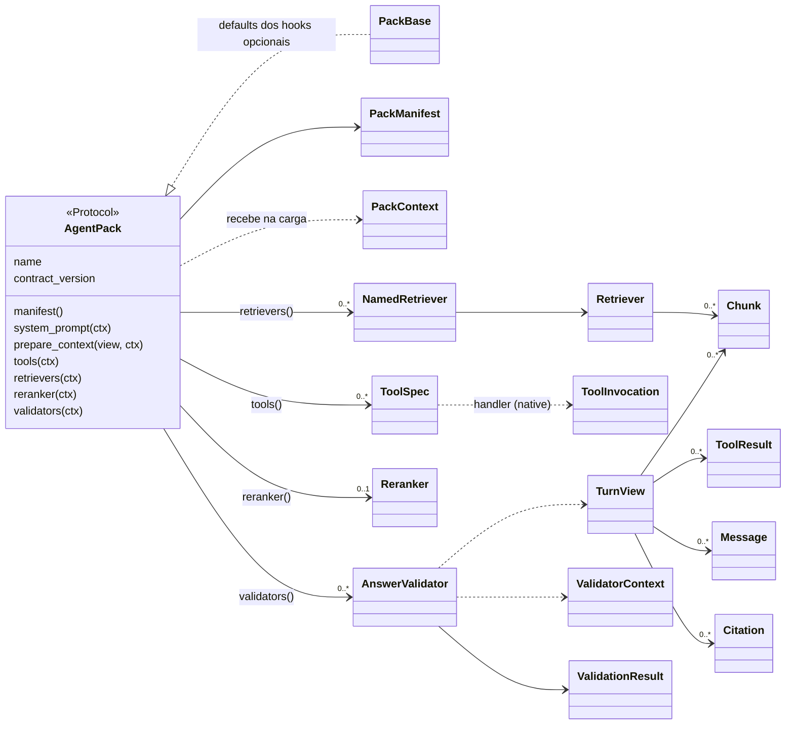
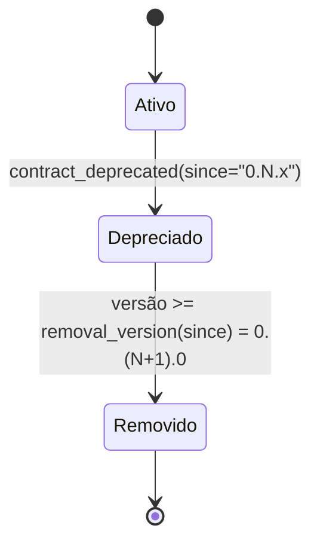

# Data Model — 001 Contratos públicos (`ai-core-contracts` 0.1)

**Plano**: [plan.md](plan.md) · **Decisões**: [research.md](research.md) · **Assinaturas**: [contracts/python-api.md](contracts/python-api.md)

Convenções que valem para todo value object:

- `dataclass(frozen=True, slots=True, kw_only=True)` — construção só por nome; campo novo com default é aditivo (R11).
- Na construção, sequências viram `tuple`, conjuntos viram `frozenset` e mapeamentos viram `MappingProxyType` sobre
  cópia, em profundidade. Nenhum value object tem caminho de mutação.
- `JSONValue` = `str | int | float | bool | None | Sequence[JSONValue] | Mapping[str, JSONValue]`.
- Invariantes estruturais são checados no `__post_init__` (`ValueError`/`TypeError`). Regras de declaração do pack
  (nomes, duplicatas, colisões) ficam em `check_declaration` (R13) e produzem `ContractIssue`, não exceção.

## Visão geral

## Pack

### AgentPack (Protocol) — FR-002, FR-003

| Membro | Tipo | Obrigatório | Quando o core chama |
|---|---|---|---|
| `name` | `str` | sim | carga |
| `contract_version` | `str` (`X.Y` ou `X.Y.Z`) | sim | carga, antes de instanciar hooks (compat) |
| `manifest()` | `→ PackManifest` | sim | carga |
| `system_prompt(ctx)` | `PackContext → str \| None` | não (default `None`) | carga, uma vez |
| `prepare_context(view, ctx)` | `async (TurnView, PackContext) → Mapping[str, JSONValue]` | não (default `{}`) | a cada execução |
| `tools(ctx)` | `PackContext → Sequence[ToolSpec]` | não (default `()`) | carga, uma vez |
| `retrievers(ctx)` | `PackContext → Sequence[NamedRetriever]` | não (default `()`) | carga, uma vez |
| `reranker(ctx)` | `PackContext → Reranker \| None` | não (default `None`) | carga, uma vez |
| `validators(ctx)` | `PackContext → Sequence[AnswerValidator]` | não (default `()`) | carga, uma vez |

- **Opcionalidade** (R7): `PackBase` implementa todos os hooks opcionais com o default da tabela. Packs herdam de
  `PackBase`; a conformidade exige a forma completa de `AgentPack`.
- **Ciclo de vida** (FR-019): `descoberto → compatível? → manifest válido? → hooks de catálogo chamados uma vez →
  declaração válida? → carregado`. O que os hooks de catálogo devolvem vale para todas as execuções; só
  `prepare_context` (e os validators e retrievers produzidos na carga) roda por execução. Falhar em qualquer etapa é
  "não carrega" — decisão da 002; a 001 fornece as regras (`check_compatibility`, `check_declaration`).
- **Retorno de `prepare_context`** (FR-010, FR-012): **atualização rasa** da própria fatia — as chaves devolvidas
  substituem as da fatia e as ausentes permanecem. Os valores são JSON. A chave reservada `retrieval_filters`
  (`RETRIEVAL_FILTERS_KEY`) carrega um `Mapping[str, JSONValue]` repassado de forma opaca como `filters` aos retrievers
  **deste** pack.

### PackBase

Classe concreta sem estado. Implementa só os hooks opcionais; `name`, `contract_version` e `manifest` ficam por conta do
pack. Hook opcional novo, numa versão futura, entra aqui com default — é o que o torna aditivo (R7).

### PackManifest — FR-002

| Campo | Tipo | Default | Regras |
|---|---|---|---|
| `name` | `str` | — | igual a `AgentPack.name` (`manifest.name_mismatch`) |
| `version` | `str` | — | versão do pack, PEP 440 do subconjunto (R5) |
| `preferred_flow` | `str \| None` | `None` | nome de flow; não vazio se presente; o Assistant pode sobrescrever |
| `depends_on` | `Sequence[str]` | `()` | nomes de packs cujas fatias este pack lê; sem repetição; sem o próprio nome. Ciclos entre packs são da 002 |
| `requires_collections` | `Sequence[str]` | `()` | coleções que a instalação precisa ter; sem repetição (`manifest.duplicate_collection`) |
| `config_schema` | `Mapping[str, JSONValue] \| None` | `None` | JSON Schema; checagem estrutural (R14) |

### PackContext e ValidatorContext — FR-008, FR-019

| Tipo | Campos | Uso |
|---|---|---|
| `PackContext` | `pack_name: str`, `config: Mapping[str, JSONValue] = {}` | hooks do pack |
| `ValidatorContext` | `pack_name: str`, `config: Mapping[str, JSONValue] = {}` | `AnswerValidator.validate` |

`config` já foi validada pelo core contra `config_schema`. Nenhum dos dois expõe serviço; os tipos são distintos para que
um serviço futuro no `PackContext` nunca alcance validators.

## Tools

### ToolSpec — FR-004

| Campo | Tipo | Default | Regras |
|---|---|---|---|
| `name` | `str` | — | local; não vazio. Para tools de pack: `^[a-z][a-z0-9_]{0,47}$` (R15) |
| `description` | `str` | — | não vazio |
| `parameters` | `Mapping[str, JSONValue]` | — | JSON Schema; em tool de pack, `type: "object"` no topo (R14) |
| `kind` | `Literal["retrieval", "mcp", "native"]` | — | — |
| `mutates` | `bool` | `False` | tool de escrita (política na 004) |
| `handler` | `NativeHandler \| None` | `None` | **invariante** (construção): não `None` ⇔ `kind == "native"`; ser assíncrono é verificado por `check_declaration` (`tool.handler.not_async`) |

Origem por `kind`: `native` → `AgentPack.tools()`; `retrieval` → `retrieval_tool_spec(named_retriever)`; `mcp` →
`MCPClient.discover_tools`. O namespacing (`<pack>.<nome>`) é do core.

### ToolInvocation — R10

| Campo | Tipo | Regras |
|---|---|---|
| `arguments` | `Mapping[str, JSONValue]` | já validados pelo gateway contra `parameters` |
| `request_id` | `str` | não vazio |
| `reference_time` | `datetime` | com fuso (*aware*); o mesmo da Turn View da execução |

`NativeHandler = Callable[[ToolInvocation], Awaitable[object]]` — devolve o **conteúdo**; o gateway (004) monta o
`ToolResult`.

### ToolResult — FR-005

| Campo | Tipo | Default | Regras |
|---|---|---|---|
| `content` | `object` | — | congelado em profundidade quando é contêiner |
| `untrusted` | `bool` | `True` | conteúdo de tool é sempre dado, nunca instrução (princípio VI) |
| `truncated` | `bool` | `False` | marca visível de truncamento (aplicada pela 004) |
| `error` | `str \| None` | `None` | mensagem de erro; `content` pode ser `None` nesse caso |

## Recuperação

### Retriever (Protocol) — FR-006

`async search(query: str, *, top_k: int = 20, filters: Mapping[str, JSONValue] | None = None) → Sequence[Chunk]`.
`filters` vem só de `retrieval_filters` da fatia do próprio pack; o modelo nunca escolhe filtros.

### NamedRetriever — FR-006

| Campo | Tipo | Regras |
|---|---|---|
| `name` | `str` | `^[a-z][a-z0-9_]{0,47}$`; único no pack; sem colisão com nome de tool nativa do mesmo pack |
| `description` | `str` | não vazio; vira a descrição da tool `retrieval` |
| `collections` | `frozenset[str]` | **invariante**: não vazio. O retriever só entra no catálogo se todas estiverem no grant (004) |
| `retriever` | `Retriever` | precisa ter `search` assíncrono |

`retrieval_tool_spec(named) → ToolSpec(kind="retrieval", name=named.name, description=named.description,
parameters=RETRIEVAL_TOOL_PARAMETERS, mutates=False, handler=None)`.

`RETRIEVAL_TOOL_PARAMETERS`: objeto com `query` (string não vazia, obrigatória) e `top_k` (inteiro ≥ 1, opcional),
sem propriedades adicionais.

### Reranker (Protocol) — FR-007

`async rerank(query: str, documents: Sequence[Chunk], *, top_k: int = 5) → Sequence[Chunk]` — no máximo `top_k`,
reordenados, cada um vindo de `documents` (verificado pela conformidade: `reranker.contract`).

### Chunk — FR-006, princípio IX

| Campo | Tipo | Default | Regras |
|---|---|---|---|
| `chunk_id` | `str` | — | estável e determinístico; não vazio |
| `text` | `str` | — | — |
| `score` | `float` | — | — |
| `document` | `str` | — | não vazio |
| `version` | `str \| None` | `None` | versão do documento |
| `status` | `str \| None` | `None` | vigência; semântica definida pelo pack |
| `section` | `str \| None` | `None` | — |
| `page` | `int \| None` | `None` | ≥ 1 se presente |
| `metadata` | `Mapping[str, JSONValue]` | `{}` | — |

## Turn View — FR-009, ADR-011, ADR-013

| Campo | Tipo | Default | Regras |
|---|---|---|---|
| `request_id` | `str` | — | não vazio |
| `assistant` | `str` | — | não vazio |
| `reference_time` | `datetime` | — | **com fuso**; o mesmo em toda Turn View da execução; packs usam este valor, nunca o relógio |
| `question` | `str` | — | — |
| `messages` | `Sequence[Message]` | `()` | histórico da conversa |
| `retrieved` | `Sequence[Chunk]` | `()` | — |
| `reranked` | `Sequence[Chunk]` | `()` | — |
| `generation_context` | `Sequence[Chunk]` | `()` | chunks **efetivamente entregues à geração** (base da verificação de citação) |
| `tool_results` | `Sequence[ToolResult]` | `()` | — |
| `answer` | `str \| None` | `None` | — |
| `citations` | `Sequence[Citation]` | `()` | citações correntes (após validators anteriores, quando houver) |
| `own_slice` | `Mapping[str, JSONValue]` | `{}` | fatia do pack que recebe a view |
| `dependency_slices` | `Mapping[str, Mapping[str, JSONValue]]` | `{}` | só packs em `manifest.depends_on` (o recorte é da 002) |

- Imutável em profundidade (R11). Dois produtores com os mesmos dados — fixture e motor — geram objetos iguais (`==`).
- Não existe campo que exponha fatias de packs fora de `depends_on`: a fatia de B está ausente, não "negada" (US4
  cenário 2).
- Campo novo entra com default — aditivo (patch em 0.x).

### Message (TypedDict, chaves `ReadOnly`) — R12

| Chave | Tipo | Obrigatória |
|---|---|---|
| `role` | `str` (`"system"`, `"user"`, `"assistant"`, `"tool"`) | sim |
| `content` | `str` | sim |

### Citation (TypedDict, chaves `ReadOnly`) — R12

| Chave | Tipo | Obrigatória |
|---|---|---|
| `chunk_id` | `str` | sim |
| `document` | `str` | não |
| `version` | `str \| None` | não |
| `status` | `str \| None` | não |
| `section` | `str \| None` | não |
| `page` | `int \| None` | não |

## Validação de resposta

### AnswerValidator (Protocol) — FR-008

`name: str` (`^[a-z][a-z0-9_]{0,47}$`, único no pack) e
`async validate(view: TurnView, ctx: ValidatorContext) → ValidationResult`. Determinístico: mesma entrada, mesmo resultado
(a conformidade roda duas vezes e compara).

### ValidationResult — FR-008

| Campo | Tipo | Default | Significado |
|---|---|---|---|
| `ok` | `bool` | — | aprovado |
| `issues` | `Sequence[str]` | `()` | problemas encontrados |
| `answer` | `str \| None` | `None` | resposta modificada (ex.: aviso acrescentado); `None` = sem mudança |
| `citations` | `Sequence[Citation] \| None` | `None` | citações após remoções; `None` = sem mudança |
| `flags` | `frozenset[str]` | `frozenset()` | marcações (ex.: `ungrounded`, `non_current_source`) |

## Contratos de serviço (provisórios até a tag — R21, R22)

| Tipo | Forma |
|---|---|
| `LLMProvider` | `async chat(messages: Sequence[ChatMessage], model: str, *, tools: Sequence[ChatTool] \| None = None, response_format: Mapping[str, JSONValue] \| None = None, stream: bool = False) → ChatResponse \| AsyncIterator[ChatChunk]` (overloads por `stream`) |
| `ChatMessage` | `role`, `content: str \| None`; opcionais `name`, `tool_calls: Sequence[ChatToolCall]`, `tool_call_id` |
| `ChatTool` | `name`, `description`, `parameters` (JSON Schema) |
| `ChatToolCall` | `id`, `name`, `arguments` (texto JSON) |
| `ChatUsage` | `prompt_tokens`, `completion_tokens` |
| `ChatResponse` | `message: ChatMessage` (papel `assistant`), `finish_reason: str`; opcionais `usage`, `model` |
| `ChatChunk` | `delta: str`; opcionais `tool_calls`, `finish_reason` e `usage` (no último) |
| `MCPClient` | `async discover_tools(aliases: Sequence[str]) → Sequence[ToolSpec]`; `async execute(alias: str, tool: str, arguments: Mapping[str, JSONValue]) → ToolResult` — só aliases já autorizados, nunca endereços |

## Versões e compatibilidade — FR-016, FR-018 ([contracts/compatibility.md](contracts/compatibility.md))

| Tipo | Campos / forma | Regras |
|---|---|---|
| `Version` | `release: tuple[int, ...]`, `pre: tuple[str, int] \| None`, `dev: int \| None` | subconjunto PEP 440 (R5); ordem total; `0.1 == 0.1.0` |
| `VersionRange` | cláusulas `(operador, versão[, curinga])` | `contains(v)`; `violated_by(v)`; `str()` canônico `>=0.1,<0.2` |
| `Compatibility` | `ok`, `installed`, `required`, `violated`, `message` | `message` = `requer ai-core-contracts<cláusula>, instalado <versão>` quando `ok` é falso |
| `ChangeKind` | `none` · `additive` · `breaking` | classificação de mudança de superfície |
| `BumpKind` | `none` · `patch` · `minor` · `major` | `required_bump` × `declared_bump` |

## Depreciação — R16

Ciclo de vida de um símbolo:

Enquanto depreciado, o uso emite `ContractDeprecationWarning` com `since` e a versão de remoção; a conformidade o reporta
como `deprecation.used` (*warning*). O objeto carrega `__contract_deprecated_since__`, e o CI barra a remoção de símbolo
que não passou por este estado (ADR-014).

## Issues — R13, [contracts/testing-kit.md](contracts/testing-kit.md)

### ContractIssue

| Campo | Tipo | Regras |
|---|---|---|
| `code` | `str` | estável; faz parte da superfície pública (lista em testing-kit.md) |
| `message` | `str` | legível, em português, nomeia o elemento |
| `subject` | `str \| None` | elemento afetado (ex.: `tool:search`, `retriever:docs`) |
| `severity` | `Literal["error", "warning"]` | `error` impede a carga (002) e reprova a conformidade |

### ConformanceReport (kit de testes)

`pack_name: str`, `issues: tuple[ContractIssue, ...]`; `ok` é verdadeiro quando não há issue `error`.

## Forma planejada, fora da 0.1 — US5 (R23)

Entra como hook opcional novo com default em `PackBase` (aditivo):

| Tipo | Forma (design.md) |
|---|---|
| `AgentPack.routine(ctx)` | `PackContext → PackRoutine \| None`, chamado na carga |
| `PackRoutine` | `reads: frozenset[str]` (campos da Turn View), `writes: frozenset[str]`; `async run(inputs, own_slice, limits) → RoutineResult` |
| `RoutineLimits` | `max_iterations: int`, orçamento herdado do Assistant |
| `RoutineResult` | `own_slice`, `outputs` (só chaves de `writes`), `truncated: bool` |
