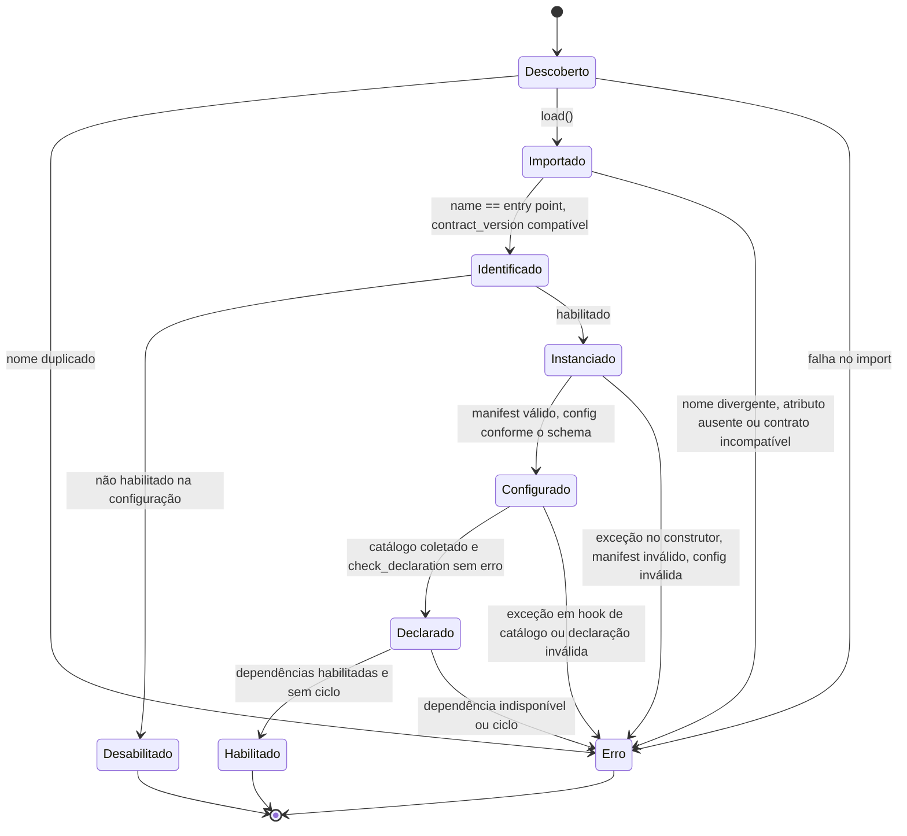

# Data Model — 002 Pack Runtime

**Plano**: [plan.md](plan.md) · **Decisões**: [research.md](research.md) · **Assinaturas**: [contracts/](contracts/)

Value objects são `dataclass(frozen=True, slots=True, kw_only=True)`, como na 001. Tipos da 001 (`TurnView`,
`PackContext`, `ValidatorContext`, `ValidationResult`, `JSONValue`...) vêm da API pública de `ai_core_contracts`.

## Portas secundárias (`ports.py`)

### DiscoveredPack

| Campo | Tipo | Regras |
|---|---|---|
| `name` | `str` | nome do entry point no grupo `ai_core.packs` |
| `distribution` | `str` | distribuição que registra o entry point |
| `version` | `str` | versão da distribuição |
| `load` | `Callable[[], object]` | importa e devolve o objeto apontado pelo entry point (a classe do pack); pode levantar |

### PackSettings

| Campo | Tipo | Default | Regras |
|---|---|---|---|
| `enabled` | `bool` | `False` | pack ausente da configuração = não habilitado |
| `config` | `Mapping[str, JSONValue]` | `{}` | validada contra o `config_schema` do pack na carga |

| Porta | Operação | Falha |
|---|---|---|
| `PackSource` | `discover() -> Sequence[DiscoveredPack]` | — (erro de import aparece só ao chamar `load`) |
| `PackConfigSource` | `load() -> Mapping[str, PackSettings]` | `PackConfigError` para arquivo malformado ou chave desconhecida — a 011 para o boot |

## Seam Pack Registry (`api.py`)

### PackStatus

`StrEnum`: `enabled`, `disabled`, `error` (FR-006).

### PackEntry

| Campo | Tipo | Regras |
|---|---|---|
| `name` | `str` | igual ao nome do entry point (FR-017) |
| `version` | `str \| None` | versão da distribuição; `None` para pack não instalado |
| `contract_version` | `str \| None` | lida da classe; `None` se não foi possível ler |
| `origin` | `Literal["code", "declarative"]` | `code` na Fase 1 |
| `status` | `PackStatus` | — |
| `error` | `str \| None` | obrigatório quando `status == error`; nomeia etapa e causa |
| `capabilities` | `PackCapabilities \| None` | só para `enabled` |

### PackCapabilities

| Campo | Tipo |
|---|---|
| `system_prompt` | `bool` — o pack contribui fragmento de prompt |
| `tools` | `tuple[str, ...]` — nomes locais das tools nativas |
| `retrievers` | `tuple[RetrieverCapability, ...]` |
| `reranker` | `bool` |
| `validators` | `tuple[str, ...]` — na ordem declarada |
| `preferred_flow` | `str \| None` |
| `depends_on` | `tuple[str, ...]` |
| `requires_collections` | `tuple[str, ...]` |

`RetrieverCapability`: `name: str`, `collections: frozenset[str]`.

### Composition

`packs: tuple[str, ...]` — lista ordenada e validada por `PackRegistry.compose`. Não carrega instâncias de pack.

### Erros

| Erro | Base | Campos | Quando |
|---|---|---|---|
| `CompositionError` | `ValueError` | `packs: tuple[str, ...]`, mensagem | `compose` recusa a lista (R10) |
| `PackHookError` | `RuntimeError` | `pack: str`, `hook: str`, mensagem | hook levanta ou devolve valor fora do contrato em execução (FR-011) |
| `PackConfigError` | `ValueError` | mensagem | configuração do operador malformada |

## Seam Pack Hooks (`api.py`)

### ValidatorRun

`pack: str`, `validator: str`, `result: ValidationResult`.

### ValidationOutcome

| Campo | Tipo | Significado |
|---|---|---|
| `ok` | `bool` | todos os validators aprovaram |
| `answer` | `str \| None` | resposta depois de todos os validators |
| `citations` | `tuple[Citation, ...]` | citações depois de todos os validators |
| `flags` | `frozenset[str]` | união das marcações |
| `runs` | `tuple[ValidatorRun, ...]` | uma entrada por validator, na ordem de execução |

### Fatias

`slices: Mapping[str, Mapping[str, JSONValue]]` — fatia de cada pack da composição, mantida pelo motor entre os passos
da execução. `prepare` devolve o mapeamento novo; packs sem fatia começam com `{}`.

## Estado interno (`service.py`, não exposto)

`LoadedPack`: entrada, instância, `PackContext`, `ValidatorContext`, manifest e o catálogo coletado uma vez na carga
(`system_prompt`, tools, retrievers, reranker, validators).

## Ciclo de vida de um pack na carga (R5)

Pack citado na configuração e não instalado entra direto como `error: não instalado`. O registry é montado uma vez e é
imutável até o restart (FR-003).

## Mensagens de erro (formato)

Toda mensagem começa pela etapa, para o operador achar a causa em menos de 1 minuto (SC-004):

| Etapa | Exemplo |
|---|---|
| duplicado | `nome duplicado: 'x' registrado por dist-a e dist-b` |
| import | `falha ao importar: ModuleNotFoundError: No module named 'numpy'` |
| identidade | `entry point 'x' aponta para classe com name 'y'` · `classe sem atributo de classe 'contract_version'` |
| contrato | `requer ai-core-contracts>=0.2, instalado 0.1.0` (mensagem de `check_compatibility`) |
| instância | `falha ao instanciar: RuntimeError: ...` |
| manifest | `manifest inválido: manifest.name 'z' difere do nome do pack 'x'` |
| configuração | `configuração inválida em 'collection': 42 is not of type 'string'` |
| catálogo | `hook tools levantou ValueError: ...` · `declaração inválida: duas tools com o nome 'search'` |
| dependência | `depende de 'b', que está em erro` · `dependência circular: a → b → a` |
| instalação | `não instalado` |

## Fase 2 (US4) — sem entidades novas

`packs list` e `packs check` são projeções de `PackEntry`: nome, versão, versão de contrato, status e erro
([contracts/cli.md](contracts/cli.md)). Nenhum campo novo no registry.
