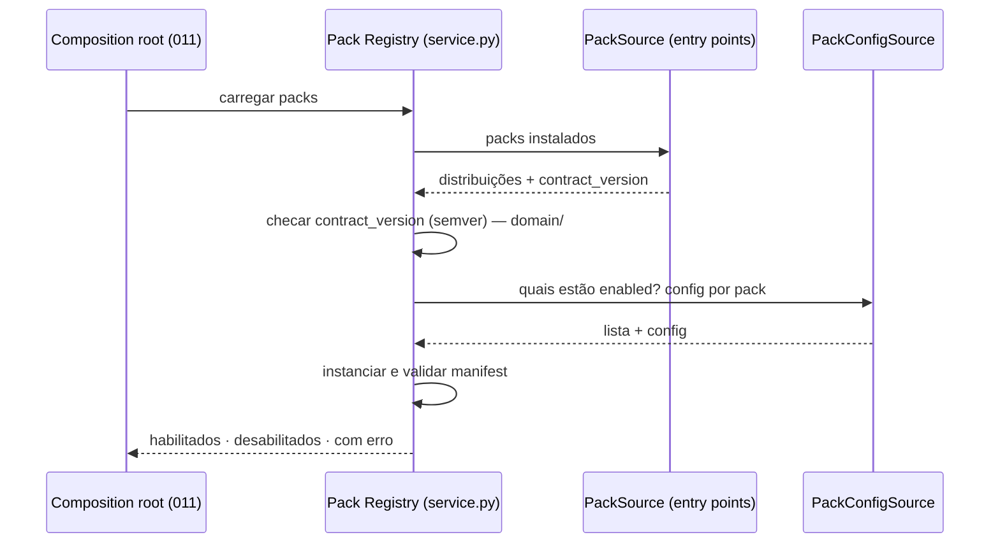

# Design — 002 Pack Runtime

> Insumo técnico pré-aprovado para `/speckit-plan`. Origem: arch-v1 §10, §11, §13, §14; ADR-003, ADR-009, ADR-011, ADR-012.

## Localização

```text
ai-core/packages/core/src/ai_core/packs/
├── api.py            # seams Pack Registry e Pack Hooks; Composition; status de pack
├── domain/           # compat de contract_version, namespacing, ordem, isolamento de fatia,
│                     # detecção de ciclo de dependência, validação de pack declarativo — puro
├── ports.py          # PackSource, PackConfigSource
├── service.py        # registry (carga fail-closed), composição, execução de hooks com recorte da Turn View
└── adapters/
    ├── entry_points.py   # PackSource: entry_points(group="ai_core.packs")
    ├── declarative.py    # PackSource: packs declarativos (YAML/banco)
    ├── config_yaml.py    # PackConfigSource: packs.yaml
    └── cli.py            # subcomandos `packs list | check` (a raiz `ai-core` é da spec 011)
```

## Os quatro níveis de extensão

| Nível | Mecanismo | Quem | Código? | Restart? | Onde vive |
|---|---|---|---|---|---|
| 1 | Assistant — compor packs, MCPs, coleções, prompt, política | usuário | não | não | banco (spec 003) |
| 2 | MCP server — capacidade nova em processo separado | usuário | não | não | banco (spec 007) |
| 3 | Pack declarativo — prompt + bindings de MCP + config | admin | não | não | banco/YAML |
| 4 | Code pack — entry point Python | operador | sim | sim | imagem |

> **MCP é o mecanismo de extensão do usuário. Python pack é o mecanismo de extensão do operador.**

## O pack se declara

```toml
# ai-scouting/pyproject.toml
[project]
name = "ai-scouting"
version = "0.1.4"
dependencies = ["ai-core-contracts>=0.1,<0.2"]   # nunca ai-core

[project.entry-points."ai_core.packs"]
scouting = "ai_scouting.pack:ScoutingPack"
```

## O core descobre



A validação dos Assistants contra os packs habilitados (003) e o restante da ordem de boot são da composition root
(spec 011); este módulo só oferece a operação de carga.

```yaml
# packs.yaml
packs:
  generic:   { enabled: true }
  scouting:  { enabled: true, config: { collection: scouting_docs } }
  financial: { enabled: false }          # instalado, desligado
```

## Introspecção

O Pack Registry fornece os dados; a rota HTTP é da spec 008.

```json
GET /private/v1/packs
[
  {"name": "scouting",  "version": "0.1.4", "contract": "0.1", "status": "enabled"},
  {"name": "generic",   "version": "0.3.1", "contract": "0.1", "status": "enabled"},
  {"name": "financial", "version": "0.3.0", "contract": "0.2", "status": "error",
   "error": "requer ai-core-contracts>=0.2, instalado 0.1"}
]
```

## CLI do operador

```bash
ai-core packs list             # o que está instalado e habilitado
ai-core packs check            # valida compatibilidade sem subir o servidor
ai-core assistants validate    # (spec 003) todo assistant referencia pack/MCP/coleção/flow que existe
```

`packs check` roda no build da imagem: incompatibilidade falha o build, não a produção. Os subcomandos `packs` moram
em `adapters/cli.py` deste módulo; a raiz `ai-core` que os registra é da spec 011.

## Composição

```text
tools        → união dos catálogos, namespaced ("<pack>.<tool>")
retrievers   → união, namespaced
prompts      → concatenação na ordem declarada pelo Assistant
prepare_ctx  → execução em sequência, fatias isoladas (retorno → merge em packs[name])
validators   → execução em sequência
flow         → o Assistant escolhe; não é derivado
```

Isolamento de estado entre packs (arch-v1 §6, ajustado pelo ADR-011):

- Um pack escreve **apenas** na própria fatia — agora por construção: o hook *retorna* a atualização.
- Um pack lê a fatia de outro **apenas** se declarar dependência no manifest; a Turn View entregue a ele só contém essas fatias.
- Violação é erro de carregamento, não de runtime.

## Pack Hooks — seam consumido pelo motor (spec 005)

Operações que o motor chama, sem conhecer packs individualmente:

```python
class PackHooks(Protocol):
    def system_prompts(self, composition) -> list[str]: ...
    async def prepare(self, composition, state_projection) -> dict[str, dict]: ...   # fatias por pack
    def reranker(self, composition) -> Reranker | None: ...
    async def validate(self, composition, state_projection) -> list[ValidationResult]: ...
    def routine(self, composition, pack: str) -> PackRoutine | None: ...
```

A projeção estado → Turn View é fornecida pelo motor; o Pack Hooks recorta a Turn View por pack (própria fatia + dependências).

## Pack declarativo

```yaml
packs:
  financial:
    kind: declarative
    system_prompt: |
      Você tem acesso a dados financeiros da organização.
      Sempre informe o período de referência dos valores.
    mcp_bindings:
      - alias: finance
        expose: [get_transactions, get_balance]     # allowlist explícita
        namespace: finance
    flow: agentic
    validators:
      - kind: required_fields
        fields: [period]
```

Um pack declarativo não pode: transformar documentos, implementar retriever próprio, ou rodar lógica condicional.

## Deployment (repositório de instalação)

O core não instala packs. **O deployment instala; o core descobre.**

```text
minha-instalacao/
├── Dockerfile
├── docker-compose.yml
├── assistants.yaml
├── packs.yaml
└── .env                    # segredos, fora do git
```

```dockerfile
FROM ghcr.io/caio/ai-core:0.3.1
# a imagem do core já traz ai-core-contracts e ai-generic

ARG PACKS="\
  ai-scouting@git+https://github.com/caio/ai-scouting@v0.1.4 \
"

RUN uv pip install --system ${PACKS} \
 && ai-core packs check          # falha o build se houver incompatibilidade
```

```yaml
services:
  ai-core:
    build:
      context: .
      args:
        PACKS: "ai-scouting@git+https://github.com/caio/ai-scouting@v0.1.4"
    volumes:
      - ./assistants.yaml:/etc/ai-core/assistants.yaml:ro
      - ./packs.yaml:/etc/ai-core/packs.yaml:ro
    env_file: .env
    depends_on: [postgres, qdrant, ollama]
```

Adicionar um pack novo é acrescentar uma linha e rebuildar. Nenhum loader custom, nenhum venv gravável em runtime, nenhuma superfície de execução remota de código.

> Atualizado em 2026-10-07 ([ADR-022](../../docs/adr/ADR-022-instalacao-constroi-o-core-num-estagio-proprio.md)): não há
> imagem do core publicada — o Dockerfile da instalação (repositório `agentic-deploy`) constrói o core num estágio
> próprio a partir da tag do `agentic-app`, instala os packs por cima, roda `packs check` e entrega um estágio de
> runtime sem instalador. Os packs privados entram por montagem SSH do BuildKit, sem credencial em camada da imagem.

### Fase 9: com ou sem console, sem Keycloak ([ADR-029](../../docs/adr/ADR-029-console-de-administracao-propria.md), [ADR-030](../../docs/adr/ADR-030-a-plataforma-e-o-provedor-de-identidade.md), [ADR-033](../../docs/adr/ADR-033-segredos-de-runtime-cifrados-com-a-chave-mestra.md))

- **Dockerfile:** estágios novos `console-build` (`node:24-bookworm-slim`, copia `ai-core/console` do estágio `core`,
  `npm ci && npm run build`) e `console` (`nginx-unprivileged`, sistema de arquivos somente leitura, `nginx.conf`
  da 013). A console sai da mesma tag `CORE_REF` da plataforma.
- **Compose:** `postgres` (volume próprio) entra em toda instalação, com ou sem interface, e o `ai-core` passa a
  `AI_CORE_PROFILE=persistent` (clarificação de 2026-10-13). Perfil `webui` = Open WebUI apontado para a plataforma
  (`OPENID_PROVIDER_URL={AI_CORE_PUBLIC_URL}/.well-known/openid-configuration`, cliente confidencial `open-webui`); o
  serviço `keycloak`, o volume `keycloak-data` e `config/keycloak/` saem. A sessão do Open WebUI (`JWT_EXPIRES_IN`) fica
  um pouco abaixo dos 30 dias da sessão do provedor (012, clarificação de 2026-10-13), como era 8 h contra 10 h. Perfil novo `console` = o serviço da console,
  publicado na porta da instalação; com ele, `AI_CORE_PUBLIC_URL` é a origem da console.
- **Configuração:** `config/identity.yaml` (clientes `open-webui` e `console`, endereços exatos); `.env.example`
  dividido em seções "sem console" (com `AI_CORE_LANGFUSE_*`) e "com console" (sem elas), mais `AI_CORE_MASTER_KEY`,
  `AI_CORE_BOOTSTRAP_ADMIN_*`, `AI_CORE_GOOGLE_*`, `AI_CORE_IDENTITY_SECRET_OPEN_WEBUI`, `AI_CORE_USAGE_TIMEZONE`;
  `assistants.yaml` de exemplo com `overrides` num Assistant.
- **Provas:** `scripts/check-webui.py` entra pelo formulário da plataforma (no lugar do Keycloak); `scripts/check-console`
  (Playwright ou biblioteca padrão) entra com o admin inicial e grava uma sobreposição de modelo.
- **Migração da Fase 7:** contas do Open WebUI ligadas ao `sub` do Keycloak — `OAUTH_MERGE_ACCOUNTS_BY_EMAIL=true` ou
  volume novo do Open WebUI; as pessoas são cadastradas na plataforma (`ai-core users create`).
- Detalhes (parâmetros do Open WebUI v0.12, nomes de perfil) ficam para o research do plano, na sequência das R36–R41.

## Portas e adapters **[ADR-012]**

| Porta | Tipo | Adapters por fase | Teste |
|---|---|---|---|
| Pack Registry | primária (seam, `api.py`) | `service.py` | suíte de conformidade do seam |
| Pack Hooks | primária (seam, `api.py`) | `service.py` | suíte de conformidade do seam (isolamento de fatia) |
| `PackSource` | secundária | entry points (Fase 1); + declarativo (P3) | fonte em memória com packs de teste |
| `PackConfigSource` | secundária | `packs.yaml` (Fase 1) | configuração em memória |

Núcleo funcional (`domain/`): regra de compatibilidade de `contract_version`, namespacing, ordem de composição,
recorte de fatias por dependência declarada e detecção de ciclos — tudo testável sem pack real.
