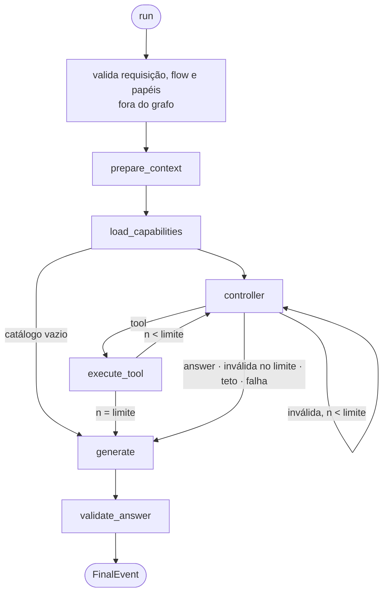

# Contrato — topologia `agentic` (Fase 3, US2)

Interno do módulo, como o [chat-flow.md](chat-flow.md): **nomes de nó e forma do estado não são contrato** (ADR-011).
O que precisa continuar verdadeiro é a sequência de efeitos observáveis, a quem cada etapa delega e as regras de
`domain/`. Decisões em [research.md](../research.md) R14–R33.



## Etapas

| Etapa | Delega a | Emite | Spec dona |
|---|---|---|---|
| validação | `domain/request.py` + `flows()` + `for_role` de cada papel do flow | nada — levanta se inválida | 005 / 006 |
| `prepare_context` | `PackHooks.prepare` | `ProgressEvent("prepare_context")` | 002 |
| `load_capabilities` | `Capabilities.open(grant, ToolContext)` | `ProgressEvent("load_capabilities")`; `McpUnavailable` (`error`) por alias em `session.unavailable` | 004 |
| `controller` | `domain/budget.py` (teto) → `for_role("controller").complete(..., response_format=…)` → `domain/actions.py` (leitura) → `domain/limits.py` (rota) | `ProgressEvent("controller", "iteração <n>")`; `ControllerDecision` | 005 / 006 |
| `execute_tool` | `ToolSession.execute(ToolCall)` | `ProgressEvent("execute_tool", <nome>)` | 004 |
| `generate` | `domain/transcript.py` + `domain/budget.py` (omissão) → `for_role("generation").stream` | `ProgressEvent("generate")`, `TokenEvent` | 006 / 002 |
| `validate_answer` | `PackHooks.validate` | `ProgressEvent("validate_answer")`, `ValidationRun` | 002 |
| montagem do final | `domain/outcome.py` | `FinalEvent` | 005 |

## A ação (FR-005)

Formato pedido ao provider (`response_format`):

```json
{"type": "json_schema", "json_schema": {"name": "controller_action", "schema": {"anyOf": [
  {"type": "object", "properties": {"action": {"const": "answer"}},
   "required": ["action"], "additionalProperties": false},
  {"type": "object", "properties": {"action": {"const": "tool"}, "name": {"const": "generic.calculate"},
                                    "arguments": {"type": "object", "properties": {"expression": {"type": "string"}},
                                                  "required": ["expression"]}},
   "required": ["action", "name", "arguments"], "additionalProperties": false}
]}}}
```

Um ramo `tool` por tool do catálogo, na ordem de `session.tools`. Parâmetros saneados: sem `pattern` nem
`patternProperties`; esquema com `$ref` em qualquer ponto vira `{"type": "object"}` (R17). O gateway valida os
argumentos de verdade.

Leitura (`parse_action`): `ToolAction`, `AnswerAction` ou `InvalidAction(reason)`. Inválida = conteúdo vazio, JSON
malformado, raiz não objeto, `action` desconhecida, `name` vazio ou não texto, `arguments` não objeto. Nome fora do
catálogo **não** é inválido — o gateway responde "tool inexistente" (R18).

## Mensagens (R19)

**Controller**:

1. sistema: instrução do controller (do core, sem domínio), o catálogo — uma linha por tool com nome, descrição e
   parâmetros em JSON compacto — e a `FENCE_INSTRUCTION` (004);
2. as mensagens da requisição;
3. a transcrição: por tool executada, `assistant` com `tool_calls=[{id: "call-<n>", name, arguments}]` e `tool` com
   `tool_call_id="call-<n>"` e o texto **cercado** do gateway; por ação inválida, um `user` do motor com o motivo.

**Geração**: fragmentos de `system_prompts` da composição; a `FENCE_INSTRUCTION` numa mensagem de sistema a mais, só
se a transcrição tiver resultado; as mensagens da requisição; a transcrição. Transcrição vazia → exatamente as
mensagens do `chat`.

## Limite (FR-006, R20)

Iteração = chamada ao controller. Limite = `grant.limits.max_iterations` ou **3**.

| Decisão na iteração `n` | `n < limite` | `n == limite` |
|---|---|---|
| `tool` | executa → controller | executa → geração + `IterationLimit` |
| inválida | `InvalidAction` → controller | `InvalidAction` → geração + `IterationLimit` |
| `answer` | geração | geração |
| falha do modelo | geração + `ModelCallFailed` (`error`) | idem |

Nunca há chamada ao controller de número `limite + 1` (SC-002).

## Teto de contexto (FR-011, R22)

Só quando `grant.limits.max_context_tokens` está declarado. Estimativa: `ceil(caracteres / 3) + 4` por mensagem.

1. Antes de cada chamada ao controller: estimativa das mensagens do controller > teto → não chama; `ContextLimit` e
   `ControllerDecision(action="limit", reason="context")`; vai à geração.
2. Antes da geração: estimativa > teto → troca o conteúdo do resultado de tool mais antigo por
   `[resultado omitido: teto de contexto]`, repete até caber; `ContextTrimmed` com a contagem. Se nem assim couber,
   `ContextOverflow` e gera mesmo assim — histórico de conversa não é cortado nesta fase.

## Turn View (FR-010, R26)

| Campo | `prepare` | `validate` |
|---|---|---|
| `tool_results` | vazio | um `ToolResult` (001) por resultado entregue à geração, na ordem: conteúdo = texto cercado, `untrusted=True`, `truncated` e `error` do gateway |
| `retrieved` | vazio | chunks de todos os resultados de recuperação |
| `generation_context` | vazio | chunks dos resultados de recuperação que ficaram no contexto da geração |
| `reranked` | vazio | vazio |
| demais | como no `chat` | como no `chat` |

## Trace (FR-016, R24)

| Momento | Evento | Emissor |
|---|---|---|
| ao abrir a sessão, por MCP indisponível ou esquema inválido | `ExecutionError(stage="catalog")` | 004 |
| por chamada ao controller e à geração | `ModelCall` (papel `controller` / `generation`) | 006 |
| por decisão do controller | `ControllerDecision(iteration, action, tool?, reason?)` | 005 |
| ao parar por limite ou teto | `ControllerDecision(action="limit", reason="iterations" \| "context")` | 005 |
| por execução de tool | `ToolCall` | 004 |
| falha do controller | `ExecutionError(stage="controller")` | 005 |
| como no `chat` | `ExecutionStarted`, `ValidationRun`, `ExecutionFinished` | 005 |

Nenhum evento leva argumentos de tool, conteúdo de resultado ou saída do modelo (ADR-017).

## Desfecho de etapa (ADR-028)

Cada etapa que emite `ProgressEvent` termina com um `StepFinished` antes da etapa seguinte; o desfecho de cada uma está
na tabela de [execution-engine.md](execution-engine.md), seção "Desfecho de etapa".

