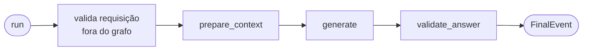

# Contrato — topologia `chat` (Fase 1)

Interno do módulo: descreve o que o flow da fase faz. **Nomes de nó e forma do estado não são contrato** (ADR-011) —
o que precisa continuar verdadeiro é a sequência de efeitos observáveis e a quem cada etapa delega.

## Etapas

| Etapa | Delega a | Emite | Spec dona |
|---|---|---|---|
| validação da requisição | `domain/request.py` (puro) + `flows()` | nada — levanta se inválida | 005 |
| `prepare_context` | `PackHooks.prepare(composition, view, slices)` | `ProgressEvent("prepare_context")` | 002 |
| `generate` | `ModelRouting.for_execution(...).for_role("generation").stream(...)` + `PackHooks.system_prompts` | `TokenEvent` por pedaço | 006 / 002 |
| `validate_answer` | `PackHooks.validate(composition, view, slices)` | `ProgressEvent("validate_answer")` | 002 |
| montagem do final | `domain/outcome.py` (puro) | `FinalEvent` | 005 |

A validação da requisição fica fora do grafo para que o erro apareça na chamada de `run`
([research.md](../research.md) R5). Tudo que é decisão do próprio motor — validar a requisição, montar o evento final —
é função pura de `domain/`, chamada pelo serviço ou pelos nós, nunca lógica dentro do grafo: é o que torna a reescrita
barata (SC-001).

## Mensagens enviadas ao modelo

1. uma mensagem de sistema por fragmento de `PackHooks.system_prompts(composition)`, na ordem da composição;
2. as mensagens da requisição, na ordem recebida.

O motor não reescreve, resume nem reordena o histórico nesta fase. Corte por orçamento de tokens entra na Fase 5, com
os chunks (`domain/budget.py`).

## Fatias de pack

`prepare` devolve as fatias novas da composição; elas ficam no estado e voltam em `validate`, na mesma execução. O
motor não lê nem interpreta o conteúdo de uma fatia — só a carrega (princípio I e 002).

## Turn View entregue aos hooks

| Campo | Valor no `chat` |
|---|---|
| `request_id`, `assistant` | da execução e do grant |
| `reference_time` | fixada uma vez no início, igual em toda Turn View da execução (ADR-013) |
| `question` | conteúdo da última mensagem de papel `user` |
| `messages` | as da requisição |
| `retrieved`, `reranked`, `generation_context`, `tool_results` | vazios — o `chat` não tem retrieval nem tools |
| `answer`, `citations` | vazios em `prepare`; preenchidos em `validate` |
| `own_slice`, `dependency_slices` | montados pela 002 a partir das fatias, por pack |

## Trace da execução

| Momento | Evento (009) |
|---|---|
| antes do primeiro evento | `ExecutionStarted` com assistant, flow, packs e `reference_time` |
| por validator | `ValidationRun` com pack, validator, resultado, issues e marcações |
| em qualquer falha | `ExecutionError` com etapa, classe e mensagem |
| ao encerrar (inclusive cancelado) | `ExecutionFinished` com desfecho e duração |

As chamadas de modelo são emitidas pela 006, que já instrumenta o cliente — o motor não as duplica
([research.md](../research.md) R10).

## Desfecho de etapa (ADR-028)

Cada etapa que emite `ProgressEvent` termina com um `StepFinished` antes da etapa seguinte; o desfecho de cada uma está
na tabela de [execution-engine.md](execution-engine.md), seção "Desfecho de etapa".

