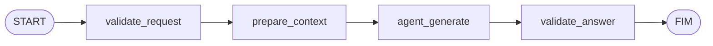
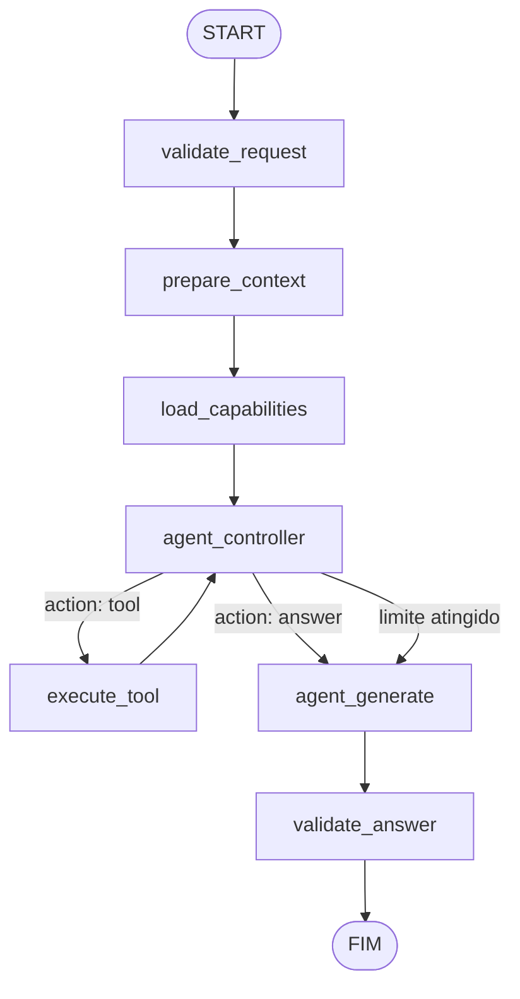
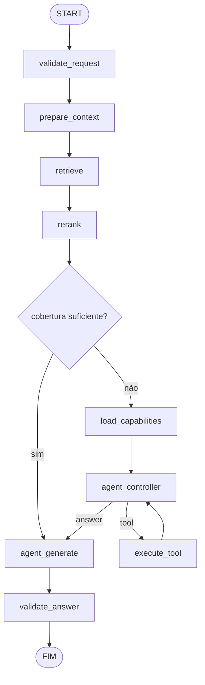
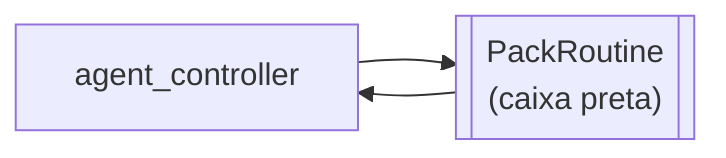

# Design — 005 Execution Engine

> Insumo técnico pré-aprovado para `/speckit-plan`. Origem: arch-v1 §6, §7, §8, §9, §25, §28; ADR-001, ADR-005, ADR-006, ADR-007, ADR-010, ADR-011, ADR-012, ADR-013.
> **Tudo neste arquivo abaixo da seção "Seams" é interno e pode ser reescrito livremente.**

## Seams (o que precisa sobreviver a uma reescrita)

```python
class ExecutionEngine(Protocol):
    def flows(self) -> frozenset[str]: ...                                   # nomes, usados por 003
    def run(self, grant: ExecutionGrant, request: ExecutionRequest) -> AsyncIterator[ExecutionEvent]: ...

ExecutionEvent = TokenEvent | ProgressEvent | FinalEvent
# FinalEvent: answer, citations, errors, flags
```

Dependências permitidas: `PackHooks` (002), `CapabilityCatalog`/`ToolGateway` (004), `ModelRouter` (006), Trace Sink (009), `TurnView`/`PackRoutine` (001). Os seams moram em `api.py`.

## Localização [ADR-012]

```text
ai-core/packages/core/src/ai_core/graph/
├── api.py          # seam ExecutionEngine; ExecutionRequest, ExecutionEvent; nomes de flow
├── domain/         # políticas puras — sobrevivem a qualquer reescrita do grafo
│   ├── gate.py         # portão de cobertura do rag_first
│   ├── limits.py       # contagem e limite de iteração, truncamento registrado
│   ├── actions.py      # esquema e validação da ação estruturada do controller
│   └── budget.py       # corte de contexto por orçamento de tokens (menor rank primeiro)
├── ports.py        # CheckpointStore, Clock
├── service.py      # implementa ExecutionEngine: fixa reference_time, monta o AgentContext a partir do grant
│                   # e delega ao adapter de fluxo
└── adapters/
    ├── langgraph/          # tudo que conhece LangGraph
    │   ├── state.py        # AgentState com reducers — PRIVADO [ADR-011]
    │   ├── view.py         # projeção AgentState → TurnView (contrato 001)
    │   ├── flows/          # chat.py · agentic.py · rag_first.py · registry.py
    │   ├── nodes/          # finos: cada nó chama um seam ou uma função de domain/
    │   └── runtime.py      # astream_events → ExecutionEvent
    ├── checkpoint_memory.py    # CheckpointStore — Fase 1 e testes
    └── checkpoint_postgres.py  # CheckpointStore — Fase 3 (pode embrulhar o checkpointer do LangGraph)
```

**Reescrever o grafo = trocar `adapters/langgraph/`.** `api.py`, `domain/` e seus testes permanecem; é o que torna o
SC-001 barato.

## Nós finos: cada nó delega a um seam

É esta tabela que torna o grafo reescrevível: a lógica vive nos serviços, o grafo só ordena.

> Atualizado em 2026-09-21 (plano da Fase 1, [research.md](research.md) R5): `validate_request` **não** é nó do grafo.
> A validação acontece em `service.run()`, antes de devolver o iterador, para que a 008 responda 4xx sem abrir o SSE —
> um nó só falharia depois do iterador já ter começado. A política continua pura, em `domain/request.py`.

| Nó (interno) | Delega a | Spec dona |
|---|---|---|
| ~~`validate_request`~~ (fora do grafo) | parâmetros, modelo (via Model Router), orçamento do grant | 005 / 006 / 003 |
| `prepare_context` | `PackHooks.prepare` | 002 |
| `load_capabilities` | `CapabilityCatalog` | 004 |
| `agent_controller` | `ModelRouter.for_role("controller")` + `catalog.for_controller()` | 006 / 004 |
| `execute_tool` | `ToolGateway.execute` | 004 |
| `retrieve` | tools de recuperação via `ToolGateway` (com filtros da fatia do pack) | 004 |
| `rerank` | `PackHooks.reranker` | 002 |
| `agent_generate` | `ModelRouter.for_role("generation")` + `PackHooks.system_prompts` | 006 / 002 |
| `validate_answer` | `PackHooks.validate` | 002 |

As decisões que são do próprio motor — portão de cobertura, limite de iteração, validação da ação, corte por orçamento
— também não ficam nos nós: são funções de `domain/`, chamadas pelos nós e pelas arestas condicionais.

## Estado interno (arch-v1 §6) — privado [ADR-011]

A versão anterior definia o estado como `TypedDict` plano sem reducers. Isso quebra com loop ou execução concorrente: `messages`, `tool_results` e `errors` são sobrescritos em vez de acumulados. Os reducers são obrigatórios.

```python
from typing import Annotated, TypedDict
import operator
from langgraph.graph.message import add_messages


class AgentState(TypedDict, total=False):
    # --- identidade (escrita uma vez) ---
    request_id: str
    principal: dict
    assistant: str
    flow: str

    # --- conversa ---
    messages: Annotated[list, add_messages]

    # --- controle do loop ---
    next_action: dict | None
    iteration: int
    iteration_limit: int

    # --- acumuladores (reducer obrigatório) ---
    tool_calls:   Annotated[list[dict], operator.add]
    tool_results: Annotated[list[dict], operator.add]
    errors:       Annotated[list[dict], operator.add]

    # --- retrieval (substituídos, não acumulados) ---
    retrieved: list[dict]
    reranked: list[dict]
    generation_context: list[dict]     # chunks efetivamente enviados à geração [ADR-007/011]

    # --- saída ---
    answer: str
    citations: list[dict]

    # --- fatias isoladas por pack ---
    packs: dict[str, dict]
```

### AgentContext (interno)

```python
@dataclass(frozen=True)
class AgentContext:
    llm: ModelRouter               # resolve modelo por papel (006)
    tools: CapabilityCatalog       # já filtrado pelo grant (004)
    gateway: ToolGateway           # (004)
    hooks: PackHooks               # (002)
    grant: ExecutionGrant          # (003)
    budget: Budget
```

`AgentContext` chega **já restrito**. O filtro por Assistant acontece na construção do contexto, não dentro dos nós.
Quem o constrói é o `service.py` deste módulo, por execução, a partir do grant e dos seams que a composition root
(spec 011) injetou no boot. O `AgentContext` continua interno: nenhum outro módulo o conhece.

### Data de referência [ADR-013]

No início de cada execução, o `service.py` fixa `reference_time` — pela porta `Clock` ou, numa execução de avaliação,
pelo valor fixado na requisição — e o repete em toda Turn View daquela execução.

```text
AgentState   → dados da execução
AgentContext → serviços e recursos disponíveis
```

## Topologias (arch-v1 §7)

### `chat` — sem tools, sem RAG



Topologia da Fase 1 e fallback quando nenhuma capacidade é necessária.

### `agentic` — loop de controller



A aresta `limite atingido` não é opcional: sem ela, o loop é ilimitado.

### `rag_first` — retrieval determinístico



Portão **determinístico**: score do melhor chunk abaixo de um limiar, ou nenhum resultado após os filtros do pack (no scouting, os filtros de vigência fazem "nenhum documento vigente" virar "nenhum resultado"). Não é pergunta ao LLM.

### Escape hatch: rotina de pack [ADR-011]



- Recebe e devolve apenas a fatia do pack mais campos declarados.
- Não consegue reconectar o grafo pai — não tem referência a ele.
- Limite de iteração e orçamento próprios, herdados do Assistant.
- Injeção arbitrária de nós e arestas no grafo pai não existe.

| Nível | O que o pack faz | Frequência esperada |
|---|---|---|
| 1 | Registra capacidades. Topologia intocada | ~90% |
| 2 | Seleciona um flow do conjunto enumerado | raro |
| 3 | Contribui uma rotina isolada | excepcional |

## Controller (arch-v1 §8, §9)

Emite **uma ação estruturada**, nunca um plano textual longo:

> Atualizado em 2026-10-01 (plano da Fase 3, [research.md](research.md) R17–R22): o formato é um `anyOf` com um ramo
> por tool do catálogo (nome como `const`, parâmetros saneados); a transcrição usa o formato nativo de tool
> (`assistant` com `tool_calls` + `tool` com o resultado cercado); limite padrão 3; teto de contexto do grant aplicado
> ao loop e à geração. Detalhes em [contracts/agentic-flow.md](contracts/agentic-flow.md).

```json
{ "action": "tool", "name": "scouting.search_docs", "arguments": { "query": "..." } }
```

```json
{ "action": "answer" }
```

| Requisito | Motivo |
|---|---|
| Saída estruturada via `response_format` | Modelo pequeno não produz JSON confiável sem constraint |
| `iteration` incrementado a cada passagem | Loop precisa ser observável |
| `iteration_limit` do Assistant | Sem limite, loop infinito é questão de tempo |
| Catálogo mínimo em contexto | Cada tool no prompt custa tokens e degrada a escolha |
| Modelo próprio (`controller`) | Modelo por papel (ADR-008) |

Ao atingir o limite, o controller não falha: transiciona para `agent_generate` com o que tem, e registra o truncamento em `errors`.

### O custo real (arch-v1 §9)

Hardware alvo 2 OCPU / 12 GB / ARM64, CPU-only, com `qwen3:1.7b`: **5–15 tokens/s**, e tool calling em 1.7B é nominalmente suportado mas **não confiável** — argumentos alucinados são frequentes. Consequências:

1. `rag_first` é o default do scouting, não `agentic`. O loop é a exceção.
2. Modelo por papel — controller pode rodar num modelo forte remoto enquanto a geração roda local.
3. Saída estruturada obrigatória no controller.
4. Catálogo mínimo — poucas tools em escopo por vez.
5. Limite de iteração baixo por default (3–4).

## Streaming (arch-v1 §25)

```text
astream(["custom", "values"]) → custom: token do agent_generate    → TokenEvent
                              → custom: etapa iniciada             → ProgressEvent
                              → último values                      → FinalEvent
```

> Atualizado em 2026-09-21 (plano da Fase 1, [research.md](research.md) R2): era `astream_events`, que pressupõe que a
> geração passe por um modelo do próprio framework. Não é o caso — o modelo vem do Model Router (006), pelo princípio
> XIII —, então não há evento de LLM a filtrar. O canal `custom` é a forma suportada de emitir de dentro de um nó e
> entrega o pedaço antes de o nó terminar, que é o que a SC-004 exige.

A tradução para SSE no formato OpenAI é da spec 008; o motor emite eventos neutros.

## Persistência (arch-v1 §28)

```text
execution state        → checkpointer, efêmero por natureza
conversation history   → domínio da aplicação, durável (spec 008)
```

| Dado | Porta | Adapter | Quando |
|---|---|---|---|
| Checkpoint de execução | `CheckpointStore` | memória → Postgres | Fase 1 → Fase 3 |

> Atualizado em 2026-10-01 (clarificação 1 da Fase 3, [research.md](research.md) R30): a porta não nasceu na Fase 1
> nem na Fase 3 — o loop roda inteiro dentro de uma requisição e nada lê o estado de volta. Entra com o primeiro
> consumidor de retomada (FR-014).

Sem motor de workflow durável (ADR-010).

## Portas e adapters **[ADR-012]**

| Porta | Tipo | Adapters por fase | Teste |
|---|---|---|---|
| Execution Engine | primária (seam) | `service.py` + `adapters/langgraph/` | suíte de conformidade do seam (eventos, limites, streaming) |
| Nomes de flow | primária (dado) | registro de flows do adapter | validação pela 003 |
| `CheckpointStore` | secundária | adiada até haver retomada (FR-014; nota em "Persistência") | em memória + conformidade contra Postgres |
| `Clock` | secundária | relógio do sistema (adapter único, injetado pela 011) | relógio fixo |

Consome por seam: Pack Hooks (002), Capability Catalog e Tool Gateway (004), Model Router (006), Trace Sink (009).
Testes do motor usam adapters em memória desses seams (controller e retriever simulados — US2 e US3).
