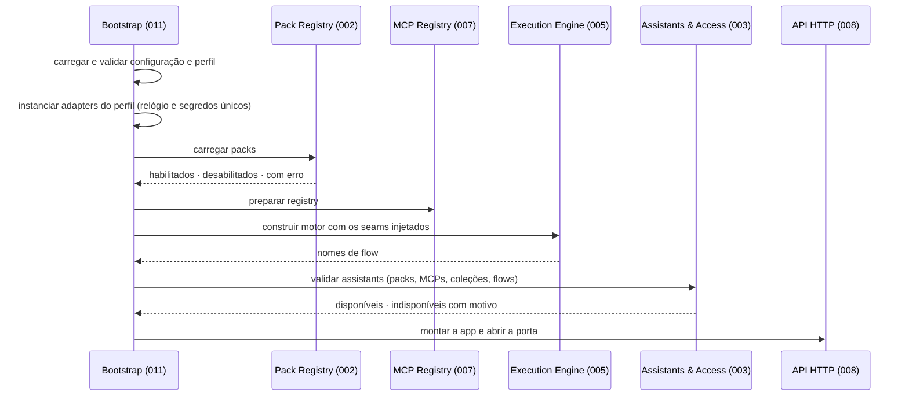

# Design — 011 Bootstrap (composition root)

> Insumo técnico pré-aprovado para `/speckit-plan`. Origem: ADR-012 (decisão 7), ADR-013; arch-v1 §13, §14;
> [relatório de estilo arquitetural](../../docs/relatorio-estilo-arquitetural.md), lacuna G6.
>
> Esta é a **única spec autorizada a conhecer serviços, portas secundárias e adapters de outros módulos**
> (princípio XIII). As tabelas abaixo derivam da seção "Portas e adapters" de cada `design.md`; se divergirem,
> vale o `design.md` do módulo dono.

## Localização

```text
ai-core/packages/core/src/ai_core/bootstrap/
├── settings.py     # configuração do operador: packs.yaml, assistants.yaml, perfil, ambiente
├── profiles.py     # perfis de adapter: porta → adapter (memory, persistent, test)
├── wiring.py       # constrói serviços e adapters e injeta seams; único import de service.py/adapters/ de outros módulos
├── lifecycle.py    # ordem de boot e de encerramento, falha fechada por etapa
├── health.py       # health agregado
└── cli.py          # raiz do comando `ai-core`; registra os subcomandos contribuídos pelos módulos
```

```toml
# ai-core/packages/core/pyproject.toml
[project.scripts]
ai-core = "ai_core.bootstrap.cli:main"
```

## Ordem de boot



- Falha de configuração ou de adapter obrigatório: o boot para antes da etapa seguinte.
- Pack, MCP ou Assistant inválido: fica indisponível com motivo; o boot segue (princípio VII).
- Encerramento: fecha a porta HTTP, aguarda execuções até o prazo e libera recursos na ordem inversa.
- Tarefas periódicas declaradas pelos módulos (ex.: expiração de conversas da 008) são agendadas ao fim do boot e
  canceladas no encerramento.
- O motor é construído antes da validação de Assistants porque a 003 valida nomes de flow (seam da 005). A
  construção do motor não depende de Assistants: o grant só chega por execução.

### Fase 9 ([ADR-030](../../docs/adr/ADR-030-a-plataforma-e-o-provedor-de-identidade.md) a [ADR-034](../../docs/adr/ADR-034-trace-com-destinos-e-conteudo-opcional.md))

`configuration` (inclui `AI_CORE_MASTER_KEY`, identidade e Langfuse; emissor único) → `adapters` (+ migrações de
`identity` e `observability`) → **`identity`** (crítica quando ligada: chave de assinatura, admin inicial, grupo de
administração protegido) → `packs` → `mcp_registry` → `engine` (Trace Sink com os destinos) → `assistants` (com o
`SystemOverrideStore` e o `JwksSource` em processo) → `api` (`create_app` com as rotas de administração e
`app.include_router` do adapter HTTP da 012). Tarefas do ciclo de vida: esvaziar o uso (2 s), expurgo da identidade,
retenção do uso; no encerramento e no `Platform.aclose()`, esvaziar os destinos.

## O que a 011 constrói e injeta

A 011 importa o `api.py`, o `service.py` e os `adapters/` de cada módulo. Nenhum outro módulo faz isso.

| Módulo | Recebe seams de | Recebe adapters para |
|---|---|---|
| 002 Pack Runtime | — | `PackSource`, `PackConfigSource` |
| 007 MCP | — | `McpServerStore`, `SecretResolver`, `McpTransport`, `DnsResolver`, `DiscoveryCache` |
| 006 LLM | 009 (Trace Sink) | adapters de `LLMProvider`, `SecretResolver` |
| 004 Capability Gateway | 002 (Pack Registry), 007 (cliente restrito), 009 (Trace Sink) | `AuditLog` |
| 005 Execution Engine | 002 (Pack Hooks), 004 (Catalog, Gateway), 006 (Model Router), 009 (Trace Sink) | `CheckpointStore`, `Clock` |
| 003 Assistants & Access | 002 (Pack Registry), 007 (MCP Registry), 005 (nomes de flow) | `AssistantStore`, `ApiKeyStore`, `OidcVerifier`, `RateCounterStore`, `Clock` |
| 008 API HTTP | 003, 005, 002, 007, 009 | `ConversationStore`, `HealthProvider` (o agregador desta spec), `Clock` |
| 009 Observability & Eval | 005 (Execution Engine, só o harness) | `TraceExporter` (Fase 9: lista de destinos), `BaselineStore`, `Judge`; Fase 9: `UsageStore`, `PriceStore`, `DestinationSettingsStore`, `SecretCipher`, `LangfuseTransport` |
| 012 Identity (Fase 9) | — (o nome do grupo de administração vem da configuração do operador) | `AccountStore`, `GrantStore`, `SigningKeyStore`, `IdentitySettingsStore`, `LoginAttempts`, `PasswordHasher`, `TokenSigner`, `SecretCipher`, `UpstreamOidc`, `ClientSource`, `IdentitySecrets`, `Clock` |

Fase 9: a 003 recebe também o `SystemOverrideStore` e, no `OidcVerifier`, o `JwksSource` em processo (o seam Public Key
Set da 012) e as audiências por superfície; a 008 recebe System Assistant Admin (003), Model Router (006), Usage Report,
Price Book e Trace Destinations (009), Account Admin e Login Settings (012).

O `AgentContext` continua interno da 005: o `service.py` do motor o monta por execução, a partir do grant, com os
seams recebidos aqui (ADR-012).

## Perfis de adapters

| Porta (módulo dono) | `memory` — Fase 1 | `persistent` — Fase 2+ | `test` |
|---|---|---|---|
| `AssistantStore` de sistema (003) | YAML | YAML | fixture |
| `AssistantStore` de usuário (003) | memória | Postgres (Fase 2) | memória |
| `ApiKeyStore` (003) | memória | Postgres (Fase 2 — plano da 003, ADR-015) | memória |
| `OidcVerifier` (003) | provedor OIDC | provedor OIDC | verificador de teste |
| `RateCounterStore` (003) | memória | memória (processo único) | memória |
| `PackSource` (002) | entry points | entry points + declarativo | packs de teste |
| `AuditLog` (004) | memória | Postgres (Fase 3) | memória |
| `CheckpointStore` (005) | memória | Postgres (Fase 3) | memória |
| `LLMProvider` (001/006) | Ollama | Ollama · OpenAI · OpenRouter | provider simulado |
| `McpServerStore` (007) | memória | Postgres (Fase 3) | memória |
| `McpTransport` (007) | http/sse | http/sse · stdio (só global) | MCP de teste em processo |
| `ConversationStore` (008) | memória | Postgres (Fase 2) | memória |
| `TraceExporter` (009) | arquivo | a decidir no plano da 009 | memória |
| `Clock` (003, 005, 008) | relógio do sistema | relógio do sistema | relógio fixo |
| `SecretResolver` (006, 007) | variáveis de ambiente | a decidir no plano da 007 | dicionário |
| `SystemOverrideStore` (003, Fase 9) | memória | Postgres | memória |
| `AccountStore`, `GrantStore`, `SigningKeyStore`, `IdentitySettingsStore` (012, Fase 9) | memória | Postgres | memória (admin semeado) |
| `LoginAttempts` (012) | memória | memória (processo único) | memória |
| `UpstreamOidc` (012) | Google | Google | Google simulado |
| `UsageStore`, `PriceStore`, `DestinationSettingsStore` (009, Fase 9) | memória | Postgres | memória |
| `LangfuseTransport` (009) | OTLP/HTTP, se configurado | OTLP/HTTP, se configurado | Langfuse simulado (troca de porta) |
| `SecretCipher` (009, 012) | chave mestra efêmera | `AI_CORE_MASTER_KEY` (obrigatória quando há o que cifrar) | chave fixa |

Um único adapter atende todas as portas de mesmo papel (`Clock`, `SecretResolver`): os `Protocol` são estruturais, então
uma implementação satisfaz a porta declarada por cada módulo.

## Linha de comando

```bash
ai-core serve                  # boot completo + API
ai-core packs list             # 002 — adapters/cli.py do módulo
ai-core packs check            # 002 — roda no build da imagem (ADR-009)
ai-core assistants validate    # 003 — adapters/cli.py do módulo
ai-core eval run               # 009 — harness em processo; único caminho que fixa a data de referência (008 FR-012)
ai-core health                 # 011 — saúde agregada
ai-core users create|list|disable|enable|password|groups   # 012 — Fase 9
ai-core identity keys rotate [--force]                     # 012 — Fase 9
```

Cada módulo contribui seus subcomandos pelo próprio `adapters/cli.py`; a 011 só os registra. Subcomandos de validação
executam o boot até a etapa necessária (sem abrir a API) e saem com código não zero em caso de erro.

## Health agregado

| Item | Fonte |
|---|---|
| Packs (habilitados, desabilitados, com erro) | Pack Registry (002) |
| Providers e modelos configurados | Model Router (006, FR-009) |
| Servidores MCP | MCP Registry (007, FR-011) |
| Armazenamentos persistentes | cada adapter persistente (verificação de conexão) |
| `trace:usage`, `trace:langfuse` (não críticos, Fase 9) | destinos do trace (009): descartes e último erro |

Fase 9: os modelos do item "Providers e modelos" passam a ser os **efetivos** dos Assistants (com sobreposições), por
consulta ao serviço da 003, e não mais a tupla lida do YAML no boot.

Exposto em `GET /private/v1/health` (008) e em `ai-core health`. A 008 declara a porta `HealthProvider`; a 011 entrega o
agregador como adapter dessa porta ao montar a app — assim a 008 não importa a 011.

## Portas e adapters

| Porta | Tipo | Adapters por fase | Teste |
|---|---|---|---|
| `ConfigSource` | secundária | arquivos montados (`packs.yaml`, `assistants.yaml`; Fase 9: `identity.yaml`) + variáveis de ambiente (Fase 9: `AI_CORE_PUBLIC_URL`, `AI_CORE_IDENTITY_*`, `AI_CORE_MASTER_KEY`, `AI_CORE_GOOGLE_*`, `AI_CORE_BOOTSTRAP_ADMIN_*`, `AI_CORE_TRUSTED_PROXIES`, `AI_CORE_COOKIE_SECURE`, `AI_CORE_LANGFUSE_*`, `AI_CORE_USAGE_*`) | configuração em memória |
| Pontos de entrada (`ai-core`, `serve`) | primária (processo) | CLI | teste ponta a ponta no perfil `test` |

## Fronteira verificada

```toml
# esboço — sintaxe exata no plano
[[tool.importlinter.contracts]]
name = "só a composition root importa service/adapters de outros módulos"
type = "forbidden"
source_modules = ["ai_core.packs", "ai_core.assistants", "ai_core.capabilities", "ai_core.graph",
                  "ai_core.llm", "ai_core.mcp", "ai_core.http", "ai_core.observability", "ai_core.eval"]
forbidden_modules = ["ai_core.bootstrap"]
```

A regra inversa (um módulo não importa `service.py`/`adapters/` de outro) é um contrato por módulo, gerado a partir da
lista de módulos; a forma exata fica para o plano.
