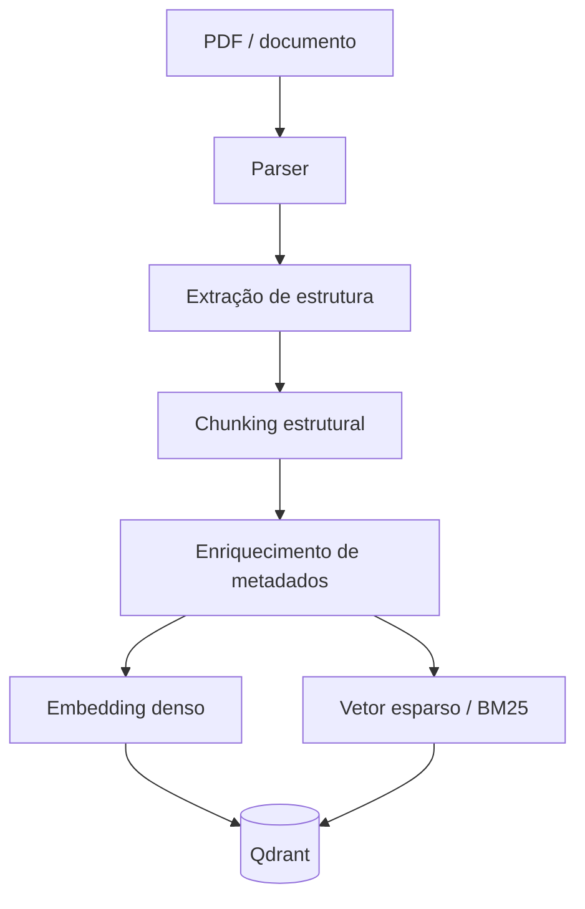

# Design — 102 Corpus Ingestion

> Insumo técnico pré-aprovado para `/speckit-plan`. Origem: arch-v1 §20, §22, Parte IX; ADR-012.

## Localização

```text
ai-scouting/src/ai_scouting/rag/
├── index/                  # seam "Índice do scouting" — consumido por 103, 104 (modelo) e 106
│   ├── api.py              # IndexedChunk, IndexFilters, IndexVersion, ChunkIndex (Protocol)
│   └── adapters/
│       ├── qdrant.py       # ChunkIndex + escrita: prefetch denso/esparso + RRF nativo (103 FR-001)
│       └── memory.py       # ChunkIndex em memória, com fusão RRF emulada — testes
└── ingestion/              # pipeline offline (pipes & filters)
    ├── domain/             # estrutura, chunking estrutural, chunk_id, modelo de vigência, sucessão — puro
    ├── ports.py            # DocumentParser, Embedder, SparseEncoder, IndexWriter, DocumentStore
    ├── service.py          # encadeia os filtros e reindexa de forma idempotente
    └── adapters/           # parser de PDF, embedders candidatos, armazenamento do original, CLI de ingestão
```

## Pipeline



É um *pipes & filters*: cada etapa é um filtro. Estrutura, chunking, identificador e metadados são funções puras em
`domain/`; parser, embedding e escrita no índice são adapters atrás de portas. Trocar o modelo de embedding é trocar o
adapter de `Embedder` e reindexar.

## Metadados

```text
document_id        chapter          version
document_type      section          publication_date
document_title     subsection       effective_date
branch             page             superseded_by
jurisdiction       article          status
```

## Chunking estrutural, não janela fixa

Para material narrativo (manuais), janela de 300–600 tokens respeitando fronteira semântica.

Para material normativo, **a estrutura é a unidade**:

```text
Lei
 └── Título
      └── Capítulo
           └── Seção
                └── Artigo        ← um artigo = um chunk
                     └── Parágrafo
                          └── Inciso
                               └── Alínea
```

Cada chunk carrega o caminho ancestral prefixado como contexto:

```text
[Lei X · Título II · Capítulo III · Seção I]
Art. 42. O responsável pela atividade deverá...
```

O texto original permanece a fonte de verdade; chunks são índice, não substituto.

## Identificador de chunk

Estável e determinístico, derivável do próprio chunk:

```text
man-pio-2026#4.2.1@p87
└──┬──┘ └┬─┘ └─┬─┘ └┬┘
 documento versão seção página
```

## Vigência, versão e revogação (arch-v1 §22)

```text
document
├── version
├── effective_date        # início da vigência
├── expiry_date           # fim, se houver
├── superseded_by         # → document_id que o substituiu
└── status                # vigente | revogado | substituído | rascunho
```

## Modelo de embedding para português (arch-v1 Parte IX — em aberto)

| Candidato | Prós | Contras |
|---|---|---|
| `multilingual-e5-small/base` | leve, roda em ARM CPU | qualidade média em português técnico |
| `bge-m3` | forte, denso + esparso num modelo | pesado; viável só se ingestão for offline |
| Embedding hospedado | melhor qualidade, zero CPU local | custo por documento, dependência externa |

**Decidir com medição**, contra o conjunto dourado (spec 105). Faixas iniciais de chunk e sobreposição também são calibradas lá.
Cada candidato é um adapter de `Embedder`; a comparação da 105 roda o mesmo pipeline trocando só esse adapter.

## Seam: Índice do scouting **[ADR-012]**

Substitui o antigo seam "Coleção indexada do scouting", que era o schema da coleção no Qdrant compartilhado entre
ingestão e leitura. Agora o contrato é um modelo e uma porta; o schema do Qdrant vira detalhe do adapter.

```python
class ChunkIndex(Protocol):                     # rag/index/api.py
    async def search(self, query: str, *, filters: IndexFilters, limit: int) -> list[IndexedChunk]:
        """Busca densa + esparsa com fusão feita pelo adapter (Qdrant: prefetch + RRF).
        O adapter codifica a consulta com o embedding da versão do índice."""

    async def get(self, chunk_ids: Sequence[str]) -> list[IndexedChunk]: ...
    def version(self) -> IndexVersion: ...


@dataclass(frozen=True)
class IndexFilters:
    effective_on: date                          # vem de 101 (reference_time da Turn View, por default)
    include_superseded: bool = False
    branch: str | None = None
    document_types: tuple[str, ...] = ()
```

`IndexedChunk` carrega os metadados da tabela acima e se converte no `Chunk` do contrato 001.

## Portas e adapters

| Porta | Tipo | Adapters por fase | Teste |
|---|---|---|---|
| `ChunkIndex` | primária (seam do pack) | Qdrant (Fase 5); memória (testes) | suíte de conformidade contra os dois adapters |
| `DocumentParser` | secundária | parser de PDF com camada de texto | documentos de teste |
| `Embedder` / `SparseEncoder` | secundária | candidatos da 105 (e5, bge-m3, hospedado) | codificador determinístico de teste |
| `IndexWriter` | secundária | Qdrant | índice em memória |
| `DocumentStore` | secundária | a decidir no plano (disco, Postgres ou payload) | em memória |
