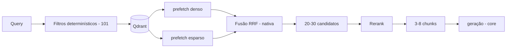

# Design — 103 Scouting Retrieval

> Insumo técnico pré-aprovado para `/speckit-plan`. Origem: arch-v1 §21, §22; ADR-006, ADR-012, ADR-013.

## Localização

```text
ai-scouting/src/ai_scouting/rag/retrieval/
├── domain/          # montagem de IndexFilters, boost por metadado (vigência, tipo, especificidade) — puro
├── retriever.py     # implementa Retriever (contrato 001) sobre ChunkIndex (api.py de rag/index, 102)
├── reranker.py      # v1: fusão + boost (puro); implementa Reranker (contrato 001)
└── adapters/        # v2 hospedado / v3 cross-encoder local, quando houver
```

## Fluxo



**Correção em relação à v0:** a fusão acontece *dentro* do Qdrant, via query API com `prefetch` + RRF. O sistema não funde resultados de buscas separadas.
Este módulo não fala com o Qdrant: chama `ChunkIndex.search` (102), e a fusão nativa é responsabilidade do adapter
Qdrant do índice.

## Reranker: o que é realista na v1

Cross-encoder (~280M parâmetros) sobre 30 candidatos em 2 cores ARM custa segundos por requisição.

| Estágio | Reranker | Custo |
|---|---|---|
| v1 | RRF nativo + boost por metadado (vigência, tipo, especificidade) | ~zero |
| v2 | Reranker hospedado (Cohere / Jina / Voyage) atrás do contrato | latência de rede |
| v3 | Cross-encoder local, se o hardware crescer | CPU |

O contrato `Reranker` permite os três sem mudança no core.

## Números

```text
query → dense + sparse → fusão → 20–30 candidatos → rerank → 3–8 chunks → LLM
```

Todos calibrados empiricamente, **contra o harness de avaliação** (specs 009/105), não por intuição.

## Vigência (arch-v1 §22)

- Default: filtro de **vigente na data de referência da execução** (`effective_on` publicado por 101 a partir de `TurnView.reference_time`; o dia da requisição, por default). Documento revogado não aparece a menos que explicitamente solicitado. O retriever não lê o relógio.
- Histórico: `effective_on` passado + status inclui revogado/substituído; o status atual segue no chunk para o validator de 104 marcar a resposta.

## Coverage signal

O portão de cobertura do `rag_first` é do core (spec 005): ele olha o melhor score e a contagem de resultados devolvidos. Este módulo só precisa devolver scores comparáveis e resultados já filtrados.

## Portas e adapters **[ADR-012]**

| Porta | Tipo | Adapters por fase | Teste |
|---|---|---|---|
| `Retriever`, `Reranker` (contrato 001) | portas implementadas | `retriever.py`, `reranker.py` | suíte de conformidade de pack; `ChunkIndex` em memória |
| `ChunkIndex` (102) | seam consumido | adapter Qdrant da 102, escolhido pelo `pack.py` | índice em memória com versões 2023/2026 de um manual |
| Reranker remoto/local | secundária (futura) | v2 hospedado, v3 cross-encoder | reranker simulado |
