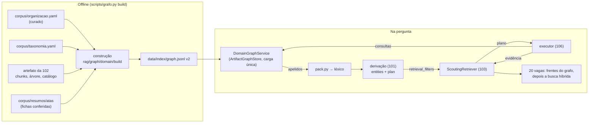

# Design — 106 Grafo de domínio e consultas do scouting

> Insumo técnico para o `/speckit-plan` da Fase 8. Decisões pré-aprovadas:
> [ADR-064](../../docs/adr/ADR-064-grafo-de-dominio-e-consultas-no-scouting.md), que substitui o item 3 do
> [ADR-063](../../docs/adr/ADR-063-grafo-das-normas-por-orgao-no-scouting.md) e refina os itens 4 e 5 dele e os ADRs
> 045, 047, 048 e 062. Origem: o [relatório do grafo](../../docs/avaliacao-grafo-rag-scouting-2026-11.md), seções 5, 7,
> 8, 10 e 11, e o [plano SDD da Fase 8](../../docs/plano-sdd-grafo-de-dominio-scouting-2026-11.md). O rascunho de
> 2026-09, um retriever que substituiria a 103, foi rejeitado pelo ADR-064.

## 1. O que o módulo é

Um grafo de domínio **em memória**, lido de um arquivo do artefato, com **sete consultas com nome**, um **esquema de
plano** e um **executor**. A 103 continua sendo o retriever: ela pede ao executor a evidência do plano, transforma a
evidência em trechos e os põe à frente da busca híbrida, que roda sempre. A 101 escreve o plano na derivação, com os
apelidos das entidades que o `pack.py` injeta no léxico.



Nada muda no core nem nos contratos. O plano viaja opaco em `retrieval_filters`, como os filtros de hoje.

## 2. Ontologia

### 2.1 Entidades

Toda entidade tem `id` (`prefixo:slug`), `nome`, `apelidos` (normalizados pela 101, `context/text.py`), `fonte` e
`origem`. As curadas vêm de dois arquivos (clarify de 2026-11-10):
- `corpus/organizacao.yaml`: a organização, isto é, tipos, instâncias, cargos e relações de governança;
- `corpus/dominio.yaml`, novo: o programa, isto é, ramos, seções, áreas e conceitos, e as arestas `REGE`, `DE_RAMO` e
  `ATUA_EM`.

As derivadas vêm do artefato.

| Prefixo | Tipo | Exemplos | De onde vem | Inc. |
|---|---|---|---|---|
| `tipo_inst:` | tipo de instituição | `tipo_inst:regiao`, `tipo_inst:grupo_escoteiro` | `organizacao.yaml` → `tipos_de_instituicao` (hoje) | G1 |
| `tipo_orgao:` | tipo de órgão | `tipo_orgao:diretoria_regional`, `tipo_orgao:comissao_regional_pioneira` | `organizacao.yaml` → `tipos_de_orgao` (hoje) | G1 |
| `inst:` | instituição (instância) | `inst:ueb`, `inst:regiao_sp`, `inst:ge_inah` | `organizacao.yaml` → `instituicoes` (seção nova), só com fonte (decisão 1) | G3 |
| `orgao:` | órgão (instância) | `orgao:dr_sp`, `orgao:ar_sp`, `orgao:can` | `organizacao.yaml` → `orgaos` (seção nova), só com fonte | G3 |
| `cargo:` | cargo ou função | `cargo:escotista`, `cargo:chefe_de_secao`, `cargo:apf`, `cargo:diretor_presidente_regional` | `organizacao.yaml` → `cargos` (hoje, ampliada) | G2 |
| `ramo:` | ramo | `ramo:filhotes` … `ramo:pioneiro` | `dominio.yaml` → `ramos` (saem do `organizacao.yaml`), com os apelidos do léxico da 101 | G2 |
| `secao:` | tipo de seção | `secao:alcateia`, `secao:tropa_senior`, `secao:cla` | `dominio.yaml` → `secoes`, com `DE_RAMO` | G2 |
| `area:` | área | `area:programa_educativo`, `area:gestao_de_adultos`, `area:espacos_seguros` | `dominio.yaml` → `areas`, ligada às categorias da taxonomia | G2 |
| `conceito:` | conceito | `conceito:especialidade`, `conceito:insignia_de_madeira`, `conceito:modalidade_do_mar` | `dominio.yaml` → `conceitos` e os tipos de unidade da árvore (ADR-048) | G2 |
| `doc:` | documento | `doc:estatuto-2024`, `doc:resolucao-can-15-2025` | o catálogo da 102 (`document_id`), com apelidos do título e do número | G1 (nó), G5 (apelidos) |

**Tipo e instância.** A norma disciplina o tipo, e a ata registra a instância. `INSTANCIA_DE` liga as duas, e
`sobre(orgao:dr_sp)` inclui o que trata de `tipo_orgao:diretoria_regional`, num salto. O id do G1 é o `tipo_orgao:` com
o slug de hoje (`diretoria_regional`): o ADR-063 só tem tipos.

**Pessoas não são entidades** (decisão 2). O nome de quem foi eleito fica no texto do evento.

### 2.2 Nós do acervo (não reconhecíveis numa pergunta)

| Nó | Chave | De onde vem |
|---|---|---|
| Unidade | `unit_id` do artefato (`<doc_key>#u/…`), único no acervo | a árvore da 102 (`path` de cada trecho), com `unit_kind`, `title`, `branches`, os trechos e as páginas |
| Versão | `doc_key` | o catálogo da 102, com tipo, papel, vigência, data e abrangência |
| Evento | `evento:<doc_key>#<n>` | as fichas das atas (`corpus/resumos/atas/*.yaml`): reunião, deliberação, eleição, com a página conferida (ADR-062) |

### 2.3 Papel do tipo de documento

A tabela é da 106, por `taxonomy_id` (ADR-049). Um tipo da taxonomia sem papel falha o build.

| Papel | Modo do `SOBRE` | Tipos (`taxonomy_id`) |
|---|---|---|
| `norma` | `disciplina` | `estatuto`, `por`, `regulamento`, `resolucao`, `politica`, `lei` |
| `orientacao` | `orienta` | `manual`, `planejamento_estrategico` |
| `registro` | `registra` | `ata`, `parecer`, `relatorio`, `manifestacao` |
| `comunicacao` | `comunica` | `oficio`, `edital`, `boletim`, `posicionamento`, `recomendacao`, `apresentacao` |

As instruções normativas da DR-SP estão hoje com o tipo `resolucao` na taxonomia, então são normas (105 R26).

O papel serve a três coisas:
- filtrar a consulta (`papeis`);
- ordenar a entrega: norma antes de orientação, a de cima antes da de baixo, registro por data;
- ir ao trecho como metadado (`role`), para o prompt da 101 dizer "o Estatuto determina" ou "a ata de 2019 registra".

### 2.4 Arestas

Toda aresta tem `tipo`, `de`, `para`, `fonte` e `origem` (`curado` | `regra` | `modelo_conferido`). A `fonte` é a
evidência que a justifica:
- um `chunk_id` ou `unit_id` do artefato;
- o item de uma ficha com a página (`<doc_key>#<n>@p<página>`);
- a entrada da taxonomia (`taxonomia:<pasta>`);
- a entrada do catálogo curado com a citação (`organizacao.yaml:<seção>/<id>`, que aponta um `chunk_id`).

| Aresta | De → para | Busca? | Origem e regra | Inc. |
|---|---|---|---|---|
| `SOBRE(modo)` | unidade → entidade | sim | regra: o título da unidade nomeia a entidade (o nome mais longo, como o ADR-063); `branches` da unidade → `ramo:`; `kind` da unidade → `conceito:` (especialidade, etapa, bloco, insígnia, cargo); o regulamento cujo título nomeia um órgão, inteiro (ADR-063). Nas atas, o tema e a decisão de cada item da ficha, por `reconhecer` (G4). Modelo conferido só no que o título não diz | G1 (órgão), G2 (o resto), G4 (atas) |
| `CONTEM` | versão → unidade | — | a árvore da 102, só para as unidades que outra aresta usa e as dos tipos de unidade com nome do ADR-048 (especialidade, insígnia, etapa, cargo…), que `itens` lista | G1 (G6 para as com nome) |
| `GERA` | unidade → evento | sim (`linha_do_tempo`) | a ficha da ata, pela página do item | G4 |
| `DE` | evento → entidade | sim | `reconhecer` no tema e na decisão do item, mais o órgão da ata | G4 |
| `INSTANCIA_DE` | `inst:`/`orgao:` → `tipo_inst:`/`tipo_orgao:` | sim | curado | G3 |
| `PARTE_DE` | `orgao:` → `inst:`, `inst:` → `inst:` | sim (`aplicavel_a`) | curado, com fonte | G3 |
| `EMITIDO_POR` | versão → `orgao:` | sim (`documentos`) | regra: a pasta da taxonomia (categoria emissora) e a subpasta da região ou da UEL | G3 |
| `APLICA_SE_A` | versão → `inst:` | sim (`aplicavel_a`) | regra: o nível e a subpasta da taxonomia | G3 |
| `DE_AREA` | versão → `area:` | sim | regra: a categoria temática da taxonomia | G2 |
| `REGE` | `area:` → `cargo:`/`ramo:`/`secao:` | sim (um salto em `sobre`) | curado, poucas dezenas de linhas | G2 |
| `DE_RAMO` | `secao:` → `ramo:` | sim | curado | G2 |
| `E_UM` | entidade específica → termo genérico (`cargo:escotista` → `conceito:adulto`) | sim (camada 1 do `sobre` e o `todas`) | curado (`abrange` no `dominio.yaml`) | G2 (R19) |
| `ATUA_EM` | `cargo:` → `secao:`/`tipo_orgao:` | sim | curado (o `orgao` do cargo de hoje) | G2 |
| `ALTERA`, `REVOGA` | versão → versão ou unidade | `ligados` | regra no texto ("Altera a Regra 057", "Revoga a Resolução…"); o alvo casa pelo título da regra, e não só pelo número, porque a numeração do POR muda (105 R26) | G5 |
| `SUBSTITUI` | versão → versão | `ligados` | a linhagem do catálogo | G5 |
| `CITA` | unidade → unidade | `ligados` | regra ("Regra 054", "art. 27") | G5 |
| `ELEGE`, `COMPOE`, `INTEGRA`, `CONVOCA`, `FISCALIZA`, `APRECIA_RECURSO_DE`, `DIRIGE` | entre tipos de órgão e cargos | **não** (decisão 4); só `ligados` | curado, as 22 de hoje com fonte conferida (ADR-063, 102 R43) | G1 |

### 2.5 De onde vem cada aresta, tipo de documento por tipo

| Tipo (documentos) | `EMITIDO_POR`, `APLICA_SE_A`, `DE_AREA` | `SOBRE` | Eventos e ligações |
|---|---|---|---|
| Estatuto, P.O.R., Regulamento (10) | pasta e nível da taxonomia, subpasta da região ou da UEL | título de seção, capítulo, artigo e regra; `branches`; regulamento inteiro do órgão | `SUBSTITUI` pela linhagem; a aprovação vem das atas |
| Resolução (273) | pasta: CAN, DEN, DR-SP | a **ementa**: o título é só o número, e o assunto sai da primeira frase ("Altera…", "Aprova…", "Dispõe sobre…") por regra; o modelo offline, conferido, só no que sobrar, com o custo estimado antes | `ALTERA` e `REVOGA` por regra no texto: 180 revogam, 61 alteram, 89 citam regras do POR |
| Política (16), Lei (1) | nível; área pela categoria | títulos das seções | — |
| Manual e guias (38) | área pela categoria | títulos de capítulo; `branches`; unidades `especialidade`, `etapa`, `bloco`, `insignia`, `cargo` | — |
| Ata (256) | órgão e região pela pasta | as fichas: cada item por `reconhecer` | reunião, deliberação, eleição (680 fichas e 516 linhas do tempo) |
| Parecer, Relatório (17) | comissão pela pasta | o órgão fiscalizado e o exercício, pelo título e pelo texto | o exercício como evento |
| Ofício, Edital, Boletim, Posicionamento, Recomendação, Apresentação, Manifestação, Planejamento (31) | pasta | título; o modelo só se uma pergunta medida pedir | a data |

## 3. As consultas

Funções puras em `rag/graph/domain/queries.py`, sobre o `DomainGraph` (dicionários imutáveis montados na carga).
Nenhuma faz I/O nem lê relógio: o período vem do plano, e a vigência vem da versão gravada no grafo. Cada uma devolve
**evidência**, e não trechos:

```python
@dataclass(frozen=True, slots=True, kw_only=True)
class Evidence:
    query: str                    # "sobre", "aplicavel_a", …
    target: str                   # a entidade ou o documento que a trouxe
    doc_key: str
    unit_id: str | None           # None quando a evidência é o documento inteiro (lista de documentos)
    chunk_ids: tuple[str, ...]    # os trechos da unidade, na ordem do documento
    role: Role                    # norma | orientacao | registro | comunicacao
    scope: str | None             # o nível, para a ordem de cima para baixo
    date: date | None             # a vigência ou a data do evento
    edge: EdgeRef                 # tipo, fonte e origem da aresta que a trouxe
    event: EventRef | None = None # na linha do tempo: o item da ficha (tipo, texto, página)
```

| # | Assinatura | Devolve | Ordem |
|---|---|---|---|
| 1 | `reconhecer(texto: str, apelidos: Aliases) -> tuple[str, ...]` | ids das entidades mencionadas, pelo nome mais longo, na ordem da menção | da menção |
| 2 | `sobre(g, entidades, *, modo="alguma", papeis=(), tipos=(), ramo=None, periodo=None) -> list[Evidence]` | as unidades com `SOBRE` para as entidades: `todas` = interseção na mesma unidade ou na seção mãe; a instância inclui o tipo (`INSTANCIA_DE`); `REGE`+`DE_AREA` dão um salto, depois das diretas | a posição da entidade em `entidades` (a ordem da menção) e, em `modo="todas"`, a primeira; depois papel, nível (de cima para baixo), `doc_key` e `unit_id` |
| 3 | `aplicavel_a(g, instituicao, *, papeis=("norma",)) -> list[Evidence]` | os documentos com `APLICA_SE_A` para a instituição e para cada uma acima dela pelo `PARTE_DE` (até 5 níveis) | de cima para baixo |
| 4 | `documentos(g, *, tipo=None, emissor=None, aplica_se_a=None, area=None, ramo=None, periodo=None, vigente=True) -> list[Evidence]` | um item por documento (unit_id `None`) | `doc_key` (a de hoje, ADR-047) |
| 5 | `itens(g, *, tipo_de_unidade=None, de=None, ramo=None) -> list[Evidence]` | as unidades do tipo, ou as entidades filhas de `de` (os órgãos de uma instituição) | a do documento (ADR-048) |
| 6 | `linha_do_tempo(g, alvo, *, eventos=(), periodo=None) -> list[Evidence]` | os eventos `DE` o alvo | por data |
| 7 | `ligados(g, alvo, *, relacoes=()) -> list[Evidence]` | os vizinhos com a fonte: citações, alterações, versões, governança | a do catálogo |

`reconhecer` é a mesma função na derivação (101), no executor e no `scripts/grafo.py query`. Ela fica no `api.py` da 106
como função pura (como o `taxonomy_id` no `api.py` da 102), e o `Aliases` é um `Mapping[str, tuple[str, ...]]`.

## 4. O plano

```python
@dataclass(frozen=True, slots=True, kw_only=True)
class QueryStep:
    q: Literal["sobre", "aplicavel_a", "documentos", "itens", "linha_do_tempo", "ligados"]
    args: Mapping[str, JSONValue]  # só os parâmetros da assinatura da consulta; chave desconhecida → PlanInvalid

@dataclass(frozen=True, slots=True, kw_only=True)
class QueryPlan:
    version: Literal[1] = 1
    forma: Literal["simples", "para_cada", "intersecao"] = "simples"
    consultas: tuple[QueryStep, ...] = ()
    para_cada: tuple[str, ...] = ()   # em "para_cada": as entidades que repartem as vagas
    def to_json(self) -> dict[str, JSONValue]: ...
    @classmethod
    def from_json(cls, raw: Mapping[str, JSONValue]) -> QueryPlan: ...  # PlanInvalid nomeia o campo
```

Exemplo, na forma da seção 11.5 do relatório:

```json
{"version": 1, "forma": "intersecao", "consultas": [
  {"q": "sobre", "args": {"entidades": ["ramo:pioneiro", "cargo:escotista"], "modo": "todas", "papeis": ["norma", "orientacao"]}},
  {"q": "aplicavel_a", "args": {"instituicao": "inst:ueb"}}]}
```

Regras do plano:
- **Dono.** O `QueryPlan` e a tabela de papéis são do `api.py` da 106 (clarify de 2026-11-10).
- **Quem escreve.** A derivação (101), a partir de `entities` e da forma que ela já reconhece: síntese, lista,
  enumeração, facetas ("cada ramo"), período e instituição citada. A tabela "forma → plano" fica na 101, e o esquema é
  da 106.
- **Plano vazio** (`consultas == ()`) quer dizer só a busca.
- **Plano inválido,** na 103: a busca roda como hoje, e um aviso vai ao log, nunca uma exceção ao usuário. É diferente
  dos filtros, em que chave desconhecida é erro, porque o plano é um otimizador e a busca continua correta sem ele.
- **Nenhuma linguagem de consulta.** Os nomes das consultas e dos parâmetros são fechados.

## 5. O executor e as vagas

`rag/graph/domain/executor.py`, puro: `executar(g, plano) -> Frentes`.

- **`simples`.** Roda as consultas na ordem do plano.
- **`intersecao`.** A primeira consulta dá a evidência, e as seguintes a filtram: `aplicavel_a` restringe aos
  documentos que valem para a instituição, e `documentos`, aos documentos da lista.
- **`para_cada`.** Roda a consulta uma vez por entidade de `para_cada`, substituindo-a nos argumentos, e reparte as
  vagas. Os ramos de hoje (ADR-045) são o caso `para_cada([ramos], sobre([ramo]))`. A busca por faceta continua na 103,
  com o mesmo repartir.
- **Tetos** (clarify de 2026-11-10). O executor corta em até 3 documentos por consulta e devolve a evidência com
  todos os trechos de cada unidade. A 103 escolhe até 3 trechos por documento, pelos termos da pergunta (o BM25 de
  `rag/retrieval/domain/terms.py`, que fica na 103), e, a partir do G2, limita o total do grafo a 8 das 20 vagas (no G1,
  3 documentos × 3 trechos, como o ADR-063). Em `para_cada`, o
  total se reparte por entidade (`ceil(8 / n)`). São constantes, ajustadas depois de medidas.
- **Saída.** `Frentes`: a evidência ordenada, por consulta e por entidade de `para_cada`. A 103 pega os trechos no
  `ChunkIndex.get`, escolhe pela pergunta, marca `graph_rank`, `graph_query` e `role` nos metadados e os põe à frente.
  O `MetadataReranker` respeita `graph_rank`, como hoje. A 106 não lida com o texto da pergunta além do `reconhecer`.

## 6. O artefato: `graph.jsonl` v2

Fica ao lado do índice, em `src/axon_scouting/data/index/graph.jsonl`, fora do manifesto, commitado no pacote. Tem um
registro por linha:

```json
{"kind": "meta", "version": 2, "built_at": "…", "chunking": "estrutural-v5;…", "organization_sha256": "…"}
{"kind": "entity", "id": "tipo_orgao:diretoria_regional", "type": "tipo_orgao", "name": "Diretoria Regional", "aliases": ["diretoria regional", "dr"], "terms": ["diretoria regional", "diretor presidente regional"], "source": "estatuto-2024#art27@p19", "origin": "curado"}
{"kind": "version", "doc_key": "estatuto-2024", "document_id": "estatuto", "type": "estatuto", "role": "norma", "scope": "nacional", "status": "vigente", "date": "2024-…"}
{"kind": "unit", "unit_id": "estatuto-2024#u/…", "doc_key": "estatuto-2024", "unit_kind": "secao", "title": "Da Diretoria Regional", "chunk_ids": ["…"], "branches": []}
{"kind": "edge", "type": "SOBRE", "mode": "disciplina", "from": "estatuto-2024#u/…", "to": "tipo_orgao:diretoria_regional", "source": "estatuto-2024#u/…", "origin": "regra"}
{"kind": "event", "id": "evento:<doc_key>#3", "doc_key": "…", "date": "2022-…", "type": "eleicao", "text": "…", "page": 4}
```

- **A unidade só entra no arquivo quando alguma aresta a usa.** O resto da árvore continua na 102.
- **`terms`** são os nomes que reconhecem a entidade numa pergunta (os `organ_terms` de hoje: o nome, os apelidos e os
  nomes de cargo que dizem o nível, 102 R43). O G1 os reproduz exatamente.
- **Invariantes,** num teste como o `test_artifact_quality.py`:
  - toda aresta tem `source` e `origin` válidos, e a fonte resolve: o chunk ou a unidade existe, a página da ficha
    existe, a pasta existe na taxonomia;
  - nenhuma aresta aponta para entidade inexistente;
  - todo tipo da taxonomia tem papel;
  - toda aresta `modelo_conferido` tem a marca de conferência;
  - o `meta.chunking` é igual ao do manifesto do índice, e um grafo de outro build é recusado na carga com uma
    mensagem que manda rodar `scripts/grafo.py build`.

## 7. Portas e adapters [ADR-012]

| Porta | Tipo | Implementação / adapters | Teste |
|---|---|---|---|
| `DomainGraphSource` (seam *Grafo de domínio*, `api.py`): `aliases()`, `run(plan) -> Frentes`, `query(nome, **args) -> list[Evidence]` | primária, consumida pela 103 (`run`), pelo `pack.py` para a 101 (`aliases`) e pelo `scripts/grafo.py` (`query`) | `DomainGraphService` (`service.py`): carrega o `DomainGraph` uma vez, com trava, pela porta `GraphStore`, e delega às consultas e ao executor do `domain/` | suíte de conformidade do seam contra o serviço com `MemoryGraphStore` e com o `ArtifactGraphStore` real |
| `GraphStore` (`ports.py`): `records() -> Iterable[GraphRecord]` | secundária: de onde vêm os registros do grafo na pergunta | `ArtifactGraphStore` (`adapters/artifact.py`, lê o `graph.jsonl` e confere a versão do chunking), `MemoryGraphStore` (`adapters/memory.py`) | conformidade das duas |
| `GraphSources` (`ports.py`) | secundária, só offline: o que a construção lê | `ArtifactSources` (`adapters/sources.py`): trechos, árvore e catálogo do artefato da 102, as fichas e os YAML do `corpus/`; o escritor do `graph.jsonl` | fontes sintéticas em memória |
| `ResolutionSummarizer` (`ports.py`) | secundária, só offline (G5) | o modelo pelo OpenRouter (`gpt-4.1-mini`, chave só no ambiente), com a fonte conferida por código contra a página (`adapters/summarizer.py`). **Não implementada** (R22): por decisão do mantenedor, as propostas do G5 saíram da sessão, num arquivo que `GraphSources.resolution_subjects()` lê e o build confere | resumidor simulado |
| `ChunkIndex` (102) | seam consumido pela 103, e não pela 106 | — | — |

**Não são portas:**
- as consultas e o executor, que são funções puras do `domain/`;
- a tabela de papéis e as regras de aresta, que são dados e funções puras.

**Layout:**

```text
src/axon_scouting/rag/graph/
├── api.py          # Entity, Edge, Role, ROLES, Evidence, QueryPlan, QueryStep, Frentes, DomainGraphSource, reconhecer, PlanInvalid
├── ports.py        # GraphStore, GraphSources, ResolutionSummarizer
├── service.py      # DomainGraphService
├── domain/
│   ├── model.py    # DomainGraph (dicionários), carga a partir de registros
│   ├── roles.py    # a tabela de papéis
│   ├── build/      # as regras de aresta por tipo (hoje rag/ingestion/domain/graph.py)
│   ├── queries.py  # as sete consultas
│   └── executor.py # o plano, as regras de composição e os tetos
└── adapters/
    ├── artifact.py # ArtifactGraphStore (hoje rag/index/adapters/graph.py) e o escritor do graph.jsonl
    ├── memory.py   # MemoryGraphStore
    ├── sources.py  # ArtifactSources (offline)
    └── summarizer.py  # G5
scripts/grafo.py    # build | query <consulta> <args> | export --arrows
```

**Import-linter** (contratos novos):
- `rag.graph.domain` não importa `rag.graph.adapters`, nem `rag.index`, nem `rag.retrieval`;
- fora de `rag.graph`, só se importa `rag.graph.api` (a 101 em `context/`, a 103 em `rag/retrieval/`). Para a 101, o
  contrato de camadas do pack põe `context` acima de `rag`, e um `forbidden` o limita a `rag.graph.api`;
- a composição (`pack.py`) e o `scripts/grafo.py` importam também `rag.graph.adapters`.

A 106 lê a 102 só offline, pelo `ArtifactSources`.

## 8. A migração (G1) sem mudar comportamento

O G1 só muda de lugar o que existe:
- o `NormGraph`, o `NormSection` e o `NormRelation` saem de `rag/index/api.py`;
- `rag/index/adapters/graph.py` vira `rag/graph/adapters/artifact.py`;
- `rag/ingestion/domain/graph.py` vira `rag/graph/domain/build/`;
- o `scripts/grafo.py` passa a escrever o v2;
- a 101 troca `organs` por `entities` (ids `tipo_orgao:` e `tipo_inst:`) e `plan`, com **um** `sobre` com todos os órgãos
  nomeados e `papeis=["norma"]`, um grupo só, como hoje;
- a 103 aceita `entities` e `plan` em `KNOWN`, tira `organs` e executa o plano. A ordem e os tetos são os do
  `_by_organ`: a ordem do `sorted` de hoje (órgão na ordem da menção, nível, `doc_key`, `unit_id`), 3 documentos e 3
  trechos por documento, **sem teto total no G1**. O teto de 8 entra no G2, medido.

Ele é provado pelos quatro conjuntos com números **idênticos** e por um teste que compara, para as perguntas do acervo,
os `chunk_id` à frente antes e depois.

Os `retrieval_filters` não são persistidos. A âncora da pergunta de seguimento (ADR-061) é o texto da pergunta, e não
os filtros, então trocar `organs` por `entities` não quebra conversa antiga.

## 9. Incrementos → user stories

| US | Inc. | Entrega | Medida (105 FR-026, os quatro conjuntos, por item) |
|---|---|---|---|
| US1 | G1 | o módulo de pé, a migração, o v2, `reconhecer`, `sobre` só de órgão | idênticos ao 0.11.1 |
| US2 | G2 | as entidades curadas, o `SOBRE` de norma e orientação, `entities` e `plan` na 101, `para_cada` e interseção, o `facet_rank` como caso | as 7 falhas do acervo e as 3 da regressão; `cada_ramo`, `duas_entidades`, `requisitos` e `obrigatorio` no programa-adultos; nada cai |
| US3 | G3 | as instâncias, `PARTE_DE`, `APLICA_SE_A`, `EMITIDO_POR`, `aplicavel_a`, a instituição na derivação | `situada` (`inah-balanco-rejeitado`) |
| US4 | G4 | os eventos das fichas, `linha_do_tempo`, `search_summaries` como fachada | a síntese não cai, com os 3 itens de 0,33 como alvo; `historico` |
| US5 | G5 | as ementas, `ALTERA`, `REVOGA`, `SUBSTITUI`, `CITA` e `ligados` | `mudanca` e `publicacoes` |
| US6 | G6 | `list_documents` e `list_units` como fachadas de `documentos` e `itens` | `lista_documentos` e `lista_itens`; acervo e regressão sem cair |
| US7 | todos | a consulta livre do mantenedor (`scripts/grafo.py query`, `export --arrows`) e os invariantes | — |
| (G7) | opcional | a força normativa da unidade | a fidelidade pelo juiz nos itens `obrigatorio` |

Cada incremento que muda o artefato ou o comportamento é um `scouting` menor, a partir do 0.12.0.

## 10. Fora desta fase

- **O planejador** (o papel `planner` no Model Router), que muda o core e pede outro ADR. O `QueryPlan` é o lugar onde
  a saída dele vai entrar.
- **A força normativa**, opcional (G7).
- **As relações de governança na busca automática** (decisão 4).
- **Pessoas como nós** (decisão 2).
- **Neo4j, SQLite, LlamaIndex** e qualquer linguagem de consulta na instalação.
