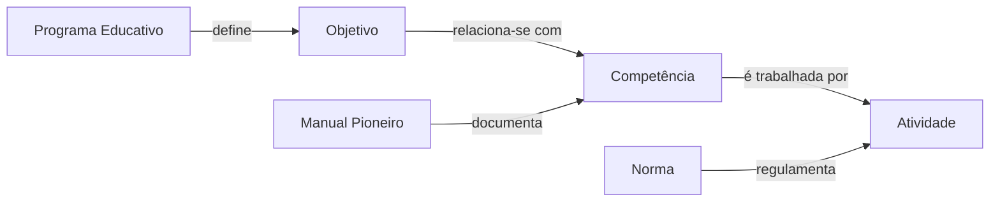

# Design — 106 Scouting GraphRAG (futuro)

> Insumo técnico para `/speckit-plan` quando a Fase 8 começar. Origem: arch-v1 §24.

Evolução do retriever, **atrás do mesmo contrato**:

```text
hoje:    ScoutingRetriever      → Qdrant
futuro:  ScoutingGraphRetriever → Knowledge Graph + Qdrant
```

## Esboço de ontologia (a validar — ver NEEDS CLARIFICATION na spec)



Um LLM pode auxiliar em extração de entidades e relações, agrupamento e sinônimos. Duas exigências herdadas:

1. Relações preservam proveniência, como chunks.
2. **Distinguir relação presente na fonte de relação inferida por LLM.** São epistemologicamente diferentes e não podem ser citadas do mesmo jeito.

O contrato `Retriever` não muda.

## Portas e adapters **[ADR-012]**

| Porta | Tipo | Adapters | Teste |
|---|---|---|---|
| `Retriever` (contrato 001) | porta implementada | `ScoutingGraphRetriever` | suíte de conformidade de pack |
| `ChunkIndex` (102) | seam consumido | adapter Qdrant da 102 | índice em memória |
| `KnowledgeGraphStore` | secundária | a decidir quando a Fase 8 começar (depende da ontologia) | grafo em memória |
| `RelationExtractor` | secundária (só offline) | modelo de linguagem, com a origem registrada | extrator simulado |

A regra "relação inferida nunca é citada como fonte" é função pura em `domain/`, independente do armazenamento do grafo.
