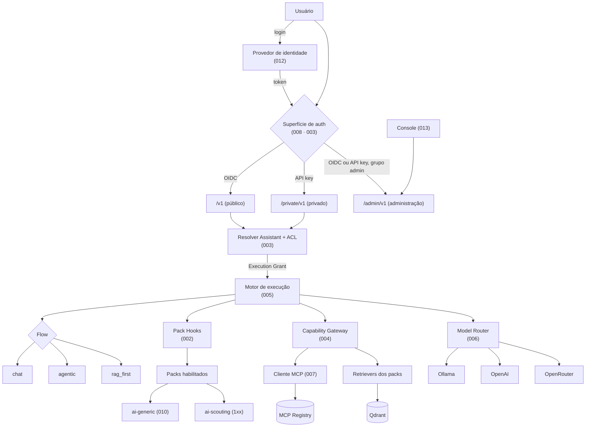
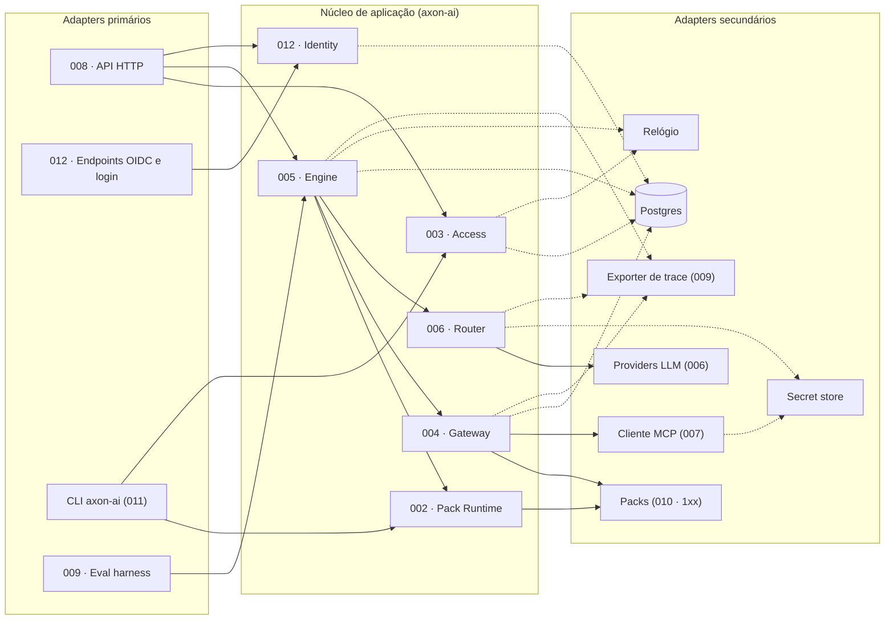
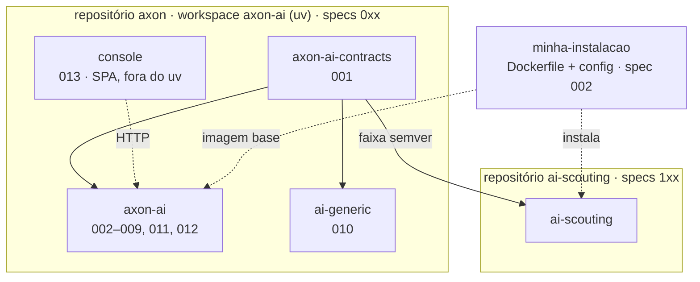
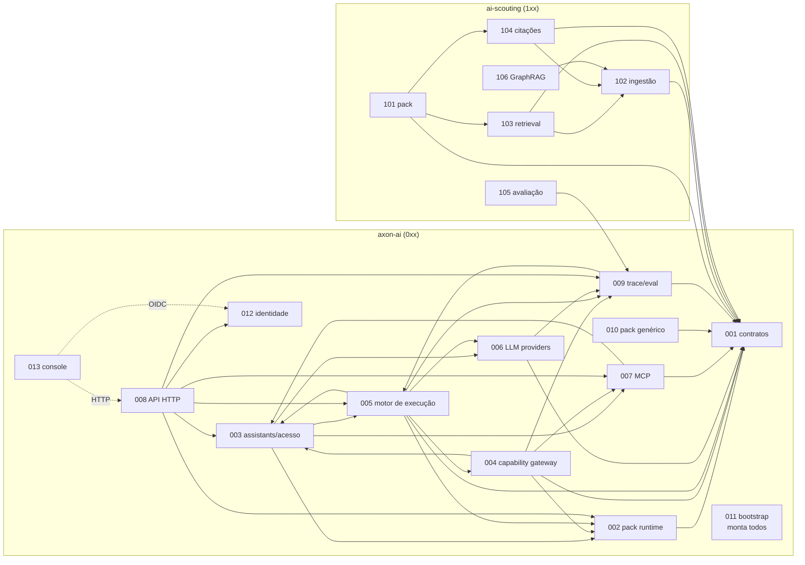

# SDD — Mapa de módulos

Cada pasta em `specs/` é **um módulo substituível**. A spec é a única fonte de verdade sobre o comportamento do módulo;
o `design.md` ao lado carrega as decisões técnicas já tomadas (insumo do `/speckit-plan`).
Módulos só se acoplam por **seams** (tabela abaixo). Regra de ouro: *se reescrever um módulo exige editar outra spec, ou um seam mudou, ou alguém violou a fronteira.*

Origem: tradução de [docs/archive/architecture-v1.md](../docs/archive/architecture-v1.md) (citada nas specs como "arch-v1 §N").

## Escopo

Plataforma de agentes modular e extensível, capaz de usar modelos locais e externos, MCP, RAG e LangGraph, na qual o núcleo é
infraestrutura genérica e todo conhecimento de domínio vive em extensões.

| Fora do escopo | Motivo |
|---|---|
| GRIS dentro da plataforma | Permanece projeto próprio; expõe MCP e é consumido como qualquer sistema externo (spec 007) |
| Workflows de longa duração | Não há caso de uso ([ADR-010](../docs/adr/ADR-010-temporal-fora.md)) |
| Lógica de agente ou regra de negócio na interface | Open WebUI e a console de administração são apenas apresentação (princípio XI, [ADR-029](../docs/adr/ADR-029-console-de-administracao-propria.md)) |
| Instalação de código arbitrário pelo usuário final | Extensão de usuário é via MCP remoto ([ADR-003](../docs/adr/ADR-003-mcp-usuario-pack-operador.md)) |
| Isolamento entre organizações (multi-tenancy) | Instalação separada é o default (spec 003) |

## Visão geral



O ponto de entrada é a **resolução de Assistant**, que decide simultaneamente *se* a execução pode acontecer e *com o quê*.
O motor não fala com packs, tools ou modelos diretamente: passa pelos seams de 002, 004 e 006.

## Estilo arquitetural

Decidido no [ADR-012](../docs/adr/ADR-012-estilo-arquitetural-hexagonal.md) (princípio XIII da constituição); os motivos
estão no [relatório de estilo arquitetural](../docs/relatorio-estilo-arquitetural.md).

| Escala | Estilo | Na SDD |
|---|---|---|
| Sistema | **Microkernel** | `axon-ai` é o kernel dono do fluxo (ADR-001); packs são plug-ins; o contrato 001 são as portas do microkernel; MCP é plug-in fora de processo |
| Organização | **Monolito modular** | um processo, uma imagem; um módulo por spec; seams como `Protocol`; import-linter |
| Módulo | **Hexagonal + núcleo funcional** | regra no centro (`domain/`, puro), infraestrutura atrás de portas (`ports.py` → `adapters/`) |



Setas cheias: portas que já existiam na arch-v1. Setas tracejadas: portas introduzidas pelos ADRs 012 e 013. A
composition root (011) não aparece: é ela que instancia os adapters e os injeta. A console (013) não é módulo do
núcleo: é um cliente HTTP da superfície de administração e do protocolo OIDC da 012 ([ADR-029](../docs/adr/ADR-029-console-de-administracao-propria.md)).

**Dentro de cada módulo:**

```text
axon_ai/<modulo>/
├── api.py       # seams que o módulo expõe (portas primárias) + value objects publicados — não importa o resto do módulo
├── domain/      # políticas puras, sem I/O
├── ports.py     # portas secundárias (Protocol): armazenamento, relógio, segredos, trace, rede
├── service.py   # implementa api.py orquestrando domain/ e as portas
└── adapters/    # infraestrutura: memória, Postgres, HTTP, CLI, LangGraph, Qdrant, SDKs
```

**Regras de import** (import-linter): um módulo só importa o `api.py` de outro; `api.py`, `domain/`, `ports.py` e
`service.py` não importam frameworks de infraestrutura; só a composition root (011) importa `service.py` e `adapters/` de
outros módulos. Num pack, a composition root é o `pack.py`. Porta secundária só onde há I/O, não-determinismo ou troca
prevista; cada uma tem adapter em memória e suíte de conformidade.

## Repositórios



A seta que **não** existe: de qualquer pack para `axon-ai` — `ai-generic` incluído, mesmo morando no mesmo repositório.

## Blocos

| Bloco | Repositório | Conteúdo |
|---|---|---|
| `0xx` | `axon-ai` (uv workspace) | contratos, runtime, API, pack genérico, deploy |
| `1xx` | `ai-scouting` | pack de domínio escoteiro |
| `2xx`+ | um repositório por pack | packs futuros (ex.: `financial`) |

Ao criar spec nova, use o próximo número livre **dentro do bloco** (ver [CLAUDE.md](../CLAUDE.md)).

## Specs

| Spec | Módulo | Distribuição / caminho | Fase | Status |
|---|---|---|---|---|
| [001](001-core-contracts/spec.md) | Contratos públicos | `axon-ai-contracts` | 0 | Fase 0 implementada (US1–US4); `0.1.1` (ADR-024) e `0.1.2` (`.eval` e o hook opcional `eval_metrics` — [ADR-027](../docs/adr/ADR-027-metricas-de-dominio-pelo-contrato-de-pack.md)); `0.1.3` (`ChatUsage.cost` — [ADR-035](../docs/adr/ADR-035-custo-informado-pelo-provider-e-providers-prontos.md)); `0.2.0`, US6 (`axon-ai-contracts`, import `axon_ai_contracts` — [ADR-037](../docs/adr/ADR-037-a-plataforma-se-chama-axon.md)) |
| [002](002-core-pack-runtime/spec.md) | Descoberta, carga e composição de packs + build da instalação | `axon_ai/packs` | 1–4, 9 | Fase 1 implementada (US1, US2, US3 cen. 2–4); Fase 2 (US4) e Fase 3 (US3 cen. 1, Pack Toolset) implementadas; Fase 4 (US5): build da instalação no repositório `agentic-deploy` (submódulo; ADR-022); Fase 6: o seam `PackEvalMetrics` (ADR-027); Fase 7: a instalação com o perfil `webui` (Open WebUI v0.12 e Keycloak de desenvolvimento); Fase 9 especificada (US7: instalação com ou sem console, sem Keycloak) |
| [003](003-core-assistants-access/spec.md) | Assistants, identidade e autorização | `axon_ai/assistants` | 2, 3, 9 | Fase 2 implementada (US1–US7) e ligada pela 008 e pela 011; Fase 3: validação de papéis por flow (ADR-019), de `allowed_tools`/`write_tools` com namespace e da colisão alias × pack; Fase 9 especificada (US9: superfície de administração; US10: sobreposições — ADR-031, ADR-032); Fase 9: US9 implementada (superfície `admin`, audiência por superfície, admin pelo grupo, `JwksSource` em processo), US10 implementada (sobreposições de `models` e `mcp` sob `overrides`, impressão digital, histórico, seam `SystemAssistantAdmin`) |
| [004](004-core-capability-gateway/spec.md) | Catálogo de capacidades e execução segura de tools | `axon_ai/capabilities` | 3 | Fase 3 implementada (US1–US5); ligada pela 002, 003, 005 e 011 |
| [005](005-core-execution-engine/spec.md) | Motor de execução (flows / grafo) | `axon_ai/graph` | 1, 3, 5 | Fase 1 implementada (US1: flow `chat`); Fase 3 implementada (US2: flow `agentic`); Fase 5 implementada (US3, US4: flow `rag_first`, com os toques na 002, 004, 009 e 011 e o [ADR-026](../docs/adr/ADR-026-o-modelo-ve-o-identificador-de-cada-trecho.md)); encaixe na 011 (`capabilities`) e na 008 (`severity`) nas passadas delas; desfecho de etapa (`StepFinished`, ADR-028) |
| [006](006-core-llm-providers/spec.md) | Providers de LLM e modelo por papel | `axon_ai/llm` | 1, 3, 9 | Fases 1 e 3 implementadas (US1–US5): OpenAI e OpenRouter sobre a camada compatível, credencial pela porta `SecretResolver` ([ADR-020](../docs/adr/ADR-020-segredos-uma-fonte-por-perfil-uma-porta-por-modulo.md)), roteamento automático recusado e saída estruturada no controller; ligada pela 011 (`llm_secrets`); Fase 9 implementada (FR-012: o `TracedModel` emite o `model_exchange`, ADR-034) |
| [007](007-core-mcp-integration/spec.md) | Registry e cliente MCP | `axon_ai/mcp` | 3 | Fase 3 implementada (US1–US6); ligada pela 011 e exposta pela 008 (`/v1/mcp`, `/private/v1/mcp`) |
| [008](008-core-http-api/spec.md) | API HTTP, compat OpenAI, streaming, histórico | `axon_ai/http` | 1, 2, 3, 7, 9 | Fases 1 e 2 implementadas (US1; US2, US3, US4 Assistants, US5, US7); Fase 3: rotas de MCP do usuário e globais, desfecho por gravidade (ADR-018) e `x-should-retry`; Fase 7 (API): fila com 503 `overloaded` e `Retry-After`, progresso como raciocínio (`reasoning_content`) até o primeiro texto, pedido efêmero (`x-ai-core-store: false`) e compatibilidade com o Open WebUI v0.12 — a interface de verdade fecha na passada de encaixe da 002; timeline de status no Open WebUI (`x-ai-core-progress: status`, FR-005a); Fase 9: US9 implementada (`/admin/v1`: sessão e marca da instalação, Assistants de sistema e sobreposições, "testar modelo" pela 006, MCP globais, uso e preços, Langfuse e captura, contas, grupos e login da 012, chaves e saúde; não admin → 404 de rota inexistente, `no-store` em toda resposta) |
| [009](009-core-observability-evaluation/spec.md) | Trace (Trace Sink) e harness de avaliação | `axon_ai/observability`, `axon_ai/eval` | 1–6, 9 | Fase 1 implementada (US1: trace e Trace Sink); Fase 6 implementada (US2–US4: harness — conjunto dourado, métricas do trace, juiz offline, linha de base, `axon eval run|compare`); Fase 9 especificada (US5–US7: uso e custo, Langfuse, conteúdo opcional — ADR-034); Fase 9 implementada (US5–US7: uso e custo por modelo e dia com preços com vigência, destino Langfuse por OTLP, captura opcional de conteúdo; verificação com um Langfuse real pendente, T070) |
| [010](010-core-generic-pack/spec.md) | Pack genérico de referência | `ai-generic` (`packages/generic`) | 1, 3 | Fases 1 e 3 implementadas (US1, US2); FR-005 decidida: continua pack, sem flow preferido |
| [011](011-core-bootstrap/spec.md) | Bootstrap e composition root: configuração, perfis de adapters, ordem de boot, CLI, health | `axon_ai/bootstrap` | 1, 2, 3, 7, 9 | Fases 1 e 2 implementadas (US1–US5: perfis `memory`, `persistent` e `test`, autenticação real, CLI `axon`, saúde agregada); Fase 3: registry MCP e gateway de tools nos três perfis, `agentic`, `axon audit`, saúde por servidor MCP, trocas de porta; Fase 7: `AXON_MAX_EXECUTIONS`, `AXON_QUEUE_SIZE` e `AXON_QUEUE_WAIT_MS` (admissão da 008); Fase 9 especificada (US6: identidade, administração, destinos do trace, chave mestra); Fase 9 implementada (US6): a identidade ligada (etapa `identity`, portas `identity_*`, CLI `users`/`groups`/`identity keys rotate`), as sobreposições da 003, o uso, os preços e o Langfuse da 009 nos três perfis (`AXON_LANGFUSE_*`, `AXON_USAGE_*`), a origem `evaluation` no `eval run`, os itens `trace:*` e os modelos efetivos na saúde e a superfície `/admin/v1`; Fase 9, incremento 9.5: US7 implementada (distribuição `axon-ai` 0.7.0rc1, workspace `axon-ai/`, import `axon_ai`, comando `axon` com `--version`, prefixo `AXON_` com recusa de `AI_CORE_*`, nome padrão "Axon" — [ADR-037](../docs/adr/ADR-037-a-plataforma-se-chama-axon.md), [ADR-038](../docs/adr/ADR-038-marca-da-plataforma-e-marca-da-instalacao.md)) |
| [012](012-core-identity/spec.md) | Provedor de identidade: contas, senha, login Google, grupos, emissão de tokens OIDC | `axon_ai/identity` | 9 | Fase 9 implementada no módulo (US1–US7): protocolo OIDC, páginas, Google, contas e grupos, bloqueio, chaves em rotação, Postgres no schema `identity`; o encaixe vem nas passadas da 003, 008, 011 e 002 ([ADR-030](../docs/adr/ADR-030-a-plataforma-e-o-provedor-de-identidade.md)) |
| [013](013-core-admin-console/spec.md) | Console de administração (SPA) | `axon-ai/console/` | 9 | Fase 9 implementada (US1–US7, [ADR-029](../docs/adr/ADR-029-console-de-administracao-propria.md)): React 19 + TypeScript, login pela 012 com PKCE e tokens só em memória, uso e custo, preços, Assistants (modelos, MCP, histórico), servidores MCP, observabilidade e acesso, temas claro e escuro; Vitest + MSW e e2e com Playwright e axe contra a plataforma em memória; nginx da instalação em `deploy/`; CI em `.github/workflows/console.yml` |
| [101](101-scouting-pack/spec.md) | Pack scouting: composição, contexto determinístico, prompts | `ai_scouting/pack.py`, `context/`, `prompts/` | 4, 5 | Fases 4 e 5 implementadas (US1–US5) no submódulo `ai-scouting` (ADR-021): pack com `rag_first`, coleção `scouting`, `config_schema` e a recuperação da 103 e os validators da 104 publicados; 0.3.0 com as métricas da 105 |
| [102](102-scouting-corpus-ingestion/spec.md) | Ingestão, chunking estrutural, modelo de vigência, índice | `ai_scouting/rag/ingestion/`, `rag/index/` | 5 | Fase 5 implementada (US1–US5): seam `ChunkIndex` com Qdrant (build atrás de alias) e memória, e5-small em ONNX, BM25, CLI `ai-scouting-corpus`; corpus inicial em `ai-scouting/corpus/` |
| [103](103-scouting-retrieval/spec.md) | Retrieval híbrido e rerank | `ai_scouting/rag/retrieval/` | 5 | Fase 5 implementada (US1–US5): `ScoutingRetriever` (score = similaridade densa, ADR-025), `MetadataReranker` (desempate sem pesos), tool `search_docs`; publicados pelo pack (US5 da 101) |
| [104](104-scouting-citations/spec.md) | Citações, proveniência e aviso de vigência | `ai_scouting/validators/` | 4–5 | Implementada: `citation_integrity` e `validity_notice`, publicados pelo pack na Fase 5 (US5 da 101) |
| [105](105-scouting-evaluation/spec.md) | Conjunto dourado e calibração do domínio | `ai_scouting/eval/` | 6 | Fase 6, infraestrutura implementada (US1, US2 sobre a semente provisória) no `ai-scouting` 0.3.0: métricas `context_accuracy`, `current_document_rate` e `validity_notice_rate` pelo hook `eval_metrics` (ADR-027), `eval/` com a semente, a configuração e a linha de base, workflow `eval`; US3–US5 (calibração, embedding, modelo local) depois da curadoria |
| [106](106-scouting-graphrag/spec.md) | GraphRAG (futuro) | `ai_scouting/rag/graph/` | 8 | Draft (futuro) |

## Seams

Seam = interface pública pela qual um módulo é consumido — a porta primária, publicada no `api.py` do módulo dono.
**É o único acoplamento permitido.** Mudar um seam exige ADR e atualização das specs consumidoras listadas. Portas
secundárias (armazenamento, relógio, segredos…) não são seams: são internas do módulo e ficam no `design.md` dele.

| Seam | Dono | Consumidores | O que é |
|---|---|---|---|
| **Contrato de pack** (`AgentPack`, `PackManifest`, `PackContext`, `ToolSpec`, `ToolResult`, `Retriever`, `Reranker`, `Chunk`, `AnswerValidator`, `PackRoutine`) | 001 | 002, 004, 005, 010, 1xx | O que um pack implementa e o que recebe |
| **Turn View** | 001 | packs (via 002), 005 (produz) | Visão somente-leitura e estável da execução para hooks de pack (ADR-011) |
| **Contratos de serviço** (`LLMProvider`, `MCPClient`) | 001 | 006, 007 | Formas que providers e cliente MCP implementam |
| **Pack Registry** | 002 | 003, 004, 008 | Packs habilitados, status, capacidades por pack |
| **Pack Hooks** | 002 | 005 | Executa hooks de pack com isolamento de fatia: prompts, preparação de contexto, rerank (o reranker de cada pack, `reranker(composition, pack)`, Fase 5), validators (inclusive o filtro da geração pelos validators de streaming — [ADR-024](../docs/adr/ADR-024-validators-filtram-o-streaming.md)), rotinas |
| **Pack Toolset** | 002 | 004 | Tools nativas e retrievers de uma composição, com namespace `<pack>.<nome>` (Fase 3) |
| **Pack Eval Metrics** | 002 | 009 | As métricas de domínio que os packs da composição declaram (hook `eval_metrics`, contratos `0.1.2`; Fase 6, [ADR-027](../docs/adr/ADR-027-metricas-de-dominio-pelo-contrato-de-pack.md)) |
| **Principal** + **Execution Grant** | 003 | 004, 005, 007, 008 | Quem pede e o que a execução pode usar, já resolvido e restrito |
| **Assistant Directory** | 003 | 008 | Listagem filtrada por ACL e CRUD de assistants de usuário |
| **API Key Admin** | 003 | 008 | Emissão, listagem e revogação de chaves de API (superfície privada; a CLI é adapter da própria 003) |
| **System Assistant Admin** | 003 | 008 | Configuração efetiva, sobreposições de `models` e `mcp` permitidas pelo YAML e seu estado (Fase 9, [ADR-032](../docs/adr/ADR-032-assistants-de-sistema-sobrepostos-em-runtime.md)) |
| **Account Admin** + **Login Settings** | 012 | 008 | Usuários, grupos e vínculo Google; Google ligado ou desligado e de onde vem cada ajuste (Fase 9, [ADR-030](../docs/adr/ADR-030-a-plataforma-e-o-provedor-de-identidade.md)) |
| **Public Key Set** | 012 | 011 (injeta no verificador OIDC da 003) | O JWKS do emissor da plataforma, em processo (Fase 9) |
| **Capability Catalog** + **Tool Gateway** | 004 | 005 | Uma sessão por execução (`Capabilities.open(grant, contexto)`): catálogo com namespace, já filtrado, e execução de tool com validação, timeout, limite, cerca, política de escrita e auditoria antes da escrita; trechos de recuperação com `· id: <chunk_id>`, cortados por trecho inteiro, e `fence_chunks` para o `rag_first` ([ADR-026](../docs/adr/ADR-026-o-modelo-ve-o-identificador-de-cada-trecho.md)) |
| **Consulta de auditoria** | 004 | 011 (`axon audit`) | Registros de tools de escrita, filtrados por Principal, Assistant, tool e período |
| **Execution Engine** (`run(grant, request) → eventos`) + **nomes de flow** e **papéis por flow** | 005 | 008, 009, 003 (valida nomes e papéis, [ADR-019](../docs/adr/ADR-019-papeis-por-flow-no-seam-execution-engine.md)) | Única porta de entrada para executar; saída é um fluxo de eventos. O grant é o da 003 e os registros têm gravidade `error`/`notice` ([ADR-018](../docs/adr/ADR-018-seam-execution-engine-fase-3.md)); `rag_first` e `RagSettings` na Fase 5; cada etapa termina com `StepFinished` e o desfecho dela ([ADR-028](../docs/adr/ADR-028-o-motor-publica-o-desfecho-de-cada-etapa.md)), que a 008 mostra como timeline no Open WebUI |
| **Model Router** | 006 | 005; 003 (só os value objects da política — [ADR-016](../docs/adr/ADR-016-grant-carrega-politica-de-modelos.md)) | Resolve provider+modelo por papel, aplicando allowlist e recusando roteamento automático; lista os providers e se cada um está pronto (`providers()`, 008 na administração — [ADR-035](../docs/adr/ADR-035-custo-informado-pelo-provider-e-providers-prontos.md)) |
| **MCP Registry** + **catálogo de aliases** + **cliente MCP restrito** | 007 | 003 (catálogo, na forma de `McpDirectory`), 004 (cliente), 008 (registry) | Servidores por alias, escopo e política; cliente limitado aos aliases do grant, com `discover` que devolve também os servidores com falha |
| **Trace Sink** | 009 | 004, 005, 006 | Porta de emissão de dados de trace por requisição; o backend é adapter ([ADR-013](../docs/adr/ADR-013-seams-transversais-trace-e-tempo.md)); cresce por eventos aditivos sem argumento nem conteúdo — `tool_call` (004), `controller_decision`, `coverage_gate` e `retrieval` (005; este com o texto só dos trechos entregues) ([ADR-017](../docs/adr/ADR-017-trace-sink-cresce-por-eventos-aditivos.md)); o único evento com prompt e resposta é `model_exchange` (006), opcional e só para destinos que aceitam conteúdo ([ADR-034](../docs/adr/ADR-034-trace-com-destinos-e-conteudo-opcional.md)) |
| **Trace** + **Eval Harness** (formato de conjunto dourado e formato de relatório) | 009 | 008 (id de requisição), 105, CI | Consulta de trace por requisição; execução de conjuntos dourados, com data de referência por item, métricas lidas do trace e linha de base (`axon eval run|compare`, Fase 6) |
| **Usage Report** + **Price Book** + **Trace Destinations** | 009 | 008 | Uso por dia, modelo e Assistant com custo calculado na consulta — o informado pelo provider vence a tabela ([ADR-035](../docs/adr/ADR-035-custo-informado-pelo-provider-e-providers-prontos.md)); tabela de preços com vigência; destinos do trace (Langfuse, captura de conteúdo) e de onde vem cada ajuste (Fase 9, [ADR-034](../docs/adr/ADR-034-trace-com-destinos-e-conteudo-opcional.md)) |
| **API HTTP** | 008 | clientes externos (Open WebUI, console 013) | Superfícies `/v1`, `/private/v1` e `/admin/v1` ([ADR-031](../docs/adr/ADR-031-superficie-de-administracao.md)) |
| **Índice do scouting** (modelo de chunk indexado + porta `ChunkIndex`) | 102 | 103, 106; 104 (só o modelo) | Contrato interno do `ai-scouting`; o schema do Qdrant é detalhe do adapter |

A **composition root (011)** não expõe seam: ela consome o `api.py`, o `service.py` e os `adapters/` de todos os módulos
do core para construí-los e injetá-los, e oferece os pontos de entrada do processo (`axon serve`, CLI).

## Grafo de dependências



Setas = "consome um seam de". A 011 (composition root) consome todos os módulos do core e não é consumida por nenhum;
suas setas foram omitidas para não poluir o grafo. Setas pontilhadas da 013 são protocolo (HTTP, OIDC), não import: a
console não importa código do core.

**Dependências mútuas entre specs** — 003↔005 (a 003 valida nomes de flow; a 005 recebe o grant), 003↔007 (a 003 valida
aliases; a 007 recebe Principal e grant) e 005↔009 (a 005 emite no Trace Sink; o harness da 009 executa pelo motor).
Não são ciclos de import: cada módulo importa só o `api.py` do outro, e nenhum `api.py` importa implementação
(princípio XIII). Em tempo de execução, a 011 constrói os módulos na ordem do boot (ver `011-core-bootstrap/design.md`).

Repare no que **não** existe: nenhuma seta de `1xx` para qualquer spec do core além de 001 (e do formato de avaliação da
009), e nenhuma seta de outro módulo para dentro de 005 além de 003 (nomes de flow), 008 e 009 — o grafo é consumido
só pelo seam *Execution Engine* e pelos nomes de flow.

## Como reescrever um módulo

1. **Liste os seams que o módulo expõe** (tabela acima) e seus consumidores.
2. **Se a reescrita preserva os seams:** edite `spec.md` e `design.md` do módulo no lugar (o git guarda o histórico), depois
   `/speckit-clarify` → `/speckit-plan` → `/speckit-tasks` → `/speckit-implement`. Nenhuma outra spec muda. As suítes de
   conformidade dos seams provam que nada quebrou.
3. **Se a reescrita muda um seam:** escreva um ADR, atualize a spec dona do seam e cada spec consumidora listada. Se o seam
   é o contrato de pack (001), siga a política de versões dos contratos ([ADR-014](../docs/adr/ADR-014-politica-versoes-0x-contratos.md)):
   enquanto 0.x, breaking = minor (a partir de 1.0, major), com janela de depreciação de uma série compatível.
4. **Se a responsabilidade do módulo se divide ou se funde:** crie specs novas no mesmo bloco e marque as antigas com
   `**Status**: Superseded by NNN`.

### Caso: reescrever o grafo do `axon-ai`

Só a [005](005-core-execution-engine/spec.md) muda. O que precisa continuar verdadeiro: a assinatura do seam *Execution Engine* (entrada = Execution Grant + requisição; saída = fluxo de eventos) e o uso exclusivo dos seams de 002, 004, 006 e 009. Nomes de nós, forma do estado e até o framework de grafo são livres (ADR-011). Na prática, reescrever o grafo é trocar `axon_ai/graph/adapters/langgraph/`; `api.py`, `domain/` (portão, limites, ação, orçamento) e seus testes permanecem (ADR-012). Se os **nomes de flow** mudarem, `axon assistants validate` aponta as referências pendentes em assistants e em `preferred_flow` de packs — é dado, não código.

### Caso: reescrever o `ai-scouting`

Só as specs `1xx` mudam. O core só enxerga o pack pelo contrato 001 e pelo nome de flow preferido. É possível trocar uma parte isolada — por exemplo, o retrieval (103) por GraphRAG (106) — sem tocar em 101, 104 ou 102, porque o retriever é consumido pelo contrato `Retriever` e a citação depende apenas dos `chunk_id` entregues à geração. Trocar a base de vetores ou o modelo de embedding é trocar um adapter do índice (102), sem mexer em 103.

## Questões em aberto (arch-v1 Parte IX)

| Questão | Onde é resolvida |
|---|---|
| Modelo de embedding para português | 105 (medição) → plano da 102/103 |
| Números de calibração do RAG | 105, Fase 6 |
| Multi-tenancy entre organizações | 003 — fora de escopo; instalação separada é o default |
| Ontologia do GraphRAG | 106 (`NEEDS CLARIFICATION`) |
| O `ai-generic` continua sendo pack? | 010 (`NEEDS CLARIFICATION`), Fase 3 |
| ~~ADR-011 (Turn View / `PackRoutine`)~~ | Aceito em 2026-09-14, com ADR-012 e ADR-013 |
| ~~Como o harness fixa a data de referência de uma execução~~ | Resolvido em 2026-09-14: só em processo, pelo harness; a API rejeita o campo (008 FR-012) |
| ~~Política de versões 0.x de `axon-ai-contracts`~~ | Resolvido em 2026-09-15 (`/speckit-clarify` da 001, FR-016): enquanto 0.x, aditiva = patch e breaking = minor |
| Dividir 009 em trace e harness | opcional ([relatório](../docs/relatorio-estilo-arquitetural.md), seção 7) |
