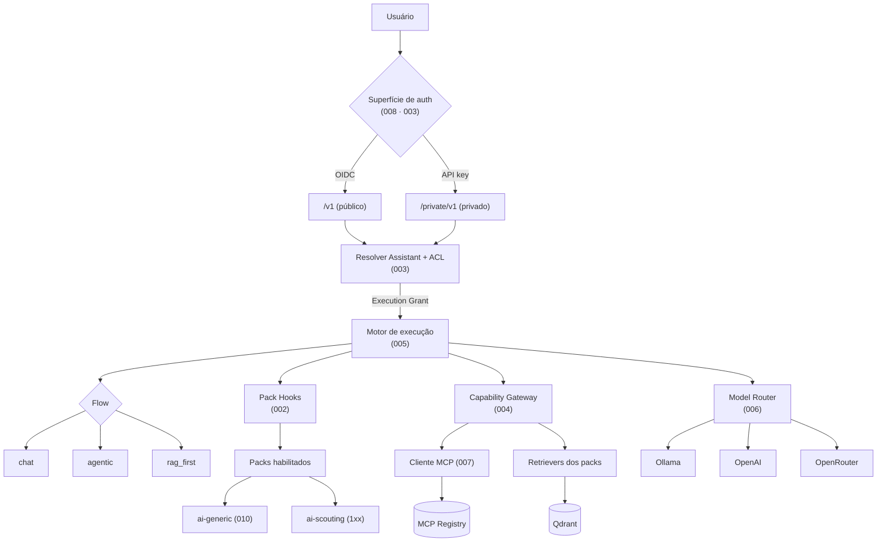
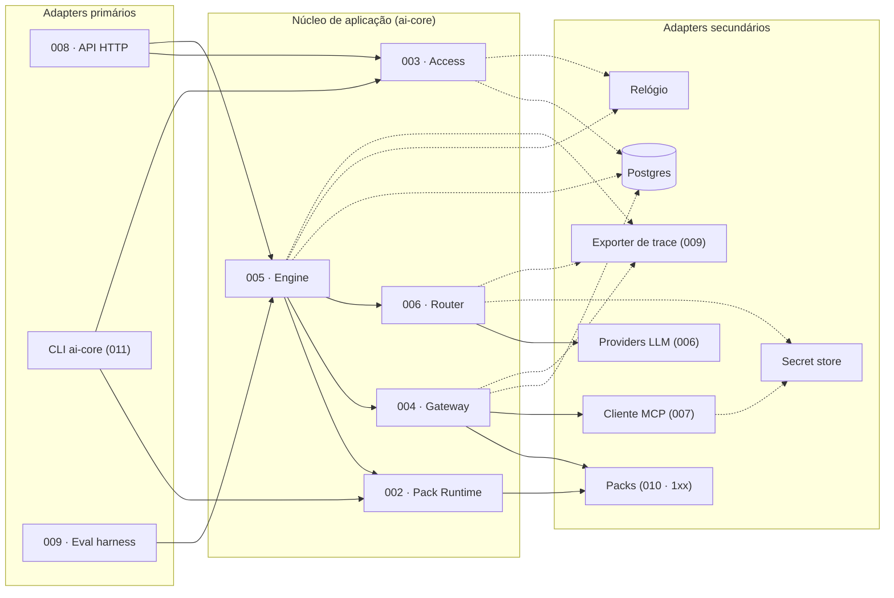
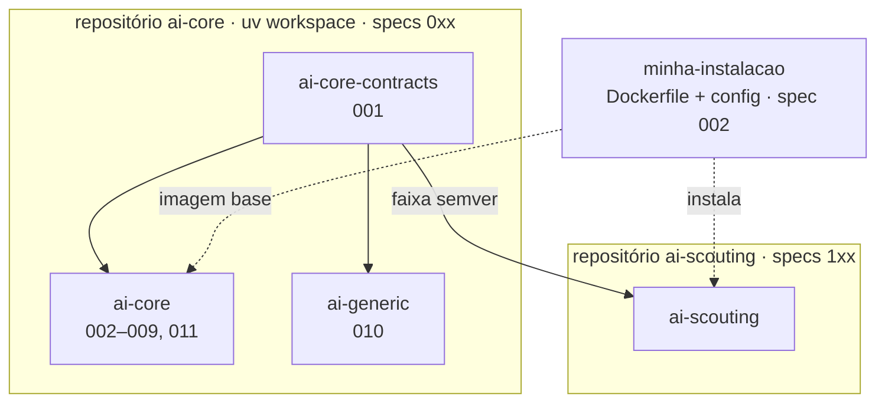
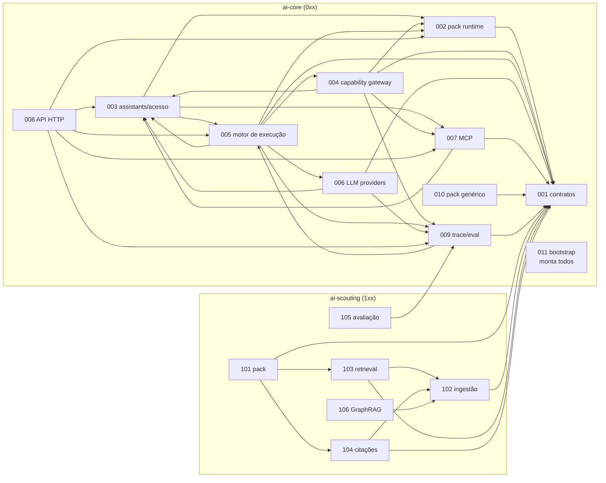

# SDD — Mapa de módulos

Cada pasta em `specs/` é **um módulo substituível**. A spec é a única fonte de verdade sobre o comportamento do módulo;
o `design.md` ao lado carrega as decisões técnicas já tomadas (insumo do `/speckit-plan`).
Módulos só se acoplam por **seams** (tabela abaixo). Regra de ouro: *se reescrever um módulo exige editar outra spec, ou um seam mudou, ou alguém violou a fronteira.*

Origem: tradução de [docs/archive/architecture-v1.md](../docs/archive/architecture-v1.md) (citada nas specs como "arch-v1 §N").

## Escopo

Plataforma de agentes modular e extensível, capaz de usar modelos locais e externos, MCP, RAG e LangGraph, na qual o núcleo é
infraestrutura genérica e todo conhecimento de domínio vive em extensões.

| Fora do escopo | Motivo |
|---|---|
| GRIS dentro da plataforma | Permanece projeto próprio; expõe MCP e é consumido como qualquer sistema externo (spec 007) |
| Workflows de longa duração | Não há caso de uso ([ADR-010](../docs/adr/ADR-010-temporal-fora.md)) |
| Lógica de agente na interface | Open WebUI é apenas apresentação (princípio XI) |
| Instalação de código arbitrário pelo usuário final | Extensão de usuário é via MCP remoto ([ADR-003](../docs/adr/ADR-003-mcp-usuario-pack-operador.md)) |
| Isolamento entre organizações (multi-tenancy) | Instalação separada é o default (spec 003) |

## Visão geral



O ponto de entrada é a **resolução de Assistant**, que decide simultaneamente *se* a execução pode acontecer e *com o quê*.
O motor não fala com packs, tools ou modelos diretamente: passa pelos seams de 002, 004 e 006.

## Estilo arquitetural

Decidido no [ADR-012](../docs/adr/ADR-012-estilo-arquitetural-hexagonal.md) (princípio XIII da constituição); os motivos
estão no [relatório de estilo arquitetural](../docs/relatorio-estilo-arquitetural.md).

| Escala | Estilo | Na SDD |
|---|---|---|
| Sistema | **Microkernel** | `ai-core` é o kernel dono do fluxo (ADR-001); packs são plug-ins; o contrato 001 são as portas do microkernel; MCP é plug-in fora de processo |
| Organização | **Monolito modular** | um processo, uma imagem; um módulo por spec; seams como `Protocol`; import-linter |
| Módulo | **Hexagonal + núcleo funcional** | regra no centro (`domain/`, puro), infraestrutura atrás de portas (`ports.py` → `adapters/`) |



Setas cheias: portas que já existiam na arch-v1. Setas tracejadas: portas introduzidas pelos ADRs 012 e 013. A
composition root (011) não aparece: é ela que instancia os adapters e os injeta.

**Dentro de cada módulo:**

```text
ai_core/<modulo>/
├── api.py       # seams que o módulo expõe (portas primárias) + value objects publicados — não importa o resto do módulo
├── domain/      # políticas puras, sem I/O
├── ports.py     # portas secundárias (Protocol): armazenamento, relógio, segredos, trace, rede
├── service.py   # implementa api.py orquestrando domain/ e as portas
└── adapters/    # infraestrutura: memória, Postgres, HTTP, CLI, LangGraph, Qdrant, SDKs
```

**Regras de import** (import-linter): um módulo só importa o `api.py` de outro; `api.py`, `domain/`, `ports.py` e
`service.py` não importam frameworks de infraestrutura; só a composition root (011) importa `service.py` e `adapters/` de
outros módulos. Num pack, a composition root é o `pack.py`. Porta secundária só onde há I/O, não-determinismo ou troca
prevista; cada uma tem adapter em memória e suíte de conformidade.

## Repositórios



A seta que **não** existe: de qualquer pack para `ai-core` — `ai-generic` incluído, mesmo morando no mesmo repositório.

## Blocos

| Bloco | Repositório | Conteúdo |
|---|---|---|
| `0xx` | `ai-core` (uv workspace) | contratos, runtime, API, pack genérico, deploy |
| `1xx` | `ai-scouting` | pack de domínio escoteiro |
| `2xx`+ | um repositório por pack | packs futuros (ex.: `financial`) |

Ao criar spec nova, use o próximo número livre **dentro do bloco** (ver [CLAUDE.md](../CLAUDE.md)).

## Specs

| Spec | Módulo | Distribuição / caminho | Fase | Status |
|---|---|---|---|---|
| [001](001-core-contracts/spec.md) | Contratos públicos | `ai-core-contracts` | 0 | Fase 0 implementada (US1–US4) |
| [002](002-core-pack-runtime/spec.md) | Descoberta, carga e composição de packs + build da instalação | `ai_core/packs` | 1–4 | Fase 1 implementada (US1, US2, US3 cen. 2–4) |
| [003](003-core-assistants-access/spec.md) | Assistants, identidade e autorização | `ai_core/assistants` | 2 | Draft |
| [004](004-core-capability-gateway/spec.md) | Catálogo de capacidades e execução segura de tools | `ai_core/capabilities` | 3 | Draft |
| [005](005-core-execution-engine/spec.md) | Motor de execução (flows / grafo) | `ai_core/graph` | 1, 3, 5 | Fase 1 implementada (US1: flow `chat`) |
| [006](006-core-llm-providers/spec.md) | Providers de LLM e modelo por papel | `ai_core/llm` | 1, 3 | Fase 1 implementada (US1) |
| [007](007-core-mcp-integration/spec.md) | Registry e cliente MCP | `ai_core/mcp` | 3 | Draft |
| [008](008-core-http-api/spec.md) | API HTTP, compat OpenAI, streaming, histórico | `ai_core/http` | 1, 2, 7 | Fase 1 implementada (US1: chat completions) |
| [009](009-core-observability-evaluation/spec.md) | Trace (Trace Sink) e harness de avaliação | `ai_core/observability`, `ai_core/eval` | 1–6 | Fase 1 implementada (US1: trace e Trace Sink); harness na Fase 6 |
| [010](010-core-generic-pack/spec.md) | Pack genérico de referência | `ai-generic` (`packages/generic`) | 1, 3 | Fase 1 implementada (US1) |
| [011](011-core-bootstrap/spec.md) | Bootstrap e composition root: configuração, perfis de adapters, ordem de boot, CLI, health | `ai_core/bootstrap` | 1, 2 | Fase 1 implementada (US1, US2 memória, US3) |
| [101](101-scouting-pack/spec.md) | Pack scouting: composição, contexto determinístico, prompts | `ai_scouting/pack.py`, `context/`, `prompts/` | 4 | Draft |
| [102](102-scouting-corpus-ingestion/spec.md) | Ingestão, chunking estrutural, modelo de vigência, índice | `ai_scouting/rag/ingestion/`, `rag/index/` | 5 | Draft |
| [103](103-scouting-retrieval/spec.md) | Retrieval híbrido e rerank | `ai_scouting/rag/retrieval/` | 5 | Draft |
| [104](104-scouting-citations/spec.md) | Citações, proveniência e aviso de vigência | `ai_scouting/validators/` | 4–5 | Draft |
| [105](105-scouting-evaluation/spec.md) | Conjunto dourado e calibração do domínio | `ai_scouting/eval/` | 6 | Draft |
| [106](106-scouting-graphrag/spec.md) | GraphRAG (futuro) | `ai_scouting/rag/graph/` | 8 | Draft (futuro) |

## Seams

Seam = interface pública pela qual um módulo é consumido — a porta primária, publicada no `api.py` do módulo dono.
**É o único acoplamento permitido.** Mudar um seam exige ADR e atualização das specs consumidoras listadas. Portas
secundárias (armazenamento, relógio, segredos…) não são seams: são internas do módulo e ficam no `design.md` dele.

| Seam | Dono | Consumidores | O que é |
|---|---|---|---|
| **Contrato de pack** (`AgentPack`, `PackManifest`, `PackContext`, `ToolSpec`, `ToolResult`, `Retriever`, `Reranker`, `Chunk`, `AnswerValidator`, `PackRoutine`) | 001 | 002, 004, 005, 010, 1xx | O que um pack implementa e o que recebe |
| **Turn View** | 001 | packs (via 002), 005 (produz) | Visão somente-leitura e estável da execução para hooks de pack (ADR-011) |
| **Contratos de serviço** (`LLMProvider`, `MCPClient`) | 001 | 006, 007 | Formas que providers e cliente MCP implementam |
| **Pack Registry** | 002 | 003, 004, 008 | Packs habilitados, status, capacidades por pack |
| **Pack Hooks** | 002 | 005 | Executa hooks de pack com isolamento de fatia: prompts, preparação de contexto, rerank, validators, rotinas |
| **Principal** + **Execution Grant** | 003 | 004, 005, 006, 007, 008 | Quem pede e o que a execução pode usar, já resolvido e restrito |
| **Assistant Directory** | 003 | 008 | Listagem filtrada por ACL e CRUD de assistants de usuário |
| **Capability Catalog** + **Tool Gateway** | 004 | 005 | Catálogo por execução; execução de tool com timeout, limite, fencing, política de escrita e auditoria |
| **Execution Engine** (`run(grant, request) → eventos`) + **nomes de flow** | 005 | 008, 009, 003 (valida nomes) | Única porta de entrada para executar; saída é um fluxo de eventos |
| **Model Router** | 006 | 005 | Resolve provider+modelo por papel, aplicando allowlist |
| **MCP Registry** + **cliente MCP restrito** | 007 | 003, 004, 008 | Servidores por alias, escopo e política; cliente limitado a aliases autorizados |
| **Trace Sink** | 009 | 004, 005, 006 | Porta de emissão de dados de trace por requisição; o backend é adapter ([ADR-013](../docs/adr/ADR-013-seams-transversais-trace-e-tempo.md)) |
| **Trace** + **Eval Harness** (formato de conjunto dourado) | 009 | 008 (id de requisição), 105, CI | Consulta de trace por requisição; execução de conjuntos dourados, com data de referência por item |
| **API HTTP** | 008 | clientes externos (Open WebUI) | Superfícies `/v1` e `/private/v1` |
| **Índice do scouting** (modelo de chunk indexado + porta `ChunkIndex`) | 102 | 103, 106; 104 (só o modelo) | Contrato interno do `ai-scouting`; o schema do Qdrant é detalhe do adapter |

A **composition root (011)** não expõe seam: ela consome o `api.py`, o `service.py` e os `adapters/` de todos os módulos
do core para construí-los e injetá-los, e oferece os pontos de entrada do processo (`ai-core serve`, CLI).

## Grafo de dependências



Setas = "consome um seam de". A 011 (composition root) consome todos os módulos do core e não é consumida por nenhum;
suas setas foram omitidas para não poluir o grafo.

**Dependências mútuas entre specs** — 003↔005 (a 003 valida nomes de flow; a 005 recebe o grant), 003↔007 (a 003 valida
aliases; a 007 recebe Principal e grant) e 005↔009 (a 005 emite no Trace Sink; o harness da 009 executa pelo motor).
Não são ciclos de import: cada módulo importa só o `api.py` do outro, e nenhum `api.py` importa implementação
(princípio XIII). Em tempo de execução, a 011 constrói os módulos na ordem do boot (ver `011-core-bootstrap/design.md`).

Repare no que **não** existe: nenhuma seta de `1xx` para qualquer spec do core além de 001 (e do formato de avaliação da
009), e nenhuma seta de outro módulo para dentro de 005 além de 003 (nomes de flow), 008 e 009 — o grafo é consumido
só pelo seam *Execution Engine* e pelos nomes de flow.

## Como reescrever um módulo

1. **Liste os seams que o módulo expõe** (tabela acima) e seus consumidores.
2. **Se a reescrita preserva os seams:** edite `spec.md` e `design.md` do módulo no lugar (o git guarda o histórico), depois
   `/speckit-clarify` → `/speckit-plan` → `/speckit-tasks` → `/speckit-implement`. Nenhuma outra spec muda. As suítes de
   conformidade dos seams provam que nada quebrou.
3. **Se a reescrita muda um seam:** escreva um ADR, atualize a spec dona do seam e cada spec consumidora listada. Se o seam
   é o contrato de pack (001), siga a política de versões dos contratos ([ADR-014](../docs/adr/ADR-014-politica-versoes-0x-contratos.md)):
   enquanto 0.x, breaking = minor (a partir de 1.0, major), com janela de depreciação de uma série compatível.
4. **Se a responsabilidade do módulo se divide ou se funde:** crie specs novas no mesmo bloco e marque as antigas com
   `**Status**: Superseded by NNN`.

### Caso: reescrever o grafo do `ai-core`

Só a [005](005-core-execution-engine/spec.md) muda. O que precisa continuar verdadeiro: a assinatura do seam *Execution Engine* (entrada = Execution Grant + requisição; saída = fluxo de eventos) e o uso exclusivo dos seams de 002, 004, 006 e 009. Nomes de nós, forma do estado e até o framework de grafo são livres (ADR-011). Na prática, reescrever o grafo é trocar `ai_core/graph/adapters/langgraph/`; `api.py`, `domain/` (portão, limites, ação, orçamento) e seus testes permanecem (ADR-012). Se os **nomes de flow** mudarem, `ai-core assistants validate` aponta as referências pendentes em assistants e em `preferred_flow` de packs — é dado, não código.

### Caso: reescrever o `ai-scouting`

Só as specs `1xx` mudam. O core só enxerga o pack pelo contrato 001 e pelo nome de flow preferido. É possível trocar uma parte isolada — por exemplo, o retrieval (103) por GraphRAG (106) — sem tocar em 101, 104 ou 102, porque o retriever é consumido pelo contrato `Retriever` e a citação depende apenas dos `chunk_id` entregues à geração. Trocar a base de vetores ou o modelo de embedding é trocar um adapter do índice (102), sem mexer em 103.

## Questões em aberto (arch-v1 Parte IX)

| Questão | Onde é resolvida |
|---|---|
| Modelo de embedding para português | 105 (medição) → plano da 102/103 |
| Números de calibração do RAG | 105, Fase 6 |
| Multi-tenancy entre organizações | 003 — fora de escopo; instalação separada é o default |
| Ontologia do GraphRAG | 106 (`NEEDS CLARIFICATION`) |
| O `ai-generic` continua sendo pack? | 010 (`NEEDS CLARIFICATION`), Fase 3 |
| ~~ADR-011 (Turn View / `PackRoutine`)~~ | Aceito em 2026-09-14, com ADR-012 e ADR-013 |
| ~~Como o harness fixa a data de referência de uma execução~~ | Resolvido em 2026-09-14: só em processo, pelo harness; a API rejeita o campo (008 FR-012) |
| ~~Política de versões 0.x de `ai-core-contracts`~~ | Resolvido em 2026-09-15 (`/speckit-clarify` da 001, FR-016): enquanto 0.x, aditiva = patch e breaking = minor |
| Dividir 009 em trace e harness | opcional ([relatório](../docs/relatorio-estilo-arquitetural.md), seção 7) |
